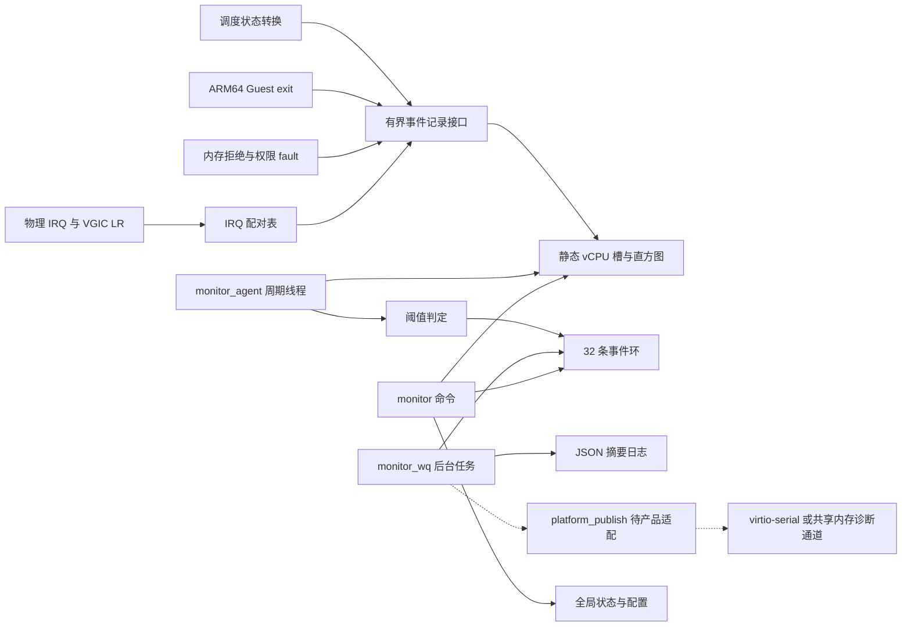
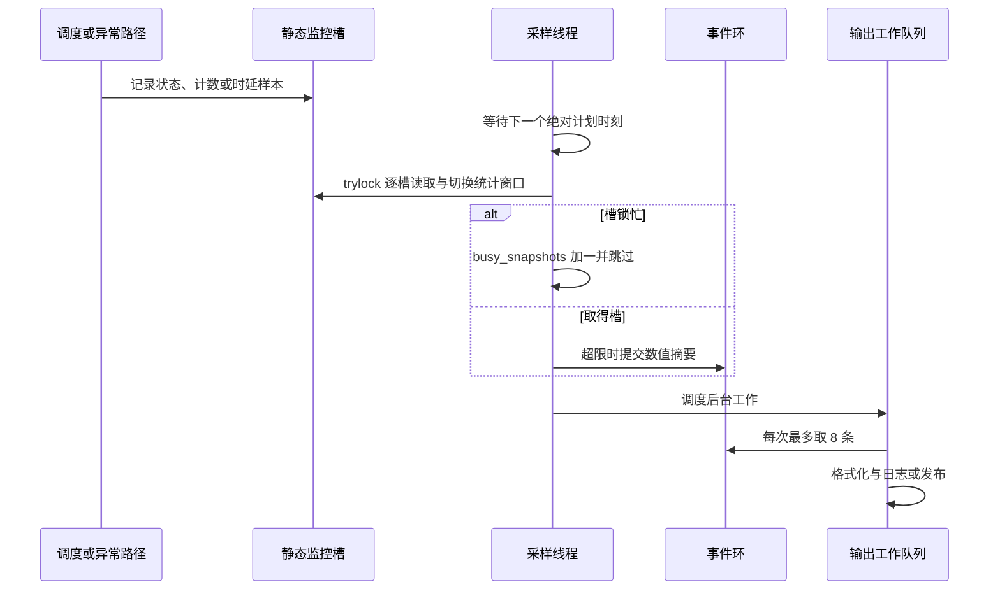
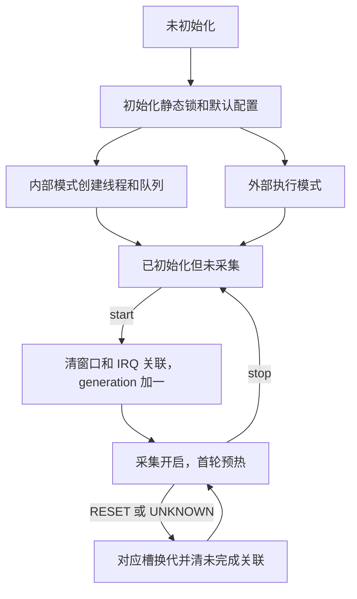
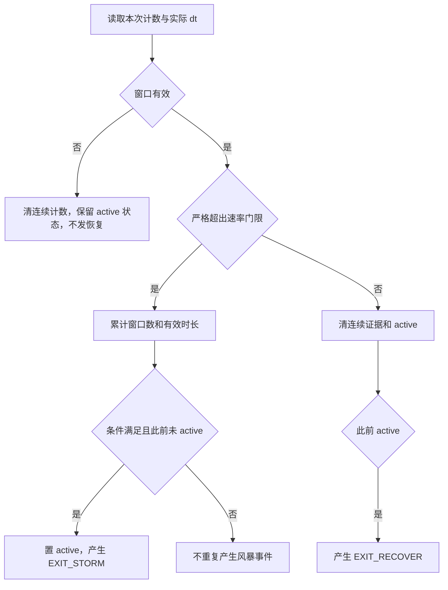
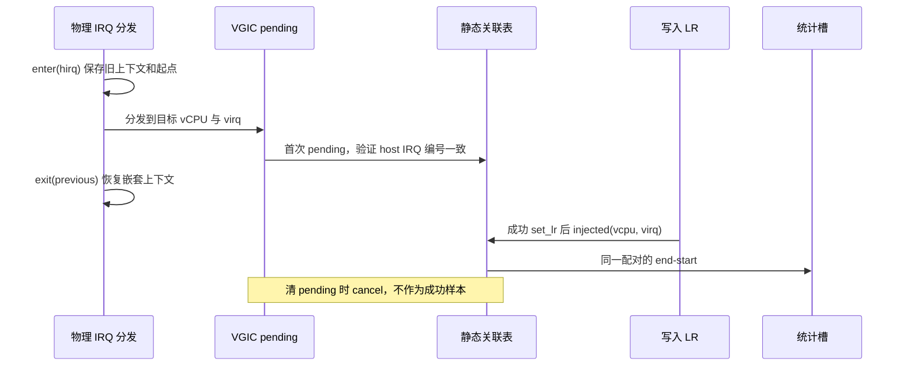

# monitor_agent 详细设计说明书与验收测试设计

版本：1.0｜日期：2026-10-21｜状态：当前实现说明及产品适配差距评审稿

## 1. 文档目的、依据与结论

本文说明已经交付的第一阶段 `monitor_agent` 如何工作，追踪每项需求到代码、打点和验收测试，并解释本次 QEMU 数据。**当前实现尚未完整满足全部需求，不能据此宣布第一阶段验收通过。**

### 1.1 三种证据边界

| 证据 | 内容 | 可以据此确认什么 |
|---|---|---|
| 参考实现 | `D:\code\xvisor-master` 的当前源码；原始基线提交 `6e1a1fbd596f3da5ed2d244ec333113b2ec70e2f` | 本文描述的函数、算法、编译选项与默认值 |
| 产品附件 | 2026-10-19 提供的 `vgic.c.txt`、`vmm_host_irq.c.txt`、`vmm_scheduler.c.txt` | 私有状态访问接口、已有 trace、GICv3/LPI/fastpath 路径和当时的接入问题 |
| 产品运行反馈 | 2026-10-21 的优先级说明和 10 条 QEMU JSON | 该批记录的字段及数值一致性；不能证明完整板端功能或性能 |

产品最新约束：ARM64、12 个物理核，Linux ServerVM 和 Android 平分 CPU；静态划分 Guest 内存。**auth 优先级 4，mterm 优先级 3；monitor 降到 3 后暂未观察到卡住。**auth/mterm 可能默认在 CPU0，确切亲和性和等待实现尚待核对。此前材料中将两者一并记为 4 的描述，以本次更正为准。

用户允许启动时创建线程和工作队列。本文因此把“无动态内存分配”分为“运行期监控不新增分配”和“严格包括启动期也不分配”两种验收口径；两者不可混用。

用户已把产品内存查询命令改为 `vm region_list`。本地参考 `cmd_monitor.c` 仍调用 `guest region_list`，未获得修改后的产品命令源码；本文记录该适配，未把它冒充为已经审查的代码。

### 1.2 状态用语

- **已有实现**：参考源码存在相应行为，仍需产品集成验证。
- **部分实现**：存在基础能力，但覆盖范围、输出或产品适配不满足完整条款。
- **未实现/仅接口**：未提供实际功能，或默认弱函数返回不支持。
- **未验证**：缺少需求对应的目标环境测量，不能以“没有发现问题”代替通过。
- **未达标**：已有测量明确超出指标。

### 1.3 交付物

本说明书、原始 QEMU JSONL、可执行的 Python 解析示例、解析结果 JSON、源码证据索引和历史容量报告。本文中的源码路径相对参考仓库根目录；行号以本次读取为准。产品附件行号另行标明。文档没有修改产品代码或参考实现。

目录：

1. 文档依据与结论
2. 需求追踪矩阵
3. 总体架构与执行模型
4. 数据结构、生命周期与并发
5. 指标算法与打点依据
6. 函数详细设计
7. 配置、命令、事件与传输接口
8. Guest 内存查询的含义及补齐设计
9. QEMU JSON 解释与解析
10. 验收测试设计
11. 已有验证证据与未关闭问题
12. 来源与附件

## 2. 需求追踪矩阵

以下 ID 是本文为追踪添加的编号；B0010/B0020 沿用原需求。测试 ID 对应第 10 节。这里对“如何实现”的说明区分当前实现与待补齐设计。

| ID | 需求 | 当前实现、定位 | 当前结论与缺口 | 验收测试 |
|---|---|---|---|---|
| B0010 | CPU/内存/中断采集、上报，消除/隔离/预警异常，为功能安全事件供数 | 埋点、静态统计、阈值事件、命令及后台摘要 | **部分实现**；具备预警数据源。原有内存拒绝仍起保护作用，但未新增完整隔离/恢复系统，也未完成安全机制资格论证 | CPU01～CPU07、MEM01～MEM06、IRQ01～IRQ07 |
| B0020 | 轻量、确定性、结构化、可开关、量产关闭 | 编译裁剪、运行开关、JSON、线程/队列 | **部分实现**；ROM 超预算，CPU 与确定性未验收，远程传输仅接口 | GEN01～GEN04、OUT01～OUT04、PERF01～PERF05 |
| CPU-1 | vCPU 调度延迟、就绪队列等待时间 | `vmm_monitor_state()` 记录 READY→RUNNING，统计均值/最大值/P99 上界/当前等待年龄 | **部分实现**；当前两种名称使用同一等待口径。未独立测量上下文切换执行耗时、唤醒到入队时延；如需求要求两项独立指标，需补充 | CPU01～CPU03 |
| CPU-2 | 一键采集、识别异常指令周期 | `monitor collect` 输出缓存，调用 `vmm_monitor_platform_diagnose()` | **未实现精确诊断**；默认返回不支持。exit 次数及最近 EC 不能识别异常指令周期 | CPU04、CPU05 |
| CPU-3 | Guest 内 CPU 利用率超限与限流，HV 提供查询 | `vcpu normal_list` 查询静态分配；`monitor cpu` 查询调度快照 | **HV 查询已有实现；Guest 监控/限流不在当前代码**。需要 Linux/Android 侧实现和系统联调，不能将此条整体标为完成 | CPU06、CPU07 |
| MEM-1A | HV 提供 Guest 物理内存查询 shell | `monitor mem` 委托区域查询；产品改为 `vm region_list` | 若产品命令确实展示对应 VM 的地址/大小/类型，**可满足区域配置查询子项**；不等于 OS 使用量 | MEM01 |
| MEM-1B | 各 Guest 实际内存使用量 | 当前未读取 Guest OS 内存统计 | **未实现**；建议 Guest 报告 `MemTotal/MemAvailable` 等，HV/诊断 VM 接收，见第 8 节 | MEM02 |
| MEM-2 | 各域内存及共享内存越界、越权 | stage-2 映射失败/权限 fault、shmem read/write/set 范围检查、故障入口 | **部分实现**；私有 ACL、已映射页内对象越界、DMA/IOMMU 路径不自动覆盖；未知调用者不归属 Guest | MEM03～MEM06 |
| IRQ-1 | 注入延时监控 | 物理 IRQ 软件分发→目标 VGIC 成功写 LR；直方图/P99 上界 | **部分实现**；不是硬件边沿→Guest ISR。产品 LPI/fastpath/异步 DM 路径尚未完整配对 | IRQ01～IRQ04 |
| IRQ-2 | exit 风暴超限触发死机日志 | 默认严格大于 50000 次/秒、连续至少 5 个有效窗口且累计至少 5 秒，生成风暴/恢复事件 | **检测已有实现，死机日志部分实现**。目前只有结构化摘要，没有完整寄存器/调用栈/冻结现场和持久化流程 | IRQ05～IRQ07 |
| GEN-1A | ROM ≤5 KB | 对象段测得约 10136 B，含命令与埋点增量 | **未达标**；即使按 5120 B 而非 5000 B 解释仍超限。最终需产品完整链接比较 | PERF01 |
| GEN-1B | 无动态内存分配 | 统计/关联/事件静态数组；启动创建线程/工作队列 | **按允许启动分配的口径已有设计**；按严格全生命周期口径不满足。需核查私有适配函数和日志后端 | PERF02 |
| GEN-1C | CPU <0.5% | 有 `sample_max_ns` 等诊断计数 | **未验证**；该字段不是 CPU 占用率。必须测埋点、采样、输出全部成本 | PERF03 |
| GEN-2 | HV 高优先级确定性采集，不受 Guest 调度干扰 | 事件同步打点，默认优先级 6 的 HV 采样线程 | **未形成产品确定性保证**；当前实测配置为 3，前台、Guest、关中断和锁均可能影响采样。高优先级上下文不能靠固定数字证明 | PERF04、PERF05 |
| GEN-3A | JSON 经 virtio-serial/共享内存到诊断 VM，或命令查询 | 命令 JSON、事件环、`platform_publish()` 弱接口 | **本地命令分支已有实现；远程接口未接通**。若“或”允许只选 shell，可验收本地分支；不能宣称通信链路也已完成 | OUT01、OUT03 |
| GEN-3B | 异常监控时间结构化记录 | 事件 `time_ns` 为采样/判定单调时间，类型/对象/数值结构化 | **基础摘要已有实现**；无 UTC，也没有每次 fault 的原始发生时间和完整死机现场。若要求逐事件精确发生时刻，需扩展 | OUT02、IRQ07 |
| GEN-4 | Kconfig/运行时启停，量产关闭 | Openconf/Kconfig、`start/stop/config` | **已有实现，产品仍需验证**。运行 stop 保留线程/历史；编译关闭才消除监控模块。shmem 溢出保护修复仍保留 | GEN01～GEN04 |

第二阶段的页表异常请求比例、HV 内存池/描述符/页表水位、IRQ 占比及屏蔽/重置策略不在本次实现内。本次 B0010 的预警范围不能被解释为上述第二阶段功能已经完成。

## 3. 总体架构与执行模型

### 3.1 当前架构



实线是当前存在的本地数据流；虚线是接口存在但具体通道尚未实现。发布函数目前仅从事件 drain 调用，**没有自动周期发布全部 vCPU 快照**；不能把 `publish=1` 理解成每秒上报全部指标。

### 3.2 文件职责

| 文件 | 职责 |
|---|---|
| `core/include/vmm_monitor.h` | 公共结构、枚举、接口；编译关闭的无操作宏；安全范围判定 |
| `core/monitor/monitor_agent.c` | 生命周期、静态统计、周期采样、阈值、事件、后台输出、弱适配接口 |
| `core/monitor/monitor_stats.c` | 整数直方图及连续超限状态机 |
| `core/monitor/monitor_irq.c` | 嵌套物理 IRQ 上下文和未完成注入关联 |
| `commands/cmd_monitor.c` | 参数验证、命令分派、JSON 序列化、内存查询委托 |
| `core/monitor/openconf.cfg`、`objects.mk` | 编译配置与对象纳入 |
| 调度/IRQ/ARM64/共享内存原文件 | 插入观察调用；保持原路径的功能行为 |
| `tests/monitor/` | 主机模型测试、ARM64 编译和容量统计脚本 |

### 3.3 执行上下文和优先级

采样线程每秒一次，默认绑定 CPU0、优先级 6、时间片 1 ms。专用工作队列使用**同一个**优先级配置和 CPU 配置；它的内部线程使用上游工作队列的默认时间片。采样与输出的独立优先级选项目前尚未实现。

产品已确认 auth=4、mterm=3、monitor 试降为 3 后暂未再现卡住。这只是新的运行观察，**不是卡死根因已解决，也不是确定性指标已满足**。同核 auth 如果长期保持 READY，优先级 3 可能被推迟；与 Guest/mterm 同级时还受同级调度影响。线程时间片不是每秒 CPU 配额。

运行时未 start 也会创建两个执行上下文；无待输出事件时它们应阻塞。外部执行模式不创建这两个上下文，但必须由产品分别提供串行采样、后台 drain。当前 sample/drain 使用 mutex，不能直接放进硬中断或 timer callback。

### 3.4 当前调度时序



错过采样周期只采一次当前数据，不补跑多个虚构窗口。采样时间使用实际间隔，避免把积累两秒的 exit 误判成一秒速率。周期线程可能由于调度延迟而错过窗口，当前选择使数据失效并报告覆盖缺口，而不是虚构按时采集。

## 4. 数据结构、生命周期与并发

### 4.1 静态存储

令 `V=CONFIG_MAX_VCPU_COUNT`、`C=CONFIG_CPU_COUNT`、`K=CONFIG_MONITOR_IRQ_SLOTS`：

| 数据 | 数量/用途 | 关键约束 |
|---|---|---|
| `slots[V+1]` | 每个 vCPU 的快照、READY/IRQ 直方图、风暴状态及故障累计 | 按全局 vCPU ID 索引；额外槽保存无法归属的故障 |
| `monitor_hist` | count/sum/min/max + 16 桶 | 每槽两个，整数统计，不保存全部原始样本 |
| `pending[V].irq[K]` | `{start, virq}` 的未完成 IRQ 关联 | 默认 K=16；满表增加覆盖缺口计数 |
| `current[C]` | 每物理核当前 IRQ 编号与时间戳 | enter 返回旧上下文，exit 恢复；支持嵌套 |
| `events[32]` | 固定长度事件历史及后台消费数据 | 覆盖未处理事件会增加 overwritten |
| 全局控制状态 | 开关、配置、事件序号、错误计数 | 短控制锁保护，开关使用原子访问 |
| JSON 工作缓冲 | worker 栈上 384 B | 发布方必须立即复制，不能保留指针 |

64 个 vCPU 上限、12 核、K=16 的既有对象统计：新增静态 BSS 58816 B；**还需**线程栈和创建线程/队列时的元数据。V 包含 HV 孤儿 vCPU/线程容量，不能直接设置为 Guest 数量 2。

### 4.2 生命周期



- `start` 切换为开启时清指标窗口、重新预热，保留事件历史及全局累计诊断计数。
- 重复 `start` 或 `stop` 不再次重置数据；内部模式会发一次唤醒通知。
- `stop` 阻止新指标采集；历史事件可继续排出，线程不销毁。
- `RESET/UNKNOWN` 在采集关闭时仍处理，避免 vCPU ID 复用导致旧关联污染。
- `generation` 是槽的数据代次，可能由 start、复位、销毁引起；不是 VM boot ID，也不是重启次数。
- `config` 改配置时清风暴连续证据和 `previous_ns`，重新建立有效窗口；不会清事件历史，也不会立即清全部计数/直方图。新的第一轮视为预热。

### 4.3 锁与一致性契约

生产者调用短 `slot.lock`；调度埋点原先持有调度锁。默认 IRQ pending 路径原先持有 VGIC 锁。监控不得反向取得调度器/VGIC 锁或调用 Guest 恢复操作。

`sample_lock` 串行化 sample/enable/configure；`drain_lock` 串行化输出。采样对单槽使用 trylock，忙时跳过；但整个模块仍有控制锁、IRQ 配对锁及 mutex，**不能据此宣称全流程无等待或已经证明 WCET**。IRQ 完成路径先释放配对锁，再更新统计槽，避免同时持有这两把锁。

每个槽拷贝时受锁保护，但查询不是全核原子快照：

- 窗口统计在采样时刷新，`ready_age_ns` 在查询时重新计算。
- `state/hcpu` 随状态埋点更新，`last_exit/last_fault/address/detail` 可在采样间被生产者更新。
- 因此一个 JSON 对象可能组合最近完整窗口的统计与更近的状态/最近原因；不能认为所有字段都精确属于 `time_ns` 同一瞬间。
- 迁移后没有相应状态记录时，缓存 `hcpu` 不一定立即改变。静态分配验收应使用产品管理接口核对。
- 控制 stop 与已经开始的生产者调用之间不提供业务级“截止纳秒”屏障；需要这样严格的定义时应增加协议并测试竞争。

数据不保留可悬空的 vCPU 指针；入口调用者必须保证传入对象在调用期间有效。私有 packed-state 接口需按锁语义适配，不能在已持调度锁时调用会递归加同一把锁的封装。

## 5. 指标算法与打点依据

### 5.1 READY 等待时延

定义：

```text
wait_ns = 实际被选中并切换的记录时刻 - 最近一次真正进入 READY 的记录时刻
```

READY 重复通知不覆盖最早起点；RUNNING 结束本段等待并入直方图；PAUSED/HALTED 等非 READY 状态撤销尚未完成的等待，不能把暂停时间当作排队时间。一直 READY 未获调度时，通过 `ready_age_ns` 观察饥饿。

**为何在这里打点：**开始点必须反映“已经可调度”，结束点应靠近实际切换；读取累计 `state_ready_nsecs` 的差值只能得到累计等待，不能还原每个样本的 P99。参考代码切换点使用新的 `vmm_timer_timestamp()`，而不是函数入口的旧时间戳。

| 文件与函数 | 参考实现位置 | 记录内容与理由 |
|---|---|---|
| `core/vmm_scheduler.c::__vmm_scheduler_next1()` | 165～166 行附近 | 首次切换后 RUNNING，结束等待 |
| `__vmm_scheduler_next2()` | 217 行附近 | 被抢占后 READY，重新进入队列前记录起点 |
| `__vmm_scheduler_next2()` | 248 行附近 | 在 `next != current` 分支之外通知 RUNNING，覆盖同一 vCPU 再选中 |
| `vmm_scheduler_state_change()` | 669 行附近 | 成功提交新状态前通知，覆盖恢复/暂停/RESET/UNKNOWN |

10 月 19 日产品附件中的相应逻辑约在 172、215、243、675 行，使用 `set_state_raw/packed`，且该附件没有 `vmm_monitor_state()` 调用。它不代表 10 月 21 日运行版本仍未接入：本次 QEMU 已有 READY 样本，实际版本显然还需以当前产品代码为准。

已有 `trace_ctx_switch(t2-t1)` 记录切换代码执行时间，是另一项有价值的指标，可以复用其时间源和 trace 通道，不能代替 READY 等待。若需求把“调度延迟”定义为唤醒请求→实际运行，应另加唤醒请求时刻；本实现不含唤醒到进入 READY 前的时间。

### 5.2 直方图、P99 和抖动

第 0～14 桶上界为 `1000 × 2^b` ns，即 1 μs、2 μs、…、16.384 ms。第 15 桶为大于 16.384 ms 的溢出桶。

```text
目标秩 k = N - floor(N / 100) = ceil(0.99 × N)
找到累计计数首次达到 k 的桶
普通桶：p99_upper_ns = 桶上界
溢出桶：p99_upper_ns = 本窗口实测最大值
mean_ns = floor(sum_ns / N)
jitter_range_ns = max_ns - min_ns
```

这是**分桶 P99 保守上界**，不是精确百分位，也不是标准差。普通桶上界可以大于实测最大值；这并不自相矛盾。小样本（例如 N=10）目标秩为 10，统计稳定性有限。零样本时字段为 0 只是编码约定，业务端应显示“无样本”。

直方图在采样成功取槽后清空，每个已完成样本归入其完成时被记录的窗口；跨窗口等待的完整时长会落在完成窗口。采样断档时可能汇总多个周期；不是滚动 5 秒 P99。

ready 告警比较 `max(P99 上界, 当前未完成等待年龄)` 与阈值；IRQ 告警比较 IRQ P99 上界。上界告警可能在精确 P99 未超限时保守触发，需要在验收中接受这个定义或改精度，不能声称无假阳性。

当前 READY/IRQ 时延及内存摘要告警不以 `snap.valid` 为前置条件；窗口质量检查主要约束连续 exit 风暴判断。因此断档后仍可能输出已观测时延/故障摘要，不能把这些事件自动解释为来自完整的一秒有效窗口。

### 5.3 Guest exit 与连续风暴

`do_sync()` 在排除 EL2 自身异常后记录 ESR EC；Guest 上下文的 `do_irq()/do_hyp_fiq()` 使用本模块原因标记 `0x100`。这些是触发记录的入口，不负责判断每一次退出是否异常。

```text
exit_rate = floor(exits × 1,000,000,000 / interval_ns)
有效窗口：存在上一采样点，且 0.75s ≤ interval ≤ 1.25s
超限：exits > floor(rate_threshold × interval_ns / 1e9)
触发：超限有效窗口数 ≥ sustain_seconds
      且这些窗口累计有效时长 ≥ sustain_seconds × 1e9
```

默认 rate=50000、sustain=5。窗口数和累计时长同时满足，避免五个 0.75 秒窗口被误当作五秒。恰好门限不触发；首次窗口不作为有效连续证据；断档清连续计数，不把缺失时间记入证据。



风暴持续时只记录一次开始事件；有效正常窗口才产生恢复事件。断档不证明恢复，不能根据没有新风暴日志推断问题结束。`last_exit` 只保留最近原因，没有按 EC 分布的直方图或异常 PC 定位。

**当前不等于完整死机日志：**记录风暴速率、门限、对象、最近原因和判定时刻；没有保存异常寄存器、栈、完整 trace、持久化标记，也不自动 panic/reset。必须接产品日志系统，才能按“完整死机现场”验收。

### 5.4 内存越界与越权事件

| 打点 | 依据 | 不覆盖的范围 |
|---|---|---|
| `cpu_vcpu_stage2_map()` 中 `vmm_guest_physical_map()` 返回错误 | 映射请求被拒绝，记录 `MAP_REJECT` | 拒绝可能是配置/资源问题，不能直接判为攻击；正常按需映射不告警 |
| `cpu_vcpu_inst_abort()/data_abort()` 的 permission FSC | 已触发 stage-2 权限异常，记录 `ACCESS_DENIED` | 不代替现有 fault 处理；须结合产品有意设置的 trap 解释 |
| `vmm_shmem_read/write/set()` 的范围拒绝 | `offset <= size && length <= size-offset`，避免 `offset+length` 溢出 | 仅这三个 HV API；Guest 直接访存、私有 DM 拷贝或其他 API 不自动覆盖 |
| `vmm_monitor_mem_fault(actor, ...)` 扩展入口 | 可接实际 ACL/hypercall 拒绝路径 | 接口存在不代表私有 ACL 已接入；不能拿监控返回值代替授权结果 |

shmem API 没有可信调用 Guest 参数，因此使用 UNKNOWN 槽，避免把后台访问错误误归属当前 vCPU。普通合法映射页内的对象越界、错误指针仍落在授权范围内、DMA 越界等不一定产生这些 trap；需对应对象边界检查或 IOMMU 路径，不能只依赖 MMU。

故障次数累计到下次允许输出摘要的采样轮，每对象最多 10 秒一次；多次故障可能合并，只保留最近地址/种类/细节。`time_ns` 是采样判定时刻，不是每次访问的发生时刻。

### 5.5 IRQ 软件分发到 LR 注入



开始点为 `vmm_host_generic_irq_exec()` 中确认 IRQ 有效后的 enter；它已经晚于硬件触发与控制器确认。结束点为 `__vgic_queue_irq()` 两条成功 `set_lr` 分支之后。**区间包括排队等待和虚拟注入准备，但不包括硬件触发到软件入口，也不包括 Guest 处理函数开始运行后的时间。**

K 个槽按目标全局 vCPU ID 管理，同一 virq 已有记录时保留最早起点；取消、RESET/UNKNOWN 和监控重新启动使旧关联失效。未找到起点的 injected 不产生零延迟样本。

`irq_untracked` 当前仅增加于“需要关联但当前物理上下文不匹配”和“关联槽耗尽”等路径；未知 host IRQ、软件 IRQ、完全绕过埋点的 fastpath/LPI 可能直接跳过，**即使 irq_untracked=0 也不能证明覆盖完整**。

### 5.6 私有 GICv3/LPI 与已有打点的适配

产品附件确认存在 GICv3、LPI、快路径及 LPI 迁移。当前默认配对不自动适用于这些新增路径：

| 产品位置 | 当前观察 | 后续接入依据 |
|---|---|---|
| `__vgic_set_pending()` 271～295 行 | 普通路径有 monitor；LPI 分支没有起点 | 用实际物理 LPI/Guest LPI 映射及目标 vCPU 建立配对，不能索引 `irq_state[lpi]` |
| `__vgic_clear_pending()` 301～317 行 | 普通路径有 cancel；LPI 没有 | 按同一关联标识取消 |
| `__vgic_percpu_irq_fastpath()` 1054～1076 行 | 直接调用 `__vgic_queue_irq(..., TRUE)`，绕过普通 pending | 在真实事件入口记录起点，不能依赖未持有的 dist_lock |
| `__vgic_mov_lpi()` 1147～1158 行 | pending 从源 vCPU 移到目标 | 转移原起点；若不能可靠转移则显式作废并记覆盖缺口 |
| `vgic_pending_set_lr_update()` 351 行起 | 旧统计显式跳过 LPI | 不可将旧统计直接称为 LPI 注入监控 |
| 旧 `set_lr.start_stamp` | 重复 pending 会重置时间 | 与“第一次 pending 起点”语义统一后复用原始样本；不能由均值/最大值推导 P99 |

异步 device model/CCM 通知可能已经离开物理 IRQ 调用栈，必须显式传递事件关联和同源时间戳，可在配对完成后调用 `vmm_monitor_irq_sample()`。不要同时使用两套入口重复统计同一事件。

10 月 19 日附件还发现普通 pending 置位遗漏、hirq enter 后错误返回不恢复两处问题，已提供最小修正与提取函数测试。未获得本次产品源码，不能确认已合入；二者也没有被证明是偶现认证卡住的唯一根因。

### 5.7 其余参考埋点的位置索引

以下行号指本地参考源码，并非产品附件。移植时依据函数、分支和锁的语义定位，不能机械按行号粘贴。

| 文件 / 函数 | 行号附近 | 插入位置和依据 |
|---|---|---|
| `core/vmm_main.c::system_init_work()` | 440 | 初始化监控；失败打印错误，不把监控初始化失败变成整个 HV 的强制停止 |
| `arch/arm/cpu/arm64/cpu_interrupts.c::do_sync()` | 101 | 确认不是 EL2 自身异常后、按 EC 分派前，记一次 Guest 同步 exit |
| 同文件 `do_irq()` / `do_hyp_fiq()` | 224 / 235 | 仅来自 Guest 的路径记录 `0x100`；不能把所有宿主 IRQ 都计入某个 Guest |
| `arch/arm/cpu/arm64/cpu_vcpu_excep.c::cpu_vcpu_stage2_map()` | 57 | 首次页大小映射查询返回失败分支，记录失败地址及返回码；不是全部 MMU 内部错误 |
| 同文件 `cpu_vcpu_inst_abort()` / `cpu_vcpu_data_abort()` | 128 / 152 | permission FSC 范围内记录越权候选，保留既有异常处理 |
| `core/vmm_shmem.c::vmm_shmem_read()` / `write()` / `set()` | 47～48 / 61～62 / 75～76 | 在真实访问前校验范围，拒绝时记录 UNKNOWN actor；不能在访问完成后再检查 |
| `core/vmm_host_irq.c::vmm_host_generic_irq_exec()` | 156 / 165 | 成功取得 IRQ 描述符后 enter，handler 执行后 exit；所有 enter 之后的返回路径必须配对 |
| `arch/arm/cpu/common/vgic.c::__vgic_set_pending()` | 172 | 每个目标 vCPU 的普通 pending 置位后记录，保留原置位操作 |
| 同文件 `__vgic_clear_pending()` | 187 | 取消 pending 后撤销未完成关联，不生成注入成功样本 |
| 同文件 `__vgic_queue_irq()` | 289 / 322 | 两条 LR 写入成功路径之后记录完成；LR 满或其他未成功路径不计完成 |

运行关闭时仍有少量开关判断、生命周期维护及物理 IRQ 上下文保存/恢复成本；只有编译关闭才裁剪这些监控调用。因此“量产关闭”需要区分运行开关和编译裁剪，不能将二者视为同样的开销。

## 6. 函数详细设计

以下函数目录由当前参考源码核对生成。上下文、输入输出和副作用是调用契约；不能仅凭函数名称把线程函数搬入 IRQ。`void` 埋点失败时通常直接忽略或记录覆盖缺口，不返回访问授权结果。

### 6.1 生命周期、控制与查询

文件：`core/monitor/monitor_agent.c`。

| 函数 / 定义位置 | 输入与输出 | 处理逻辑 / 副作用 | 调用上下文 / 约束 |
|---|---|---|---|
| `vmm_monitor_init()`，464 行 | 无参数；返回 VMM_OK 或分配/绑定/启动错误 | 初始化静态锁、默认门限和 IRQ 关联；内部模式创建并启动队列与采样线程；失败按已创建资源逆序释放；最后发布 initialized。 | 启动期调用一次；有启动期动态分配；外部模式跳过线程创建。 |
| `vmm_monitor_enabled()`，47 行 | 无参数；返回 bool | 原子读取 enabled。它只表示采集开关，不代表数据有效或整个系统健康。 | 热路径可调用；无锁、无分配。 |
| `vmm_monitor_enable()`，227 行 | on: bool；未初始化返回 ENOTAVAIL，否则 OK | sample_lock 串行控制；真正开启时清所有指标槽与 IRQ 关联并递增代次；关闭停止新增采集；重复操作幂等；唤醒内部线程。 | 可睡眠线程上下文；O(V×K) 清理；历史事件/累计状态不清；不是所有生产者的纳秒截止屏障。 |
| `vmm_monitor_configure()`，257 行 | config 指针；无效参数返回 EINVALID | 验证 rate 和持续时间；整体替换配置；逐槽清 storm 和 previous_ns，使下轮预热。 | sample_lock→短 control/slot 锁；线程上下文；不自动持久化，不清全部累计样本。 |
| `vmm_monitor_status()`，185 行 | 有效 out 指针；void | 控制锁内复制全局状态，并读取 enabled 和 irq_untracked。 | 调用者保证 out 非空；只是全局诊断状态，不代替逐 vCPU 快照。 |
| `vmm_monitor_snapshot()`，195 行 | id、out；返回 OK / EINVALID / ENOTAVAIL | 校验初始化及 id≤V；槽锁内复制缓存；按查询时间重新计算未完成 READY 年龄；present=false 返回不可用。 | V 为 UNKNOWN 额外槽；不触发一次新采样；字段时间口径见 4.3。 |
| `vmm_monitor_event_get()`，212 行 | 非零 sequence、out；返回 OK / EINVALID / ENOTAVAIL | 检查序号是否仍在最近 32 条历史范围，复制对应事件。 | 短 control_lock；非破坏性读取；历史已覆盖时返回不可用。 |

### 6.2 生产者接口与内部辅助

文件：`core/monitor/monitor_agent.c`。

| 函数 / 定义位置 | 输入与输出 | 处理逻辑 / 副作用 | 调用上下文 / 约束 |
|---|---|---|---|
| `vmm_monitor_state()`，75 行 | vcpu、新 state、单调 now；void | 识别普通 Guest vCPU；READY 建起点，RUNNING 完成等待；非 READY 撤销等待；RESET/UNKNOWN 清槽换代并使 IRQ 关联失效。 | 调用方持 sched_lock；内部 slot 锁；不能反向取得调度锁；生命周期通知在 stop 时仍处理。 |
| `vmm_monitor_exit()`，110 行 | vcpu、reason；void | 开关及槽校验后锁内复查 enabled；累计 exits，更新最后原因。 | 异常入口短操作；不格式化、不判断单次 exit 是否异常。 |
| `vmm_monitor_mem_fault()`，125 行 | actor 可 NULL、kind、address、detail；void | 累计拒绝/故障；记录最近上下文；actor=NULL 进入 UNKNOWN 槽；不可归属的非空 actor 可能被忽略。 | 应在真实拒绝点调用；不实施 ACL；不保存每一次故障的独立时间/现场。 |
| `vmm_monitor_irq_sample()`，146 行 | vcpu、start_ns、end_ns；void | 要求 start 不早于本槽 epoch 且 end≥start；将差值加入 IRQ 直方图。 | 直接接入者负责同一事件唯一配对、同源时钟和对象有效；接口不能自行识别重复样本。 |
| `slot_for()`，52 行 | vcpu；返回槽指针或 NULL | 检查 initialized、非空、is_normal、全局 id<V。 | 内部辅助；不持有长期 vCPU 引用；不能用它监控 auth/mterm 孤儿 vCPU。 |
| `identify()`，60 行 | monitor_data、vcpu 可 NULL；void | 设置 present 和 guest/vCPU 管理 ID；空 actor 使用 UNKNOWN 常量。 | 调用者持槽锁；普通 vCPU 的 guest 指针须有效。 |
| `reset_data()`，67 行 | monitor_data、now；void | 保存旧 generation+1，清整个数据块，恢复新代次与 epoch。 | 调用者持槽锁；清 present，后续事件重新识别；generation 是 u32，非永久唯一启动标识。 |
| `record_event()`，161 行 | 已复制快照、type、value、detail、code；void | 递增序号，写固定事件环；若覆盖未排出记录则推进消费序号并计 overwritten。 | 控制锁内有界写入；调用前已释放 slot 锁；不输出字符串。 |

### 6.3 采样、输出与产品适配

文件：`core/monitor/monitor_agent.c`。

| 函数 / 定义位置 | 输入与输出 | 处理逻辑 / 副作用 | 调用上下文 / 约束 |
|---|---|---|---|
| `vmm_monitor_sample()`，279 行 | now: 同源单调时间；void | sample_lock 串行化；逐槽 trylock，计算实际 dt/质量/速率/直方图；判定风暴及三个限频告警；清窗口计数；解槽锁后提交事件；调用平台 sample 并更新耗时统计。 | 线程上下文；O(V×桶数) 加平台回调；trylock 失败保留该槽累积；不能递归控制接口；首轮速率无验收意义。 |
| `vmm_monitor_drain()`，376 行 | 无参数；void | drain_lock 下每次最多消费 8 条；在 384 B 栈缓冲格式化 JSON；按配置打印及发布；发布失败计数。 | 后台可睡眠上下文；不在设备/调度锁内输出；无可靠重传；关输出也消费；同步日志耗时须实测。 |
| `report_fn()`，420 行 | work 指针；void | 工作队列包装函数，仅调用 drain。 | 内部执行模式；与采样线程共用配置优先级及 affinity。 |
| `monitor_thread()`，421 行 | unused；常驻线程入口 | 按绝对相位等待；关闭且无待处理事件时阻塞；迟到≥250 ms 增 late_samples；采样后调度输出；跳过错过周期而不补跑。 | 内部模式创建；时间片 1 ms 不等于执行预算；工作已排队的 EALREADY 不计错误。 |
| `vmm_monitor_platform_sample()`，369 行 | now；默认 void 空函数 | 提供在每轮 sample 末的产品扩展位置，当前没有额外功能。 | 仍持 sample_lock；禁止等待 Guest、分配或递归 sample/enable/configure；新增成本纳入预算。 |
| `vmm_monitor_platform_publish()`，365 行 | json、length；默认 ENOTAVAIL | 仅有链接期弱接口；产品实现需要在成功返回前复制整条 JSON。 | 由 drain 调用；当前只有事件，未周期发送指标；通道 ACL、容量、背压需另设计。 |
| `vmm_monitor_platform_diagnose()`，370 行 | cdev；默认 ENOTAVAIL | collect 调用；不支持时命令输出 instruction_cycles=unsupported。 | 命令上下文；尚无 PMU 周期或指令识别；不能把默认诊断文字当实现。 |

### 6.4 直方图、风暴与范围算法

文件：`core/monitor/monitor_stats.c`。

| 函数 / 定义位置 | 输入与输出 | 处理逻辑 / 副作用 | 调用上下文 / 约束 |
|---|---|---|---|
| `vmm_monitor_hist_add()`，5 行 | hist、单个 ns；void | 查找 16 桶之一，更新 count/sum/min/max 和桶计数；不保存原始样本。 | O(16)，无内部锁；调用者串行保护；u64 非饱和累加，需按最大事件率和最长无采样期控制溢出。 |
| `vmm_monitor_hist_read()`，22 行 | 只读 hist、out；void | 写 count/min/max、整数均值和 P99 上界；空样本为零；最后溢出桶用实测最大值。 | O(16)，不清 hist；调用者确保读取一致。 |
| `vmm_monitor_storm_step()`，45 行 | streak、count、dt、rate、seconds、valid；返回 1 / -1 / 0 | 1=新风暴，-1=已激活后恢复，0=无状态事件；双条件累计窗口数/时长；断档清连续证据但保留 active。 | 纯有状态整数算法，无内部锁；调用者保证配置合法，valid 仍会被 dt 范围复查。 |

### 6.5 范围判定内联接口

文件：`core/include/vmm_monitor.h`。

| 函数 / 定义位置 | 输入与输出 | 处理逻辑 / 副作用 | 调用上下文 / 约束 |
|---|---|---|---|
| `vmm_monitor_range_valid()`，78 行 | size、offset、length 均 u64；返回 bool | 计算 offset≤size 且 length≤size-offset，先检查 offset 避免减法下溢，也避免加法回绕。 | 无状态、无锁；监控编译关闭时仍保留；零长度且 offset=size 合法，空指针由外部 API 单独检查。 |

### 6.6 IRQ 上下文与关联

文件：`core/monitor/monitor_irq.c`。

| 函数 / 定义位置 | 输入与输出 | 处理逻辑 / 副作用 | 调用上下文 / 约束 |
|---|---|---|---|
| `vmm_monitor_irq_init()`，23 行 | 无参数；void | 初始化所有 pending[vCPU] 自旋锁；其余静态数据初始为零。 | 启动期、启用采集前调用一次。 |
| `vmm_monitor_irq_restart()`，30 行 | now；void | 逐 vCPU 更新 epoch、清全部 K 个 start。 | 由 enable 在关闭采集期间调用；O(V×K)；不清全局 untracked。 |
| `vmm_monitor_hirq_enter()`，43 行 | hirq；返回旧 hirq_context | 保存当前核旧上下文，写新 hirq；enabled 时取时间戳，否则 timestamp=0。 | 物理 IRQ 上下文、不迁核；嵌套必须按栈顺序配对；不能在后续错误返回中漏掉恢复。 |
| `vmm_monitor_hirq_exit()`，52 行 | 旧 hirq_context；void | 恢复当前核的旧物理 IRQ 上下文。 | 必须与 enter 在同一 CPU、同一嵌套层次配对。 |
| `vmm_monitor_irq_reset()`，57 行 | 普通 vcpu；void | 校验对象，取当前时间作新 epoch，清其 K 个未完成关联。 | 生命周期已释放统计槽锁后调用；不能只清计数而保留旧起点。 |
| `vmm_monitor_irq_pending()`，70 行 | vcpu、virq、hirq；void | 检查采集开关和普通目标；未知 hirq 跳过；匹配当前核物理上下文；锁内查 epoch、重复或空槽；重复保留最早起点，满表计 untracked。 | O(K)，上游 VGIC 调用路径有 dist_lock；私有 fastpath 必须重新确认路由并发契约，不能依赖不存在的外锁。 |
| `irq_finish()`，105 行 | vcpu、virq、injected；void | 查找到的配对后清 start；成功注入时取结束时刻；释放 pending 锁后才调用 irq_sample。 | O(K)；不存在配对时静默不生成样本；不同时持有 pending 与统计 slot 两把锁。 |
| `vmm_monitor_irq_injected()`，126 行 | vcpu、virq；void | 以 injected=true 调用 irq_finish。 | 仅在 LR 写入真正成功之后；它不是 Guest ISR 执行时间。 |
| `vmm_monitor_irq_cancel()`，131 行 | vcpu、virq；void | 以 injected=false 调用 irq_finish，撤销起点但不记录时延。 | 适用于 pending 被清除；编译关闭为无操作宏。 |
| `vmm_monitor_irq_untracked()`，136 行 | 无参数；返回 u64 | 原子读取因上下文不匹配或表满等记录的缺口计数。 | 不是丢中断计数；完全未接入路径可能不增加它。 |

### 6.7 命令函数

文件：`commands/cmd_monitor.c`。

| 函数 / 定义位置 | 输入与输出 | 处理逻辑 / 副作用 | 调用上下文 / 约束 |
|---|---|---|---|
| `monitor_usage()`，11 行 | cdev；void | 输出语法和各命令的基础提示。 | 命令上下文；提示混有普通文本。 |
| `number()`，19 行 | 字符串、u64 out；返回 OK / EINVALID | 逐字符验证十进制；用 (~0ULL-digit)/10 检查乘加前溢出。 | 拒绝空串、负号、字母；失败时临时 out 可能已有部分值，但命令不提交配置。 |
| `latency()`，31 行 | cdev、字段名、latency；void | 写 count/mean/p99_upper/max/jitter_range，jitter=max-min。 | 不独立输出完整顶层 JSON；count=0 的全零编码需接收端解释为无样本。 |
| `monitor_exec()`，40 行 | cdev、argc、argv；返回动作/查询错误码 | 分派启停、配置、status/events、缓存快照、collect 和区域命令；按 disabled/warmup/stale/valid/gap 顺序标质量。 | 不强制即时采样；mem 非纯 JSON；产品 vm 命令须适配依赖/参数；逐槽查询不是全局原子快照。 |
| `monitor_cmd_init()`，129 行 | 无参数；返回注册结果 | 向 cmdmgr 注册 monitor。 | 模块初始化；依赖 CONFIG_CMD_MONITOR。 |
| `monitor_cmd_exit()`，130 行 | 无参数；void | 从 cmdmgr 注销 monitor。 | 模块退出；不意味着核心监控线程同时停止。 |

### 6.8 核心接口原型（从本次源码提取）

以下原型包括内部辅助函数，`static` 函数不构成跨模块调用接口；实际 ABI 以源码为准。

`core/monitor/monitor_agent.c`

```c
int __init vmm_monitor_init(void);
bool vmm_monitor_enabled(void);
int vmm_monitor_enable(bool on);
int vmm_monitor_configure(const struct vmm_monitor_config *c);
void vmm_monitor_status(struct vmm_monitor_status *out);
int vmm_monitor_snapshot(u32 id, struct vmm_monitor_snapshot *out);
int vmm_monitor_event_get(u64 sequence, struct vmm_monitor_event *out);
```

`core/monitor/monitor_agent.c`

```c
void vmm_monitor_state(struct vmm_vcpu *vcpu, u32 state, u64 now);
void vmm_monitor_exit(struct vmm_vcpu *vcpu, u32 reason);
void vmm_monitor_mem_fault(struct vmm_vcpu *actor, u32 kind, u64 address, u64 detail);
void vmm_monitor_irq_sample(struct vmm_vcpu *vcpu, u64 start_ns, u64 end_ns);
static struct monitor_slot *slot_for(struct vmm_vcpu *vcpu);
static void identify(struct monitor_data *d, struct vmm_vcpu *vcpu);
static void reset_data(struct monitor_data *d, u64 now);
static void record_event(struct vmm_monitor_snapshot *s, u32 type, u64 value, u64 detail, u32 code);
```

`core/monitor/monitor_agent.c`

```c
void vmm_monitor_sample(u64 now);
void vmm_monitor_drain(void);
static void report_fn(struct vmm_work *work);
static int monitor_thread(void *unused);
void __weak vmm_monitor_platform_sample(u64 now);
int __weak vmm_monitor_platform_publish(const char *json, u32 length);
int __weak vmm_monitor_platform_diagnose(struct vmm_chardev *cdev);
```

`core/monitor/monitor_stats.c`

```c
void vmm_monitor_hist_add(struct vmm_monitor_hist *h, u64 ns);
void vmm_monitor_hist_read(const struct vmm_monitor_hist *h, struct vmm_monitor_latency *out);
int vmm_monitor_storm_step(struct vmm_monitor_streak *s, u64 count, u64 dt, u32 rate, u32 seconds, bool valid);
```

`core/include/vmm_monitor.h`

```c
static inline bool vmm_monitor_range_valid(u64 size, u64 offset, u64 length);
```

`core/monitor/monitor_irq.c`

```c
void vmm_monitor_irq_init(void);
void vmm_monitor_irq_restart(u64 now);
struct vmm_monitor_hirq_context vmm_monitor_hirq_enter(u32 hirq);
void vmm_monitor_hirq_exit(struct vmm_monitor_hirq_context old);
void vmm_monitor_irq_reset(struct vmm_vcpu *v);
void vmm_monitor_irq_pending(struct vmm_vcpu *v, u32 virq, u32 hirq);
static void irq_finish(struct vmm_vcpu *v, u32 virq, bool injected);
void vmm_monitor_irq_injected(struct vmm_vcpu *v, u32 virq);
void vmm_monitor_irq_cancel(struct vmm_vcpu *v, u32 virq);
u64 vmm_monitor_irq_untracked(void);
```

`commands/cmd_monitor.c`

```c
static void monitor_usage(struct vmm_chardev *cdev);
static int number(const char *s, u64 *n);
static void latency(struct vmm_chardev *cdev, const char *name, const struct vmm_monitor_latency *s);
static int monitor_exec(struct vmm_chardev *cdev, int argc, char **argv);
static int __init monitor_cmd_init(void);
static void __exit monitor_cmd_exit(void);
```

## 7. 配置、命令、事件与传输接口

### 7.1 编译与运行配置

| 项 | 当前默认/范围 | 作用 |
|---|---|---|
| `CONFIG_MONITOR_AGENT` | n | 监控模块编译开关 |
| `CONFIG_CMD_MONITOR` | 依赖监控，默认 y | monitor 命令；参考版 select guest/vcpu 命令 |
| `CONFIG_MONITOR_START_ENABLED` | n | 初始化后自动采集 |
| `CONFIG_MONITOR_HCPU` | 0；配置范围 0～255 | 实际还检查小于 CPU_COUNT 且在线 |
| `CONFIG_MONITOR_PRIORITY` | 6；0～7 | 参考实现采样与输出共用；产品试用 3，不代表已修改默认值 |
| `CONFIG_MONITOR_IRQ_SLOTS` | 16；1～64 | 每个 vCPU 未完成 IRQ 关联数量 |
| `CONFIG_MONITOR_EXTERNAL_EXECUTOR` | n | y 时不创建内部执行上下文 |
| `exit_rate` | 50000；1～10^9 | 每 vCPU 每秒风暴门限，严格大于 |
| `sustain_seconds` | 5；1～60 | 连续时间和最小有效窗口数 |
| `ready_ns`、`irq_ns` | 0 | 0 关闭对应时延告警，继续统计 |
| `log`、`publish` | 1、0 | 后台事件日志、项目发布接口 |

只接受无符号十进制整数字符串并检测溢出，非法参数返回错误。运行配置不持久化到启动配置。Kconfig 使用项目现有 Openconf 格式；产品命令从 guest 改为 vm 后，除了字符串，还要核对真实命令是否内建、构建依赖和参数语义，不能臆造一个并不存在的 `CONFIG_CMD_VM`。

### 7.2 命令语义

| 命令 | 当前输出/动作 | 注意事项 |
|---|---|---|
| `monitor start/stop` | 启停采集 | stop 不删除线程和历史 |
| `monitor status` | 一条全局状态 JSON | enabled、samples、late、错误/丢覆盖计数、配置 |
| `monitor cpu` | 逐槽缓存 JSON | 不等于 Guest CPU 利用率 |
| `monitor irq` | 同一组逐槽缓存 JSON | 当前没有只筛 IRQ 字段 |
| `monitor collect` | 同一缓存 JSON + 诊断适配回调 | 不强制全核即时采样；默认附 instruction_cycles=unsupported |
| `monitor events` | 非破坏性读取最近最多 32 条事件 | 不消费 worker 队列，无永久保存保证 |
| `monitor mem <name>` | 区域查询及解释文字 | 参考 guest region_list，产品 vm region_list；非纯 JSON |
| `monitor config <key> <value>` | 修改门限/输出开关 | 清连续风暴证据，下一窗口预热 |
| `vcpu normal_list` | 参考上游的 vCPU 配置查询 | 产品命令名以实际版本为准 |

### 7.3 事件格式与背压

事件包含 `schema, seq, time_ns, type, guest, vcpu, generation, value, detail, code`。未知对象 ID 为 `4294967295`。

| type | 名称 | value / detail / code |
|---|---|---|
| 1 | EXIT_STORM | 速率 / 速率门限 / 最近 exit 原因 |
| 2 | EXIT_RECOVER | 当前速率 / 门限 / 最近原因 |
| 3 | MEMORY | 自上次摘要后累计次数 / 最近地址 / 最近故障 kind |
| 4 | READY_SLOW | max(P99 上界,等待年龄) / 时延门限 / 1 表示等待年龄占主导，否则 0 |
| 5 | IRQ_SLOW | P99 上界 / 时延门限 / 0 |

MEMORY/READY_SLOW/IRQ_SLOW 各对象各类型最多 10 秒一条；exit 使用连续状态而非该冷却间隔。环容量 32；每次 drain 最多处理 8 条。内部模式一般每秒调度一次 drain；外部执行频率由调用方控制。批量上限限制记录数量，不等于对同步串口驱动耗时有硬上界。

新记录覆盖尚未输出记录时增加 `overwritten`；读取已被覆盖的序号失败。发布失败增加 `publish_errors`，记录仍可能在历史中，但**不会自动可靠重传**。关闭 log/publish 时 drain 仍可推进消费序号；随后再打开不会补发此前已经消费的记录。

### 7.4 平台接口和待补齐设计

- `platform_publish(json, length)`：默认 `VMM_ENOTAVAIL`。实现必须复制完整记录，快速返回，不保留指针，不在采样/设备锁里调用。当前仅用于异常事件。
- `platform_sample(now)`：默认空。每轮采样末调用一次，不得等待设备或递归调用 sample/configure/enable。
- `platform_diagnose(cdev)`：默认 `VMM_ENOTAVAIL`。对接 PMU/指令诊断需要核对计数器归属、Guest/HV 过滤、跨核读数一致性、溢出及功能影响；现在并未实现。

若产品要求完整死机日志，建议增加独立、版本化的故障现场记录：触发 vCPU/Guest、原因、触发时间、寄存器/PC、最近 trace 和现场有效性。需要精确触发时现场时，应在对应异常点有界留存；事后 worker 不能把当前寄存器冒充成过去超限时的寄存器。捕获、序列化、持久化和限频分层实现，避免在调度/IRQ 锁中打印。

如果需要远程周期指标上报，应另加快照记录类型、周期、容量与限流；不应只覆盖 publish 弱函数就宣称全部完成。共享内存通道还需约定 ACL、序号、容量、内存屏障、重启代次和溢出策略，CCM 只作为通知。

## 8. Guest 内存查询的含义及补齐设计

### 8.1 `vm region_list` 是否符合需求

**可满足“查看 VM 物理地址区域/配置”这一子项；单独使用它不能满足“Guest OS 实际内存使用量”。**修改命令名不会改变这两者的语义。若产品的 vm 命令还有额外运行统计，必须查看其实现才能确认。

参考区域命令遍历 Guest regions，展示 GPA、别名、大小、flags 和映射。它会包含 RAM、设备/MMIO、共享区或别名，不能把全部 size 相加直接当作 Guest RAM：

| 量 | 含义 | 当前可获取程度 |
|---|---|---|
| Guest RAM 配额/配置区间 | 为该 Guest 指定的物理内存范围 | 配置和 region 查询可提供；需筛选 RAM 并处理别名/重叠 |
| Hypervisor 已分配/保留的 backing | HV 为 VM 实际持有的主机物理页 | 若现有分配器有账本可统计；当前 monitor 未新增这个计数 |
| 共享区映射容量 | 该 VM 可见的共享范围 | 可查询映射，但跨 VM 相加会重复计算物理页 |
| Guest 内核可用总量/空闲量 | Guest OS 页分配器视角 | 当前 HV 接口不能从 region 表直接得出 |
| Guest 内应用/内核实际使用及可回收量 | Guest 的内存管理语义 | 需要 Guest 数据或与其内核版本紧耦合的解析；当前未实现 |

例：某 Guest 分配 5 GiB，OS 从中申请或释放 500 MiB，原有 GPA→HPA 映射可能完全不变。观察映射表无法区分这些页在 Guest 内是空闲、匿名内存还是可回收缓存。已访问/脏页信息也不等同于 OS used/free。

因此，在固定划分内存的本产品中，HV 可以准确报告其**配置和拥有的内存资源**，但不能只凭这些信息可靠报告 Guest OS 使用情况。理论上可读取 Guest 内核数据结构，但需要版本、布局、一致性和授权适配，既不是当前实现，也不适合作为这里的轻量通用方案。

### 8.2 建议的 Guest 协同方案（尚未实现）

Linux/Android 的 Guest 代理读取内核统计，经已有受控通道送到 ServerVM/诊断 VM；若需求要求从 HV shell 查询，再由 HV 保存最近一份经过验证的静态快照。可以直接 Guest→诊断 VM，避免让 HV 参与非必要的数据解析。


全图为待补齐设计。现有 `platform_publish` 是 HV→诊断端发布接口，**不是 Guest→HV 内存遥测接收接口**，不能直接把两者混为一谈。

建议保留 Guest 的 `MemTotal`、`MemFree`、`MemAvailable` 原始数值及口径。Linux 文档将 `MemAvailable` 定义为无需交换即可用于新应用的估计容量，区别于纯空闲 `MemFree`；CMA 可用字段包括 `CmaTotal/CmaFree`，是否存在取决于内核配置。[Linux /proc 官方说明](https://docs.kernel.org/filesystems/proc.html#meminfo)

产品可约定展示 `used_estimate_bytes = (MemTotal - MemAvailable) × 1024`，明确这是**按可用量估算的占用口径**，不是一个统一的“精确应用内存”定义。应保留原字段，不能把缺失 MemAvailable 当成 0 或悄悄替换公式。Android 若要进程细分，可辅以 `dumpsys meminfo` 的 PSS 等；它不是 HV 内存配额查询。[Android dumpsys 官方说明](https://developer.android.com/tools/dumpsys#meminfo)

协议设计应包含：版本、固定长度、VM 身份、VM boot 代次、递增序号、Guest 采样时间、HV 接收时间、字段有效位、字节单位和质量状态。按授权通道确定 VM 身份，不盲信报文中的 guest ID；检查长度/溢出/容量关系；处理重复、乱序、Guest 重启与超时，超时显示 stale 而非 0。

Guest 采样时间与 HV 单调时钟不一定同源，不能直接相减；未校时使用 HV 接收年龄。Guest 自报告可以作为运行监控数据，不能单独证明恶意或已失控 Guest 的内存状态；需在系统安全论证中说明可信边界。

### 8.3 建议明确的验收措辞

将 MEM-1 拆为两个可验证交付：

1. “HV shell 可查询每 VM 的 RAM 配置区间、大小及共享区映射”，由 `vm region_list` 或等价接口完成。
2. “可查询 Guest 上报的 OS 内存总量、可用量及按约定口径计算的占用量，含时间与新鲜度”，由 Guest 代理、通道和接收端完成。

若整个项目确实要求第二项，当前第一项完成不能作为整条需求完成的证据。

## 9. QEMU JSON 解释与解析

### 9.1 这批输出是否正常

对用户提供的 10 行原文逐条 JSON 解析，字段和整数速率检查通过。观察到 4 个 Guest ID（0、1、2、3）、10 个全局 vCPU ID，hcpu 出现在 0～3；这只说明样本覆盖这些核，不证明 QEMU 总核数一定是 4，也不应直接映射成最终两域 12 核部署。

多个 Guest 的 vCPU 出现在同一个 hcpu，说明这批缓存反映的 QEMU 调度/绑定与最终 CPU 平分配置不同。Guest 0/1 不能仅凭数字命名为 Linux/Android，需要管理列表核对。

**当前参考版本 `monitor status` 应输出全局状态对象**，包含 enabled/samples/late_samples 等；这里的对象是 `monitor cpu/irq/collect` 输出的 vCPU 快照。若产品确实由 status 输出它们，说明命令分支已有改动。本文按字段格式解析，不据此判定数据损坏，也不能从这批数据推断全局 enabled/overwritten 等值。

### 9.2 字段字典

| 字段 | 类型/单位 | 正确解释 |
|---|---|---|
| schema | 整数 | 输出模式版本 1；不是健康等级 |
| guest | u32 | Guest 管理 ID；UNKNOWN 为 4294967295 |
| vcpu | u32 | 全局 vCPU ID，不是 Guest 内从 0 开始的 CPU 编号 |
| generation | u32 | 监控槽代次；2 不等于 Guest 重启两次 |
| hcpu | u32 | 最近状态记录时的宿主 CPU；不能仅凭此作为永久亲和性 |
| state | u32 | 原始状态值；参考枚举 16=0x10=PAUSED，产品需核对头文件 |
| quality | 字符串 | 窗口有效性/新鲜度；valid 不代表所有监控覆盖完整或系统正常 |
| time_ns | u64/ns | 最近采样使用的 HV 单调时刻，不是 UTC 日期 |
| interval_ns | u64/ns | 最近两次成功读取该槽的采样间隔；首轮为 0 |
| ready_age_ns | u64/ns | 查询时当前尚未完成的 READY 等待年龄，非平均等待 |
| exits | u64/次 | 最近窗口计数，不是开机累计 |
| exit_rate | u64/次每秒 | 使用实际窗口长度整除取下界 |
| last_exit | u32 | 最近一次原因；不代表窗口内全部或主要原因 |
| ready.count | u64 | 窗口内完成的 READY→RUNNING 等待样本数 |
| ready.mean_ns | u64/ns | 等待样本的整数平均值 |
| ready.p99_upper_ns | u64/ns | P99 分桶上界，可大于实测 max |
| ready.max_ns | u64/ns | 窗口样本的实测最大值 |
| ready.jitter_range_ns | u64/ns | max-min；不能当作标准差 |
| host_irq_to_lr | 同上五字段 | 成功配对的物理 IRQ 软件分发→LR 样本 |
| faults_pending_summary | u64 | 上一次采样捕获的待摘要故障累计，不是开机总数或必然单周期数 |
| last_address | u64 | 最近故障地址；shmem API 中可能是偏移，而非统一 GPA |
| last_fault | u32 | 1=shmem 范围，2=映射拒绝，3=权限拒绝；0=尚无记录 |
| last_detail | u64 | 最近细节：len、映射错误码或 syndrome，依 kind 解释 |

负的映射返回码作为 u64 存储时会显示很大的无符号值，需要依 kind 和原错误码宽度解释，不能将其当成地址或巨大事件数。未知对象槽的 hcpu/state 可能为默认值，不代表真实 CPU/状态。

`quality` 的参考生成顺序：disabled → 尚无时间戳的 warmup → 时间戳距查询超过 2 秒的 stale → 有效窗口 valid → 其他 warmup_or_gap。首轮即使有统计也不是有效速率窗口。

### 9.3 第一条记录逐步解释

- `time_ns=1684883422592`：HV 单调时钟原点后约 1684.883422592 秒，即约 28 分 4.883 秒；时钟原点是否对应启动须核对实现。
- `interval_ns=1000029280`：1.00002928 秒，比 1 秒长 29.28 μs，属于 0.75～1.25 秒有效窗口。
- `exits=514`：`floor(514×1e9/1000029280)=513`，所以 exit_rate=513 正确。其他记录 10→9、415→414 等同理，不是丢了一次 exit。
- `last_exit=1`：在参考 ARM64 EC 定义中是 WFI/WFE trap；这通常可发生在等待路径。它只描述最后一次，不能证明所有 exit 都是 WFI/WFE，也不能据此判定“异常指令周期”。
- `state=16`：参考定义是 PAUSED；vCPU 执行等待指令后可能进入这种状态，并非一定故障。最终以产品枚举及等待路径为准。
- `ready.count=512`、均值 32.554 μs、P99 上界 512 μs、最大 1092.208 μs。由 max-jitter 可还原该窗口最小值 8.128 μs。
- `ready_age_ns=0`：查询时没有正在累计的 READY 等待，不能解释为此前从未等待。
- `host_irq_to_lr.count=0`：没有匹配成功的注入样本；其他 0 不能作为真实 0 ns 时延。
- `faults_pending_summary=0`：本次缓存没有待摘要故障，不证明所有内存访问路径都被监控，也不证明历史无故障。

### 9.4 全部样本汇总

下表时延单位统一为 μs；保留原始 ns 在附件中。表中“P99 上界”不应去掉“上界”二字。

| Guest | vCPU | hCPU | exits / 次每秒 | READY 样本 | 均值 μs | P99 上界 μs | 最大 μs | 最小 μs |
|---|---|---|---|---|---|---|---|---|
| 0 | 49 | 0 | 514 / 513 | 512 | 32.554 | 512.000 | 1092.208 | 8.128 |
| 0 | 50 | 1 | 415 / 414 | 411 | 60.307 | 512.000 | 2327.232 | 9.376 |
| 0 | 51 | 2 | 111 / 110 | 110 | 78.772 | 1024.000 | 677.904 | 5.984 |
| 0 | 52 | 3 | 315 / 314 | 311 | 21.363 | 256.000 | 700.384 | 6.304 |
| 1 | 54 | 0 | 110 / 109 | 110 | 95.622 | 512.000 | 711.840 | 4.208 |
| 1 | 55 | 1 | 312 / 311 | 311 | 67.596 | 512.000 | 714.112 | 2.896 |
| 1 | 56 | 2 | 10 / 9 | 10 | 188.972 | 256.000 | 232.368 | 87.968 |
| 1 | 57 | 3 | 10 / 9 | 10 | 220.449 | 512.000 | 385.120 | 191.008 |
| 2 | 58 | 1 | 210 / 209 | 210 | 19.528 | 256.000 | 436.448 | 9.232 |
| 3 | 59 | 2 | 311 / 310 | 310 | 39.945 | 1024.000 | 1918.992 | 8.992 |

vCPU51 的 P99 上界 1024 μs 大于实测最大 677.904 μs，vCPU56/57/58 也存在类似关系，这是普通桶返回固定上界的结果。不能用 `p99_upper <= max` 作为解析校验规则。若 UI 希望更直观，可另显示 `min(p99_upper,max)` 作为收紧上界，但应区分原始字段和派生字段，不改变原始证据。

全部 IRQ count=0 的可能原因包括：没有经过默认监控的物理直通 IRQ；QEMU 使用软件模拟通知；host/virq 映射不匹配；产品 LPI/fastpath 绕过起点；埋点未接通；本窗口只有取消而无成功配对。不能只凭这批 JSON 确定是哪一种。需要一条已知来源、已知目标、可追踪到成功 LR 写入的受控中断来验证。

这些 exit_rate 均远低于默认门限，但没有全局配置及连续窗口记录，只能说“本窗口未显示默认门限以上速率”，不能证明过去/将来无风暴。均值几十微秒、最大几毫秒在 QEMU 的意义取决于宿主负载和测量口径，不能据此验收目标板性能。

### 9.5 解析方式

这是一行一个对象的 JSON Lines，不是一个 JSON 数组。逐行解析，并按 `(guest, vcpu, generation)` 标识指标代次。generation 还不足以区别 HV 整机重启；持久接收端需额外关联启动会话，当前 schema 未提供 boot ID。

```python
import json

with open("qemu_monitor_sample_20261021.jsonl", encoding="utf-8") as stream:
    for line in stream:
        record = json.loads(line)  # Python int 保留 64 位数值精度
        irq = record["host_irq_to_lr"]
        irq_p99_us = None if irq["count"] == 0 else irq["p99_upper_ns"] / 1000
        print(record["guest"], record["vcpu"], record["exit_rate"], irq_p99_us)
```

附带 `parse_monitor_jsonl.py` 更完整地检查字段、重复 key、窗口与速率，识别全局状态/事件/诊断/快照四种记录。零样本时输出 null 时延；不拒绝合法的 P99 上界大于 max。它只接受纯 JSONL，控制台提示符、内存命令说明文字等应在采集时分离，不能默默当成成功解析。

JavaScript 的普通 Number 不能精确表示所有 u64，尤其地址/长期时间戳；需要保留整数的 JSON 解析方案或明确的字符串编码协议。不能先用普通 JSON.parse 丢失精度后再转 BigInt。当前提供的示例时间戳尚小，但完整协议仍需考虑 u64。

```text
python parse_monitor_jsonl.py qemu_monitor_sample_20261021.jsonl --output qemu_analysis.json
```

## 10. 验收测试设计

### 10.1 环境、判定口径和证据

分三层执行：**L1 主机函数/API 模型**验证确定的逻辑；**L2 QEMU 集成**验证真实调度、命令、模拟设备与生命周期；**L3 产品板**验证双 Guest、12 核静态划分、auth/mterm、GICv3/LPI、实际传输、ROM/CPU 和长稳。L1/L2 不能代替 L3 的性能与功能覆盖验收。

每次测试保存：源码与配置哈希、工具链、固件 build ID、平台和 Guest 版本、CPU 绑定/优先级、负载、开始/结束时刻、原始 trace/JSON、期望/实测、错误计数、判定人和结果。产品适配未完成的测试标“阻塞/未实现”，不能写成“未执行但默认通过”。

验收前还需冻结以下口径：

| 待确定量 | 为什么需要 |
|---|---|
| “调度延迟”的起止点 | 确定是 READY 等待、唤醒到运行还是切换执行耗时；若要求多项应独立验收 |
| “内存使用量”的公式 | 区分配置/backing、MemTotal-MemAvailable、进程 PSS |
| 注入时延区间 | 当前 host dispatch→LR；若要求硬件触发起点，需要硬件/驱动时间源 |
| “死机日志”的最小字段与保存位置 | 摘要能否接受，还是必须寄存器/栈/trace/持久化；当前后者未实现 |
| 5 KB 的计量单位与归属 | 5000 或 5120 B；命令、字符串、埋点、适配和额外依赖是否计入，不能事后排除 |
| CPU <0.5% 的分母 | 单核等效还是 12 核总容量；两者相差 12 倍 |
| 采样最大抖动 `J_budget`、最大延迟、允许缺失 | “高优先级”不是可测时间指标；产品需明确边界 |
| 允许的 Guest 性能退化和测试持续时间 | 在满载/风暴下不能只看 monitor 线程平均值 |

下面是**测试设计**，不是全部已经执行的报告。标有“待补齐”的能力必须先完成实现。

### 10.2 配置与生命周期

| ID | 条件与步骤 | 预期/通过条件 | 证据 |
|---|---|---|---|
| GEN01 | 同配置构建监控 n/y；n 时检查 map/符号/线程/命令；调用关闭宏时用有副作用参数 | n 无监控线程/核心统计对象/命令；宏不求值参数；原有 IRQ/调度正常；shmem 防溢出仍有效 | map、符号表、启动记录、模型测试 |
| GEN02 | 默认未开启；start 两次、stop 两次、再 start；同时查询历史 | 重复启停幂等；重开清窗口和关联、保留事件；预热有效标记正确；stop 后不持续忙跑 | 多窗口 JSON、线程状态、CPU trace |
| GEN03 | 空值、负数、字符、u64 溢出、exit_rate=0/上界、seconds=0/61、布尔=2；修改合法门限 | 非法返回错误且不部分更新；合法清连续证据、首轮预热；不残留旧门限风暴状态 | 命令返回码、配置前后快照 |
| GEN04 | 外部模式构建；仅一个采样执行者与一个 drain 执行者；再故意停止采样 | 不创建内部线程；周期正常；停止后数据变 stale，不继续声称 valid。接口不得在 IRQ 中调用 | 线程列表、JSON、调用上下文审查 |

### 10.3 CPU 与诊断

| ID | 条件与步骤 | 预期/通过条件 | 证据 |
|---|---|---|---|
| CPU01 | L1 注入已知 READY/RUNNING 时间对；重复 READY；同一 vCPU 再次被选中；L2 与独立 trace 同事件配对 | 完成样本数和整数均值/最大值准确；重复 READY 不覆盖起点；时间误差在预先校准的时间源/埋点误差内 | 原始时间对、直方图 oracle、JSON |
| CPU02 | 等待中 PAUSE/HALT/RESET/UNKNOWN，销毁后复用 ID；跨一次/多次采样窗口 | 暂停/复位期间不进入 READY 样本；旧 IRQ 不串代；跨窗口完整样本只记录一次；代次正确 | 生命周期 trace、逐槽数据 |
| CPU03 | vCPU 保持 READY 而不运行；设置已知 ready_ns；随后恢复 | 无完成样本仍能由等待年龄触发 READY_SLOW；code=1；恢复运行后有完成样本；10 秒限频生效 | 状态 trace、events |
| CPU04 | 当前 collect 命令执行；对照 EC 计数与 PMU 未适配状态 | 缓存可读；明确显示 instruction_cycles=unsupported。仅验证负向契约，CPU-2 本项仍不能验收通过 | collect 原文 |
| CPU05 | **待补齐 PMU**：已知指令/循环与异常停滞负载，Guest/HV 混合、计数器溢出/跨核 | 按冻结口径输出周期/指令及异常依据，区分观测与推断；误差限值与基准工具一致；不把最近 EC 当作异常 PC | PMU 基准、诊断记录 |
| CPU06 | 产品 12 核、两 Guest 分配；对照管理配置、CPU 亲和性与 shell | 能核实每域分配与目标 CPU，包含线程容量说明；不把采样 hcpu 当完整 affinity；QEMU 配置另记录 | 配置、vcpu/vm 查询 |
| CPU07 | **Guest 侧能力待联调**：在 Linux/Android 运行受控 CPU 压力，跨门限后限流并恢复 | Guest 内利用率和限流行为符合其需求；HV 查询能关联域。仅 HV CPU JSON 不作为利用率证据 | Guest 监控/限流日志、吞吐 |

### 10.4 内存

| ID | 条件与步骤 | 预期/通过条件 | 证据 |
|---|---|---|---|
| MEM01 | `monitor mem` / `vm region_list` 查询各 VM；含 RAM、MMIO、别名、共享区、多段映射 | VM 选择正确；地址/大小与配置一致；RAM 汇总过滤非 RAM、处理重复；不标成 OS used/free；错误 VM 返回失败 | 区域配置及命令输出 |
| MEM02 | **Guest 协同待实现**：采集基线；分配并触碰已知大小内存、释放；改变缓存压力；断开上报、重启 Guest | region 配额保持不变；Guest 原字段与 Guest 自查一致且时间可追溯；stale/乱序/重启正确处理；不要求 used 恰好等于 malloc 字节 | Guest meminfo、报文、接收快照 |
| MEM03 | 对三个 shmem API 测 off=0/size/size+1，len=0/1，刚好结束，u64 加法回绕；原有空指针分支 | 边界合法性符合 `off<=size && len<=size-off`；拒绝返回 0、不越界读写、故障摘要正确；关闭监控也保护范围 | 内存哨兵、API 返回、event |
| MEM04 | 测试 Guest 访问无区域 GPA、只读区域写入、执行受限区域；同时触发正常按需映射 | 对应错误路径才记录；正常 lazy map 不误报；原始 fault/拒绝处理不变；地址和 syndrome 可核对 | 受控异常、独立 trap trace |
| MEM05 | **私有 ACL 待接入**：合法 Guest 与越权 Guest 访问共享对象；对象边界错而地址仍在同页 | 真实 ACL 拒绝仍有效，监控准确归属调用者；同页错误若没有显式校验应列为未覆盖，不能通过 | ACL 决策与事件关联 |
| MEM06 | 多 Guest 同时拒绝；未知 actor；10 秒内混合不同 fault；再超过冷却期 | 各槽/UNKNOWN 不串域；合并数量与最近 kind/address 含义正确；不会声称每次 fault 都有独立现场 | 注入清单、事件序号和摘要 |

### 10.5 IRQ 与 exit 风暴

| ID | 条件与步骤 | 预期/通过条件 | 证据 |
|---|---|---|---|
| IRQ01 | L1 已知匹配 start/end；L2/L3 选择一条真实映射物理 IRQ，跟踪进入分发→目标 LR 两条成功分支 | 有效非零 count；同事件时差与独立 trace 对齐；明确软件区间；不能以全零 JSON 通过 | hirq/virq/vCPU 配对 trace、JSON |
| IRQ02 | 嵌套物理 IRQ、无效 IRQ、handler 返回、注入失败/LR 满 | enter/exit 全路径恢复；失败不冒充注入；原 IRQ 功能/计数不变 | 上下文快照、驱动功能检查 |
| IRQ03 | 同 virq 重复 pending、clear、满 K 槽、第 K+1 条、RESET、stop/start | 最早起点保留、每事件至多一次；取消/旧代不入样本；满表可观测；不把 untracked 叫丢中断 | 关联表模型、events/status |
| IRQ04 | **产品扩展待完成**：SPI/PPI、LPI、fastpath、MOVI、异步 DM/CCM 分别注入已知事件 | 每条目标路径明确配对或报告不支持；迁移不伪造起点；映射不越界；无重复；需分类覆盖表 | ITS/VGIC trace、每类 count |
| IRQ05 | L1 精确构造每秒 50000 与 50001；连续 4 秒/5 秒；0.75 秒窗口累积；持续风暴再恢复 | 等于不触发；严格超限且有效时间足够才触发一次；恢复只触发一次；判定与显示速率取整差异可解释 | 精确输入序列、oracle、events |
| IRQ06 | 初次预热、0.749/0.750/1.250/1.251 秒边界、2 秒采样断档、锁忙、运行时改门限 | 有效边界包含等号；缺口清连续证据，不发虚假恢复；陈旧数据标记可见 | sample/status、故意调度延迟 |
| IRQ07 | **完整死机日志待补齐**：超限时触发项目现场记录，随后重启/异常断开输出 | 保存约定字段、发生/采集时间与一致性标记；按约定介质可恢复；失败可观测；没有把 worker 当前现场冒充过去现场 | crash record、持久化恢复记录 |

### 10.6 JSON、日志和通道

| ID | 条件与步骤 | 预期/通过条件 | 证据 |
|---|---|---|---|
| OUT01 | status/cpu/irq/collect/events；最大 u64、未知 ID、零样本、P99 上界大于 max | 每种 JSON 可逐行解析、数值无精度损失；字段含义正确；诊断 unsupported 可识别；无样本显示 N/A | 原始 JSONL、解析结果 |
| OUT02 | 连续产生超过 32 条事件，worker 每轮取 8；读取历史；关闭输出后重开；故障合并 | 覆盖计数和序号可解释；读取非破坏性；不假设重开补发；time_ns 明确为采样/判定时间 | 事件输入账本、history/status |
| OUT03 | **传输适配后**：接收端断连/慢读、缓冲满、重启、部分发送、乱序；不泄露地址权限 | 成功返回前已复制整条记录；有界失败，不阻塞采样；错误计数正确；接收端按协议处理完整记录 | 实际通道报文、队列水位与时延 |
| OUT04 | 快照过期、代次变化、UNKNOWN；多核并发更新状态/原因；采样窗口与查询不同步 | 不把各字段当同一原子时刻；接收端按代次/时间处理，stale/无样本不判健康 | 并发 trace、接收端结果 |

### 10.7 资源、确定性与认证回归

| ID | 条件与步骤 | 预期/通过条件 | 证据 |
|---|---|---|---|
| PERF01 | 同产品配置、同工具链，监控开/关完整链接比较；另单列功能裁剪组合 | 分配段 ROM 增量≤冻结预算；计入代码/常量/初始化数据/埋点/专用依赖；不能用源码行数或压缩包大小 | map、ELF 段、对比脚本；当前估算 FAIL |
| PERF02 | 在分配器加入分类追踪，启动完成后 start/stop/config/查询/风暴/输出反复运行 | 运行期监控相关路径无新增动态分配；静态大小和启动线程栈/元数据全部计入；严格静态口径另验 | 分配调用栈及计数、链接 BSS |
| PERF03 | 编译关闭、只采集、采集+日志、采集+发布四组；相同双 Guest 负载、亲和性、频率；稳态及风暴 | 按约定分母，所有监控增量 CPU 成本<0.5%；同时报告最忙核、Guest 吞吐与尾延迟；QEMU 不作性能结论 | 同板配对试验、计数器/trace、置信区间 |
| PERF04 | 双 Guest 满载、高 IRQ、跨核锁竞争、前台 auth、合法临界区最长时间；记录计划与实际采样 | 周期抖动/最坏延迟≤`J_budget`，遗漏符合约定；slot busy/late 计数有解释。指标未冻结或只提供 valid 样本不能通过 | 原始 planned/actual 时间、每核 trace |
| PERF05 | 按产品确认的 affinity 比较 monitor=3/其他合法配置；启用/禁用/未 start/输出组合；反复认证和前台切换 | 无卡死、输入丢失、锁饥饿；采样和输出确实休眠；记录足够运行时长与次数。“暂未复现”不等于修复 | auth/mterm/monitor 栈、状态、计数、长稳日志 |

### 10.8 ROM 与 CPU 的计算方式

ROM 按完整固件加载的代码、只读数据、初始化数据等分配段比较，并结合 map 解释变化；不计调试段/ELF 文件头为代码，也不能漏掉监控拉入的依赖。既有参考结果为新增对象 9758 B + 既有路径增量 378 B = 10136 B；这是对象估算，尚未替代最终链接。

CPU 需先明确分母。若观测时间为 `T`，各核监控总增量执行时间之和为 `ΔC`：

```text
单核等效开销百分比 = 100 × ΔC / T
12 核容量归一百分比 = 100 × ΔC / (12 × T)
```

0.5% 单核等效在 1 秒内只有 5 ms 总增量 CPU 时间；0.5% 的 12 核总容量则是 60 ms/秒，二者不能互换。计入所有生产者埋点、锁竞争增加的执行、采样、worker、序列化和传输。采样函数墙钟经过时间、线程 CPU 时间、Guest 性能损失分别报告，避免重复计费或漏计。

`sample_max_ns` 是采样调用的经过时间，可能包含抢占/等待，不能直接除以周期充当模块 CPU 占用；它也不包含全部埋点和后台成本。可在产品允许的 tracing/PMU 设施上测量，并以相同配置的监控关闭组校准测量工具自身开销。

对于偶现认证卡住，建议形成可复现负载矩阵和累计运行次数/时长，例如以多轮认证、切前台、Guest 满载交叉测试；具体次数/时长由项目冻结，不把文档建议当作已执行结论。降低到 3 可保留为当前调试条件，但要同步记录其采样迟到情况。

## 11. 已有验证证据与未关闭问题

### 11.1 已有证据

| 项目 | 已有结果 | 不能推出的结论 |
|---|---|---|
| ARM64/12 核编译 | 参考源码开启 11、关闭 7、外部执行 11、基线 7 个翻译单元通过；Zig 0.13.0/Clang，-Os -Wall -Werror | 未完成产品固件链接与板端启动 |
| 主机逻辑模型 | 算术、窗口、生命周期、IRQ 配对、事件、命令测试通过；15 条 JSON 解析通过 | 不证明真实 SMP 竞争、定时器/调度/串口性能 |
| ROM/BSS | ROM 估算 10136 B，新增 BSS 58816 B | ROM **未达标**；BSS 不含全部线程栈/元数据 |
| 产品附件最小修正 | 两个提取函数、8 个构建组合、16 次运行结果符合预期 | 不证明认证卡死已解决或完整产品可编译 |
| 本次 QEMU 数据 | 10 条 JSON 解析及速率/时延基本一致性检查通过；IRQ 样本总数 0 | 不证明 IRQ 监控有效、性能达标或所有 Guest 健康 |
| 用户运行反馈 | monitor=3 暂未再现偶发卡住 | 无法形成已修复结论；auth/mterm 等待路径尚未审查 |

历史测试证据来自 10 月 18～19 日；本次文档整理不虚构重新执行全部构建/板端测试。源码证据索引提供本次文件哈希，便于判断是否仍为相同版本。

### 11.2 缺口与建议优先顺序

| 优先顺序 | 待办 | 关闭条件 |
|---|---|---|
| 1 | 确认两处产品接入修正、实际状态接口/命令适配和编译开关行为 | 私有源码审查及最小回归通过 |
| 2 | 审查 auth/mterm 等待和调度，拆分采样/报告配置，定义周期预算 | PERF04/PERF05 有板端证据；拆分选项目前未实现 |
| 3 | 接通并验证至少一种实际 IRQ 正向样本，再补 LPI/fastpath/MOVI | IRQ01～IRQ04 分类覆盖，不再用全零结果验收 |
| 4 | 明确 CPU 两种时延口径、内存 used 定义、死机日志要求 | 需求方冻结口径及测试判据 |
| 5 | PMU 诊断、Guest 内存遥测、产品日志现场及所选远程通道 | 对应待补齐测试可执行并通过 |
| 6 | ROM 裁剪/优化、CPU 预算和长稳 | 完整链接 ROM 达标，目标板 CPU 与确定性达标 |

不能通过去掉需求功能后仍按原范围声称满足 5 KB；若采用量产精简版，应分别列出保留/关闭功能及对应预算。统计上报本身也不等于已经完成“主动消除/隔离”。

## 12. 来源与附件

### 12.1 源码依据

| 来源 | 文件 | SHA256 前 16 位（完整值见附件） |
|---|---|---|
| reference_source | `core/monitor/monitor_agent.c` | `2e3f60c4f626ac65` |
| reference_source | `core/monitor/monitor_stats.c` | `e098fc1d679d87d2` |
| reference_source | `core/include/vmm_monitor.h` | `9ccb8d7ba74fd7b0` |
| reference_source | `core/monitor/monitor_irq.c` | `9c24a7070b17cbd8` |
| reference_source | `commands/cmd_monitor.c` | `02fce708580f4af8` |
| reference_source | `core/monitor/openconf.cfg` | `a40e3734b352a390` |
| reference_source | `core/monitor/objects.mk` | `4a918b0a48b5d169` |
| reference_source | `core/openconf.cfg` | `b3036b5f0a58517e` |
| reference_source | `core/vmm_scheduler.c` | `5a568e5f259766fb` |
| reference_source | `core/vmm_host_irq.c` | `442bd4db154fdb81` |
| reference_source | `core/vmm_main.c` | `2aaf3529c800d331` |
| reference_source | `core/vmm_shmem.c` | `c2f07bc5cfcc3707` |
| reference_source | `arch/arm/cpu/arm64/cpu_interrupts.c` | `443ef291fa46591c` |
| reference_source | `arch/arm/cpu/arm64/cpu_vcpu_excep.c` | `99868361c6483ddf` |
| reference_source | `arch/arm/cpu/common/vgic.c` | `c089098438478059` |
| reference_source | `commands/openconf.cfg` | `19f6c6d99ecb40f4` |
| reference_source | `commands/objects.mk` | `5e4c2f30daf63be9` |
| reference_source | `commands/cmd_guest.c` | `b2381155b0fa00c9` |
| reference_source | `commands/cmd_vcpu.c` | `830583d269f82485` |
| reference_source | `core/include/vmm_manager.h` | `1c2f97de501edd4b` |
| reference_source | `arch/arm/cpu/arm64/include/cpu_defines.h` | `2e9d88a2627fe4d7` |
| reference_source | `core/vmm_threads.c` | `d1b99929f4188253` |
| reference_source | `core/vmm_workqueue.c` | `ec646f3a32247e3a` |
| reference_source | `tests/monitor/arm64_12cpu.config` | `20c4405e64b84723` |
| reference_source | `tests/monitor/test_monitor.c` | `ec4939e986a7192e` |
| reference_source | `tests/monitor/test_disabled.c` | `88f44b598271c906` |
| reference_source | `tests/monitor/run_host_tests.py` | `342f38bb78705d1e` |
| reference_source | `tests/monitor/cross_compile.py` | `9452f9a5c0610c38` |
| reference_source | `tests/monitor/elf_budget.py` | `e2f3b263d28e85e7` |
| reference_source | `tests/monitor/host.h` | `6a7b3257a48946e9` |
| product_attachment_20261019 | `vgic.c.txt` | `c45b65457945d964` |
| product_attachment_20261019 | `vmm_host_irq.c.txt` | `b8cdce4328c9403e` |
| product_attachment_20261019 | `vmm_scheduler.c.txt` | `9fd5b4270210f817` |
| test_evidence | `work/arm64-final/report.json` | `bfb64b5ef7279060` |
| test_evidence | `work/host-test/results.txt` | `bea9155893a5f03d` |
| test_evidence | `work/private-monitor-check/results.json` | `f167f929d003c239` |
| test_evidence | `outputs/qemu_monitor_sample_20261021.jsonl` | `2ab58e4c45eb4a80` |

这些源码是当前实现的一手依据。`source_evidence_20261021.json` 记录绝对路径、SHA256 和基线信息；不将私有附件内容上传至外部服务。

### 12.2 外部术语参考

Guest 内存统计字段参考 [Linux `/proc/meminfo` 官方文档](https://docs.kernel.org/filesystems/proc.html#meminfo)。Android 应用内存快照参考 [Android `dumpsys meminfo` 官方文档](https://developer.android.com/tools/dumpsys#meminfo)。本文关于“region 表不能推出 Guest OS 使用量”的判断，是结合静态划分与本项目查询实现做出的工程分析。

### 12.3 随附文件

- `qemu_monitor_sample_20261021.jsonl`：用户提供的 10 条原始记录。
- `parse_monitor_jsonl.py`：逐行解析示例，Python 标准库即可运行。
- `qemu_monitor_解析结果_20261021.json`：本次数据的机器可读检查和换算结果。
- `source_evidence_20261021.json`：源码和附件证据索引。
- `monitor_agent_编译容量报告.json`：既有 ARM64 对象容量测量，配置 priority=6，非本次 priority=3 的产品性能报告。

文档内 Mermaid 图为设计表达，不代表新增运行组件已实现；图中待适配路径均明确标注。
