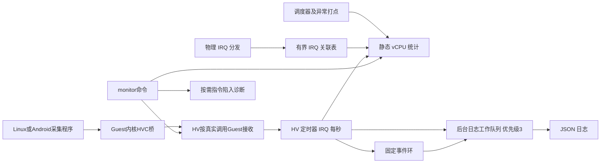

# monitor_agent 第二版：实现、合入与验收说明

日期：2026-10-21。基于当前 Xvisor 开源参考树，ARM64、12 核；产品 auth=4、mterm=3。本版的日志工作队列默认优先级为 3，采样改为定时器 IRQ。**这不是全部指标已经验收通过的声明：5 KB ROM 仍未达标，目标板 CPU <0.5% 未验证，精确 PMU 周期数未实现。**

## 1. 对修改后的需求逐项回答

“已有代码”与“产品路径已接入、板端验收通过”分别记录。新的要求只要求 exit 风暴触发日志，不再要求死机现场；当前结构化风暴/恢复日志可以对应这一功能。

| 条款 | 本版实现 | 状态/验收边界 |
|---|---|---|
| CPU 1：调度延迟、就绪等待 | 新增 `selected` 打点结束 READY 等待；新增 `dispatch` 统计调度函数进入到目标上下文安装完成 | 两种指标独立；不把唤醒请求发生到进入 READY 前的时间包含进来。产品调度器需按语义合入 |
| CPU 2：一键识别异常指令周期 | `monitor diagnose [ms]`、`collect`：有界时间内采集 ELR、ESR/EC、重复次数、处理耗时、错误，标疑似异常 | 实现了**异常指令陷入诊断**。耗时为 ns，不是 CPU 硬件周期；不定位没有任何 trap 的 Guest 内纯计算死循环。若本条指 PMU 周期/指令数，仍未完成，不能把这两种能力混称 |
| CPU 3：Guest CPU 超限与 HV 查询 | Linux/Android 通用采集程序、ARM64 内核 HVC 桥、HV 静态接收缓存、`monitor guest/cpu`；Guest 输出超限标记，HV 也有限频事件 | 源码链路已提供；需要在两个 Guest 构建部署采集端。当前数据为整个 Guest 汇总 CPU 利用率，iowait 归入空闲，不是进程利用率 |
| 内存 1：Guest 内存使用与 shell | `monitor mem <name>` 同时输出 Guest OS 遥测和区域表；OS 总量/可用/空闲/估算占用，带时间、valid 位和过期状态 | 不再把区域大小当 OS 使用量。没有部署 Guest 采集端时明确 missing；不是 0 使用量 |
| 内存 2：域与共享内存越界/越权 | stage-2 拒绝/permission fault；三个原 shmem API 范围保护；新增显式 actor 的共享内存授权读写接口 | 公开路径有实现。私有 DM/CCM 必须调用新授权接口或接入既有拒绝点；Guest 授权页内部的对象越界、DMA/IOMMU 不会自动被 MMU 捕获 |
| IRQ 1：注入延迟 | 原物理分发→成功写 LR 配对；新增显式原始时间戳、稀疏大 IRQ ID、同域迁移接口 | 上游 VGIC 已接入。LPI/MOVI 算法已模型测试，但私有 GICv3/fastpath 的实际调用位置仍需产品合入；不能将接口存在当作板端覆盖完成 |
| IRQ 2：exit 风暴触发日志 | >50000/s，连续有效窗口至少 5 个且累计至少 5 秒，结构化开始/恢复事件 | 已有实现并回归；不是 panic/reset；门限可命令配置 |
| 通用 1：ROM ≤5 KB | 对象段统计与预算失败检查，含新增对象及已有路径增量 | **未达标**；完整结果见附带容量报告。`-Os`、`-Oz` 均测量；没有通过排除命令/诊断/接入成本宣称通过 |
| 通用 1：无动态分配 | 运行期静态数组、固定缓冲；启动时创建一个日志工作队列 | 符合之前确认的“允许启动分配”口径。Guest 程序、内核设备注册各有自身 OS 分配，不属于 HV 运行期统计分配 |
| 通用 1：CPU <0.5% | 采集路径有界、诊断按命令开启；提供测量方法 | **目标板未验证**；sample_max_ns 不是 CPU 占用率证明 |
| 通用 2：高优先级确定性采集 | HV 定时器 IRQ 采样，不依赖 monitor 线程能否被 Guest 调度让出；trylock 竞争则计缺口 | 已改执行机制。长时间关 IRQ、宿主锁争用、硬件故障仍会推迟；需按最大 IRQ 屏蔽时间及 WCET 验收，不能承诺绝对实时 |
| 通用 3：JSON 通道或命令 | 本地 shell JSON、后台异常日志；保留 platform_publish 接口 | 选择需求中的**命令查询分支**已有实现。远程 virtio-serial/共享内存 JSON 发布仍为产品适配接口；Guest HVC 遥测不是该远程发布通道 |
| 通用 4：编译与运行开关 | CONFIG_MONITOR_AGENT、CONFIG_CMD_MONITOR、start/stop、量产编译关闭 | 已实现；stop 保留历史及每秒一次的 timer 轻量唤醒。只有编译关闭才去掉监控执行上下文 |

## 2. 执行模型



内部模式只创建一个专用输出工作队列，没有优先级 6 的常驻采样线程。静态 timer 在 `CONFIG_MONITOR_HCPU` 对应核启动，默认 0；队列使用同一 affinity、优先级默认 3。`CONFIG_MONITOR_PRIORITY` 现在**只控制日志线程**。不要因 mterm/auth 偶现问题重新把采样搬回前台忙轮询。

`sample_lock` 已由 mutex 改为自旋控制锁，采样只尝试取得它；拿不到就记录 busy，不等待配置路径。单槽也 trylock；统计不全时按实际 dt 标质量，不制造完整窗口。生产者、控制和事件仍使用短锁，不能将 trylock 描述成整个系统完全无等待。

`vmm_monitor_platform_sample()` 现在处于 IRQ 上下文：产品覆盖函数必须无等待、无分配、无日志、无递归 sample/enable/configure。`vmm_monitor_drain()` 仍使用 mutex，仅可后台调用。发布函数也仅在后台调用。

初始化为 IPI 延迟/超时和 timer 启动失败设置静态状态；失败后的晚到回调不访问已经销毁的队列。配置核必须在线；CPU 热拔出不在本产品静态 12 核设计中，若产品支持 hotplug 需增加迁移/停用流程。

stop 后不新增周期指标及 Guest 遥测；历史事件仍可排出。再次 start 清监控槽、IRQ 起点和 Guest 遥测缓存，下一轮预热。诊断命令是独立按需能力，允许在周期 monitor 停止时使用。

## 3. CPU 时间口径和打点

| 指标 | 起点 | 终点 | 不包含 |
|---|---|---|---|
| ready | 状态真正转为 READY 的通知 | 选出且已验证目标 vCPU，准备安装上下文的 selected 通知 | selected 后的上下文切换耗时；进入 READY 前的唤醒处理 |
| dispatch | `__vmm_scheduler_next1/next2` 入口原有 tstamp | arch_vcpu_switch 完成后打点；同一 vCPU 再选中也记录 | Guest 实际执行；调度函数后续记账尾部 |
| host_irq_to_lr | 确认有效物理 IRQ 后的分发软件时间 | 成功 set_lr 后 | 硬件边沿到软件入口、Guest ISR 开始及执行 |

`dispatch` 是该次调度路径延迟，包含出队、必要的旧状态处理、锁和上下文安装；不是仅测汇编切换，也不是从唤醒请求到 Guest 第一条指令。两个区间可以重叠，不能简单相加得出总延迟。

`vmm_monitor_selected()` 在目标 sched_lock 保护下记录 READY 样本并清 waiting。`vmm_monitor_state(RUNNING)` 保留兼容兜底：遗漏 selected 的旧集成仍能得到 READY→RUNNING 样本，但这不符合新版精确口径，产品验收须确认 selected 已合入。

直方图仍为 16 桶；P99 是桶上界，允许大于实测最大值；零 count 是无样本。PAUSE/HALT/RESET/UNKNOWN 撤销未完成等待。一直 READY 时仍通过 ready_age_ns 检测饥饿。

由于 ready 口径变化，HV JSON **schema 升为 2**；旧 QEMU schema=1 数据不被重解释。新版解析脚本兼容读入 1 和 2，并保留 schema。

## 4. 一键指令陷入诊断

```text
monitor diagnose
monitor diagnose 2000
monitor collect
```

diagnose 默认观察 1000 ms，允许 1～5000 ms；命令阻塞等待但采用 sleep，不忙轮询。collect 输出缓存后执行一次 1000 ms 诊断。命令 mutex 防止两次诊断互相清空数据。

ARM64 `do_sync()` 排除 EL2 自身异常后开始计时，仿真处理完成、原有错误日志之前结束；保存进入时的 ELR/ESR，避免处理函数修改 regs 后丢失位置。静态表保存最先遇到的最多 16 个 `(guest, vcpu, ELR, EC)` 组合，重复项累计；容量不足记 `untracked`，它不是精确 Top-N。

诊断行包含：guest/vcpu、elr、esr、ec、count、mean_service_ns、max_service_ns、last_ns、errors、suspect。suspect 位：1=同位置速率严格超过 1000 次/秒；2=最大服务经过时间 >1 ms；4=异常处理返回错误。WFI/WFE 不参与位 1/2 判断，避免把正常等待当重复指令异常；错误位仍保留。

这些是疑似条件而非故障定论；经过时间包含该路径上的等待/抢占，不等于 CPU 执行周期。HVC/SMC 的 ELR 可能是返回地址，定位 A64 调用指令时结合 EC 和反汇编处理，不能把 ELR 统一当成 fault 指令地址。

内置诊断汇总明确输出 `pmu_cycles="not_collected"`。随后保留调用 `vmm_monitor_platform_diagnose()`，产品覆盖该接口时应输出独立记录；默认返回不支持，不影响内置诊断成功。没有修改 PMCR/PMU 计数器，避免占用 Guest 或平台已有 PMU。要实现真正 cycles/instructions/CPI，必须先确定 PMU 所有权、虚拟化方式和过滤口径；本包未将服务耗时换算成伪造的 CPU 周期。

## 5. Guest CPU/内存采集与 HV 查询

### 5.1 Guest 端构建和部署

新增目录 `tools/monitor_guest/`：

- `monitor_guest.c`、`monitor_parse.h`：Linux/Android 用户态采集程序。
- `xvisor_monitor_bridge.c`、`monitor_uapi.h`：ARM64 Guest 内核设备桥。
- `Makefile`：用户程序和内核模块构建入口。
- `parse_monitor_jsonl.py`：HV 输出解析示例。

Linux 示例（使用 Guest 对应的内核构建树和工具链）：

```sh
make -C tools/monitor_guest CC=aarch64-linux-gnu-gcc
make -C tools/monitor_guest bridge KDIR=/path/to/guest-kernel-build ARCH=arm64 CROSS_COMPILE=aarch64-linux-gnu-
# 将程序和按产品策略签名/集成的驱动放入 Guest
insmod xvisor_monitor_bridge.ko
./monitor_guest --interval-ms 1000 --cpu-limit-bp 9000
```

Android 用户程序使用对应 NDK 的 AArch64 clang 构建；桥按 Android 产品内核构建，模块或内建均需符合项目的内核配置和签名方式。采集服务需访问 `/proc/stat`、`/proc/meminfo` 和 `/dev/xvisor_monitor`，并具有 CAP_SYS_ADMIN；设备默认 0600，SELinux 权限由产品配置。

**仅在已合入本包 HVC 分支的 ARM64 Guest 环境运行上报。**旧固件会把私有 HVC 交给原处理路径；可能注入未定义指令，不能盲测。驱动加载本身不执行 HVC，首次 write 才发送。只查看 Guest 统计时可使用：

```sh
./monitor_guest --stdout-only
./monitor_guest --stdout-only --once
```

采集周期允许 100～2000 ms，默认 1000 ms。CPU 使用 `/proc/stat` 前八个汇总字段的增量；guest/guest_nice 已包括在原 CPU 字段中，不再累加。idle+iowait 计入空闲；计数倒退、总增量为零时 CPU valid 位不置位，重新建立基线。

内存采集 `MemTotal`、`MemAvailable`、`MemFree`，kB 按 1024 转成字节；缺少字段、溢出或容量关系异常时内存 valid 位不置位。`used_estimate_bytes=total-available` 是约定估算口径，不等于所有进程 RSS/PSS 相加。CMA 不在本次新增需求中，没有额外实现。

Guest 每期输出 JSON，其中 `cpu_high` 表示超过 Guest 命令门限。HV 独立门限使用 `monitor config cpu_bp 9000`；10000=100%，9000=90%，0=关闭该告警。部署时同步设置两端门限。

### 5.2 私有 HVC ABI

| 位置 | 值/含义 |
|---|---|
| 指令 | `hvc #0x4d4f`，与 PSCI 常用 `hvc #0` 分离 |
| x0 输入 | `0x584d4f4e00000001`，协议 magic/version |
| x1 | 驱动本次加载会话随机非零值 |
| x2 | 本会话递增序号，普通报告非零；0 仅版本查询 |
| x3 | CPU basis points，0～10000 |
| x4/x5/x6 | total/available/free，字节 |
| x7 | 有效位：bit0=CPU，bit1=内存；至少一项有效 |
| x0 输出 | 报告成功为 0，失败为 VMM 错误；版本查询返回 1 |

HV 仅拦截匹配的 A64 HVC EC、immediate 和 magic；其他 HVC 仍走原路径。HVC 的返回 PC 不额外加 4。身份取自实际陷入的 `vcpu->guest`，报文没有可伪造的目标 Guest ID，也没有 Guest 指针/物理地址参数。

HV 校验字段范围、valid 位和同会话序号；每 Guest 固定一个槽，原子替换报告。不同会话允许重新从序号 1 开始；这不是对恶意 Guest 自报告的真实性认证。每个 Guest 只能更新自己的槽。

### 5.3 HV 命令和质量

```text
monitor start
monitor guest
monitor cpu
monitor mem Linux
monitor config cpu_bp 9000
monitor events
monitor stop
```

`monitor guest` 输出每个存在 VM 的 OS 报告；`monitor cpu` 先输出 OS 报告，再输出 vCPU 时延快照。`monitor mem <name>` 输出指定 Guest 报告及区域表。当前开源树仍使用 `guest region_list`；产品改成 `vm region_list` 时保留这一适配，并核对 Guest 查找 API 是否也改名。

OS 报告质量：missing=没有报告；disabled=HV monitor 关闭；stale=距 HV 接收时间超过 3 秒或时间异常；valid=接收时间有效。另必须检查 valid 位决定 CPU/内存字段是否可用。**valid 不是 Guest 健康证明。**

HV 接收时间使用 HV 单调时钟，不和 Guest 时钟直接相减。报告包含 session/seq/received_ns/age_ns；Guest 复位、监控重开清缓存。CPU 高负载事件 type=6，value=cpu_bp，detail=HV 门限，vcpu=UNKNOWN；只用新报告触发，每 Guest 最多 10 秒一条。

## 6. 内存保护与私有路径接入

原 stage-2 和 shmem 埋点保留。新增：

```c
u32 vmm_shmem_guest_read(struct vmm_vcpu *actor, struct vmm_shmem *shm,
    physical_addr_t gpa, physical_addr_t off, void *dst, u32 len, bool cacheable);
u32 vmm_shmem_guest_write(struct vmm_vcpu *actor, struct vmm_shmem *shm,
    physical_addr_t gpa, physical_addr_t off, void *src, u32 len, bool cacheable);
```

actor 必须来自真实调用上下文；shm 必须是已持有效引用的对象。接口先验证对象范围与地址加法溢出，再检查该 Guest 的 GPA 映射覆盖整个请求、真实 HPA 恰好等于 `shm->addr+off`、类型为真实 RAM/共享区，以及写入不为 readonly。任何拒绝返回 0，并记录对应 actor 的范围或权限事件；不会执行 backing 访问。

第一版接口明确拒绝 alias 映射，避免绕过中间别名权限。产品要支持 alias，需补齐完整权限传播后再放行。调用者保证 Guest/shm 生命周期，并序列化映射配置变更；不能在授权检查和实际访问间撤销映射后释放对象。

原 `vmm_shmem_read/write/set` 仍为宿主内部 API，不猜测当前 vCPU 就是请求者，也不擅自改变所有宿主访问语义。DM/CCM 中由 Guest 发起的共享访问，应改用新接口或在既有 ACL 拒绝点调用 `vmm_monitor_mem_fault()`。上游没有这些私有调用点，本包不能自动替换它们。

对象内部已授权页上的错误访问、不同对象共用同一映射页、恶意 DMA 不会全部经过这些 API。不能把页级 MMU 边界监控宣称成字节级任意指针检测。

## 7. GICv3 / LPI / fastpath 接入

通用配对表按 vCPU 建表，virq 作为存储的 key，**不会使用 LPI ID 索引普通 IRQ 数组**。

```c
vmm_monitor_irq_pending_at(target_vcpu, guest_lpi, original_hv_timestamp);
vmm_monitor_irq_injected(target_vcpu, guest_lpi); /* 成功写 LR 之后 */
vmm_monitor_irq_cancel(target_vcpu, guest_lpi);   /* 取消，不产生成功样本 */
vmm_monitor_irq_move(old_vcpu, new_vcpu, guest_lpi); /* 同域 MOVI，保留原起点 */
```

pending_at 用于异步 DM/CCM 或可显式携带时间戳的 LPI 路径；时间必须为与 HV timer 同源的原始事件时刻，不能在快路径末尾重新取一个“起点”。同步物理分发路径仍可用 `vmm_monitor_irq_pending(target, virq, hirq)` 自动校验来源。

move 只允许同 Guest 的不同 vCPU，按 ID 顺序取得两把关联锁；目标同 virq 已存在时保留较早起点，目标满或跨 epoch 则作废并增加 untracked。调用者必须用实际路由锁同步 MOVI、pending 和注入，否则仅移动监控表不能使真实路由原子化。

针对之前三份附件：

| 产品函数 | 手工接入要求 |
|---|---|
| `__vgic_set_pending()` | 普通 pending 原置位必须保留；LPI 使用实际目标与 LPI 映射建立配对，不访问 `irq_state[lpi]` |
| `__vgic_clear_pending()` | LPI 分支也取消关联 |
| `__vgic_percpu_irq_fastpath()` | 在直接 queue 前补起点；成功 LR 后唯一结束，避免重复记两次 |
| `__vgic_mov_lpi()` | 实际迁移的同一临界区调用 move，不调用会重建起点的普通 pending |
| `vmm_host_generic_irq_exec()` | 成功 lookup 之后 enter；任何 enter 后的返回都恢复 old context |

旧 trace 的 context-switch 执行时间可继续保留，不代替 READY 队列时间。旧 pending 统计若每次覆盖起点，与本版保留首次起点的口径不同，应区分报表。

## 8. 本版验收与已执行验证

| 测试 | 方法 | 本次证据 |
|---|---|---|
| ARM64 构建 | on/off/external，13/7/13 个修改相关 TU；另 7 个基线 TU | 已执行 -Os/-Oz；不是完整固件链接 |
| READY 与调度区间 | 已知时间点，selected 前后分界、同一 vCPU 再选中、状态复位 | 主机模型已执行 |
| IRQ/LPI/MOVI | 大 IRQ ID、首次起点、迁移、取消、epoch、嵌套/满表 | 通用 API 模型已执行；私有 ITS/VGIC 实际路径待板测 |
| Guest 上报 | 超范围、重复序号、新会话、域隔离、RESET、stop/start、CPU 告警限频 | 主机模型已执行；Guest/HV HVC 联调待执行 |
| 定时器上下文 | timer 回调中若睡眠/打印则测试立即失败；stop 后采样不增长；IPI 延迟及失败后回调 | 主机 API 模型已执行；不是硬件中断优先级证明 |
| 共享内存授权 | 从生产文件提取函数原文；正常、跨 Guest backing、只读、别名、虚拟区、范围和回绕 | 已执行；完整 TU 也交叉编译 |
| Guest 统计算法 | CPU 前八字段增量、不重复 guest 时间、计数倒退/零窗口、内存单位/缺失/溢出 | 主机测试已执行 |
| Guest 程序/桥 | ARM64 Linux 用户程序编译；桥 HVC 汇编寄存器约束编译 | 已执行；**没有在真实 Guest 内核树构建完整 ko，也没有运行 ARM64 二进制** |
| 指令陷入诊断 | 窗口边界、并发启动拒绝、次数/耗时/错误、表满、旧窗口样本 | 主机模型已执行；PMU 未采集 |
| JSON | 输出逐行解析、v1/v2 区分、P99 上界、零样本 | 已执行基础解析；接收端必须按 kind 分派 |
| ROM/CPU | 对象段 + hook 增量；目标板开关组同负载比较 | ROM FAIL；CPU <0.5% 尚无板端数据 |

复现脚本：

```sh
python tests/monitor/run_host_tests.py --cc /path/to/zig --build-dir /tmp/monitor-host
python tests/monitor/run_boundary_tests.py --cc /path/to/zig --build-dir /tmp/monitor-boundary
python tests/monitor/cross_compile.py --cc /path/to/zig --build-dir /tmp/monitor-arm64 --baseline-ref <upstream-commit> --enforce-rom
```

`--enforce-rom` 在超出 5120 B 时必须失败。最终容量必须同一产品工具链、同一配置完整链接开/关版本比较，计入代码/常量/初始化数据/监控拉入的依赖。5 KB 若按 5000 B 解释，本次同样不满足。

板端验收至少包含：双 Guest 满载与 idle；普通 SPI/PPI、LPI、MOVI、fastpath 分类正向样本；Guest 申请/触碰/释放内存而 region 不变；连续超限/恢复；auth 登录和前台切换长稳；日志输出阻塞；关闭和未 start 两组。

CPU 开销统计所有埋点、锁竞争、IRQ 采样和后台输出的增量，不只计线程。单核等效 0.5%=每秒 5 ms，总 12 核归一 0.5%=每秒 60 ms，须先冻结分母。诊断命令单独报告成本，因为它是按需诊断，不是持续监控。

确定性以最大采样迟到、最大关 IRQ 时间、计数缺口和最坏执行时间验收；优先级 3 暂未复现卡死不是原问题已修复的证据。

## 9. 包内容与合入顺序

1. 先看随包“需求覆盖与验证结果.txt”，了解未关闭项。
2. 对新增文件，按 `新增文件/` 相对路径合入完整内容。
3. 对原开源文件，按“开源原有文件_手动合入.txt”中的函数、原/新行号和上下文合入，保留产品 packed-state/GICv3/认证代码。
4. 已合入第一版的项目再看“相对上一版_升级说明.txt”。monitor 自有文件在开源基线中属于新增文件；产品已经改过的 `guest`→`vm` 等适配应保留。
5. 先验证编译关闭、未 start，再验证定时器采样；最后部署 Guest 桥和采集程序。

本版选择 shell 输出分支，未新增未经配置的共享内存 GPA、设备树地址或 virtio 端口。资料包不是 patch，不应拿整个上游原文件覆盖产品文件。
