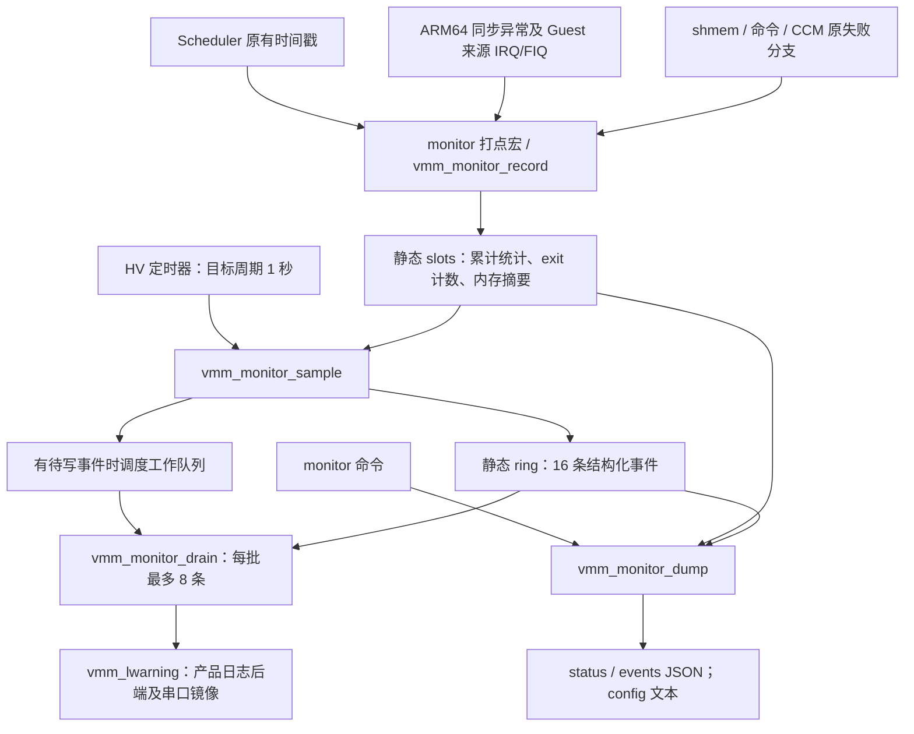
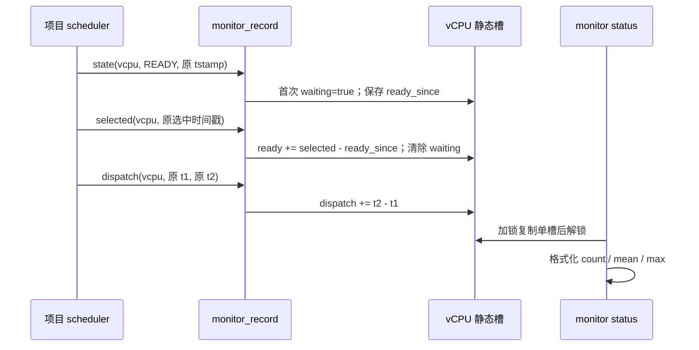
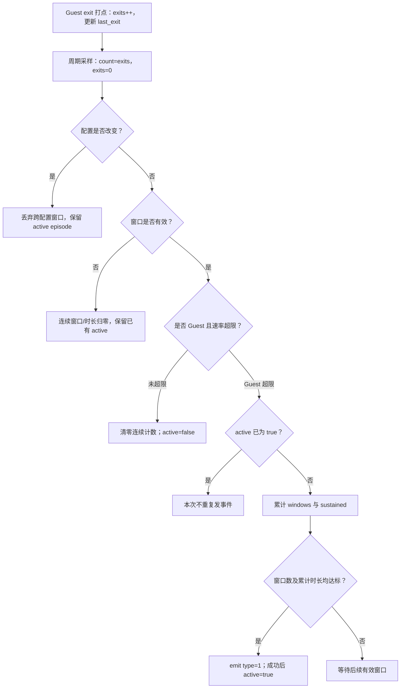
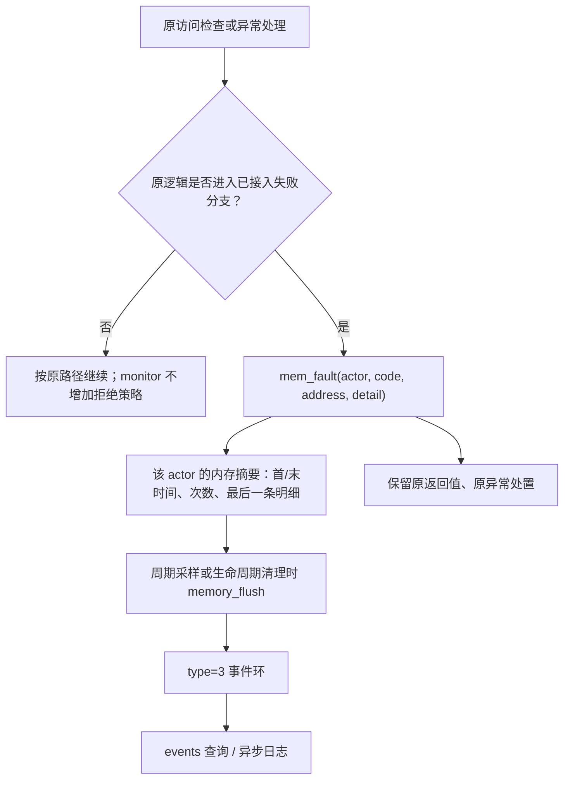
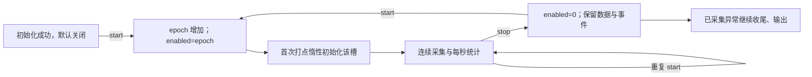
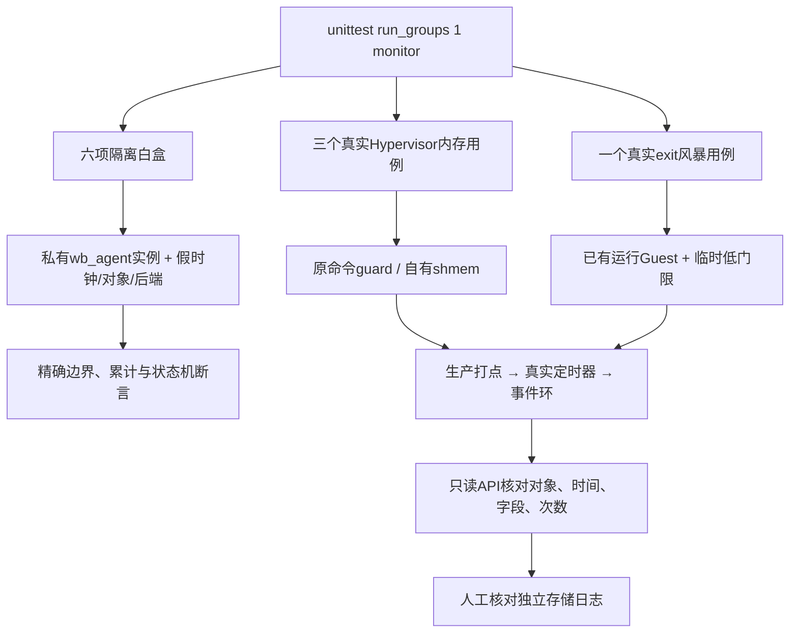
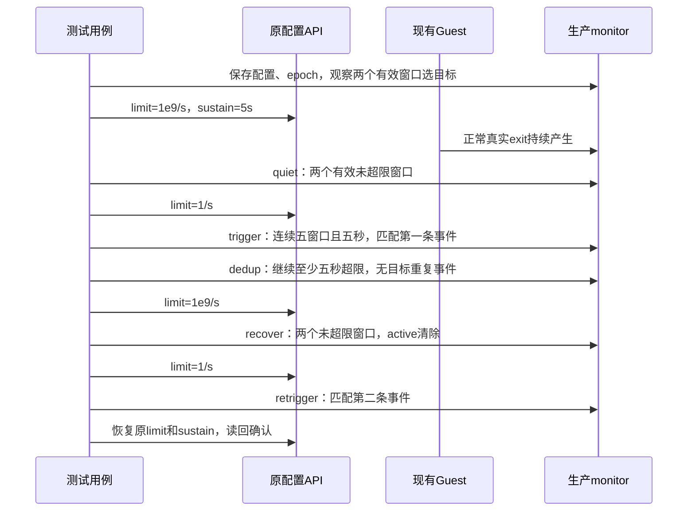

# Hypervisor Monitor v4 累计修改与实现详解

文档日期：2026-10-27。交付文件名：`monitor_implementation_report_v4_20261027.md`。交付版本为 v4；运行时 JSON 协议仍为 `schema=3`。

本文描述截至最新风暴测试负载修正后的实现，不引入新功能、不修改源码。CPU 调度阈值预警暂不实现；1 秒统计周期尚未配置化。报告以已交付源码、补丁和用户反馈的运行输出为依据，不将参考源码等同于用户未提供的完整产品源码。

目录：

- [1. 范围、版本与证据](#chapter-1)
- [2. 文件分布与构建关系](#chapter-2)
- [3. 架构、执行上下文与完整链路](#chapter-3)
- [4. 原有文件的逐项修改](#chapter-4)
- [5. 新增生产文件的数据结构](#chapter-5)
- [6. 新增文件逐函数说明](#chapter-6)
- [7. 命令、JSON 与事件解析](#chapter-7)
- [8. 十项测试的设计、链路与验收含义](#chapter-8)
- [9. 开发机工具与历史资料](#chapter-9)
- [10. 已有设计取舍与未解决限制](#chapter-10)
- [11. 开发机辅助文件的函数目录](#chapter-11)
- [12. 源码定位、完整性与报告核对](#chapter-12)

<a id="chapter-1"></a>

## 1. 范围、版本与证据

### 1.1 项目背景与当前目标

产品为 ARM64，规划 12 个物理核，Linux serverVM 与 Android 静态划分 CPU；serverVM 承载基于 ACRN 的设备模型/CCM 后端。auth 优先级为 4、mterm 为 3，monitor 日志工作线程默认优先级为 3。此前提高 monitor 优先级出现认证后卡住的现象，本轮未修改这些任务的优先级、亲和性或调度策略。

当前目标是：记录 vCPU READY 等待与调度处理耗时；记录已接入路径上可见的内存边界/权限/CCM 失败；检测 Guest exit 持续超限并记录事件；提供开关、配置、JSON 查询与日志接口。

“静态内存分区”是产品背景，不是 monitor 新增的分区分配功能。此前 1G/5G/6G 的容量描述不作为本模块硬编码参数。

### 1.2 当前版本如何组成

| 来源 | 本报告使用的内容 | 与最终实现的关系 |
|---|---|---|
| `monitor_agent_v3` 及日志/配置增量 | 静态槽、累计延迟、exit 窗口、事件环、命令、ARM64 接入 | 生产框架来源，后续版本覆盖同名文件 |
| `monitor_scheduler_history_适配_20261022` | 基于上传的 1818 行 scheduler，复用 history 与 t1/t2 | 产品 scheduler 的主要解释依据；不可用上游文件覆盖 |
| `monitor_all_vcpus_v4_20261023` | Guest/host/idle 分类，调度统计覆盖 orphan 线程 | 已纳入当前生产核心 |
| `monitor_live_tests_v4_20261023` | 隔离白盒与早期真实观察接口 | 后续整理的历史基线，不再照搬其目录结构 |
| `monitor_observer_from_20261023_v4_20261025` | 记录版 shmem、私有 CCM 错误分支记录 | 用户要求的固定升级基线；不改变现有策略 |
| `monitor_tests_flat_v4_20261025` | 单开关、平铺目录、三个真实 Hypervisor 内存测试 | 移除独立测试头和 `.inc`，原 live 用例归档 |
| `monitor_memory_compat_v4_20261025` | 对旧包装接口/无用函数的兼容修正 | 当前 `memory.c` 已使用原 shmem API |
| `monitor_test_sampling_fix_v4_20261026` | 按目标槽位判断采样进度 | 不再因无关槽位 skipped 增加而误判失败 |
| `monitor_runtime_storm_v4_20261026` | 现有 Guest 的真实 exit 风暴测试 | 第十项用例 |
| `monitor_storm_init_fix_v4_20261026` | `sr_phase()` 的事件结构显式初始化 | 修复 GCC maybe-uninitialized 报错 |
| `monitor_storm_load_fix_v4_20261026` | 测试低门限固定为 1/s，保留真实判据 | 当前最终风暴用例；覆盖前一项初始化修正 |

报告核对的生产/测试参考树为 `work/monitor-runtime-storm/tree`。产品 scheduler 使用上述专项适配文件；`cmd_memory.c` 使用已交付私有命令适配文件；`cpu_hcall.c`、`vmm_u_ioreq.c` 使用记录版私有完整文件。附录给出来源、行号及 SHA-256。

原 `D:\code\xvisor-master` 仍保留部分较早安装状态，不能单独把该目录当成全部最新交付的依据。本文没有覆盖该目录或用户工程。

### 1.3 范围对照

| 需求/议题 | 当前实现 | 验证边界 |
|---|---|---|
| vCPU 就绪等待与调度延迟 | READY→selected；外层 dispatch；累计次数/均值/最大值 | 白盒与 scheduler 适配模型已验证；真实目标板受控调度延迟试验不在当前十项中 |
| 调度超限预警 | 未实现，按用户决定暂缓 | 不应把统计值解释成自动报警 |
| 内存及共享内存越界/越权记录 | 已接入映射失败、权限 fault、shmem 拒绝、命令拒绝、CCM 失败 | 只覆盖实际进入这些路径的行为 |
| exit 风暴 | 按 Guest vCPU、窗口时长和速率门限判断，去重、恢复后可重触发 | 最新反馈已完成真实低门限集成测试 |
| JSON 与日志 | `status/events` 查询，后台 `vmm_lwarning` | 产品后端仍镜像串口；现场存在 JSON 截断，落盘需人工核对 |
| virtio-serial/诊断 VM 共享内存传输 | 当前代码未包含独立传输适配器 | 已实现“通过命令查看”这一输出选项；不可声称所有传输都接通 |
| 编译及运行开关 | OpenConf/Kconfig 风格配置；start/stop；运行时四项参数 | 统计周期固定 1 秒 |
| ROM ≤5KB、CPU <0.5% | 未完成当前产品验收 | 历史对象估算超过 5KB；CPU 指标无最终实测 |
| 无动态内存分配 | 运行时采集、统计和事件存储采用静态内存 | 内置工作队列在启动时分配；真实 shmem 测试也分配测试对象 |

原先讨论过的 Guest CPU 占用率、物理内存使用量查询、注入延迟/P99、异常指令 PC 诊断、IOMMU/资源池阈值均不属于当前保留的完整功能。历史包或文件存在这些名称，不代表当前已启用。

<a id="chapter-2"></a>

## 2. 文件分布与构建关系

### 2.1 当前板端目录

```text
hypervisor/
├── core/
│   ├── include/vmm_monitor.h                新增：生产 API、事件枚举、测试只读 API
│   ├── monitor/
│   │   ├── monitor_agent.c                 新增：记录、采样、事件、日志、测试快照
│   │   ├── objects.mk                      新增：生产对象构建
│   │   └── openconf.cfg                    新增：生产配置
│   ├── vmm_main.c                          修改：初始化入口
│   ├── vmm_scheduler.c                     修改：项目版本打点复用
│   ├── vmm_shmem.c                         修改：原拒绝分支记录
│   ├── vmm_u_ioreq.c                       修改：私有 CCM 元素长度拒绝记录
│   └── openconf.cfg                        修改：配置入口
├── arch/arm/cpu/arm64/
│   ├── cpu_interrupts.c                    修改：同步异常、Guest 来源 IRQ/FIQ 计数
│   ├── cpu_vcpu_excep.c                    修改：映射失败与权限异常记录
│   └── cpu_hcall.c                         修改：私有 sbuf 注册失败记录
├── commands/
│   ├── cmd_monitor.c                      新增：monitor 命令
│   ├── cmd_memory.c                       修改：项目原检查分支及测试适配
│   ├── objects.mk                         修改：命令对象
│   └── openconf.cfg                       修改：命令开关
└── libs/wboxtest/
    ├── openconf.cfg                       修改：统一测试配置入口
    └── monitor/
        ├── common.h                       新增：隔离测试结构及注册宏
        ├── support.c                      新增：生产算法的私有测试实例
        ├── lifecycle.c                    新增：生命周期、参数两项
        ├── scheduler.c                    新增：调度统计白盒
        ├── memory.c                       新增：shmem 隔离白盒
        ├── storm.c                        新增：风暴状态机白盒
        ├── output.c                       新增：输出、聚合、环形缓冲白盒
        ├── memory_runtime.c               新增：三个真实 Hypervisor 内存用例
        ├── storm_runtime.c                新增：真实 Guest exit 观察用例
        ├── guest_cases.c                  保留归档：当前不构建
        ├── objects.mk                     八个编译对象，共注册十项用例
        └── openconf.cfg                    唯一测试选项 CONFIG_WBOXTEST_MONITOR
```

这里“新增/修改”相对最初上游或上传的产品原文件；相对 20261025 记录版，部分新增文件已存在，只是继续修改。`core/include/vmm_shmem.h` 的变更是撤回早期 monitor 自行添加的包装声明，保留产品原有接口。`core/objects.mk`、`libs/wboxtest/objects.mk` 的现有递归构建机制不需要为本次整理反复追加同一对象。

### 2.2 删除、合并及未启用内容

- `core/include/vmm_monitor_test.h` 的结构和声明并入 `vmm_monitor.h`。
- `core/monitor/monitor_test.inc` 的实现并入 `monitor_agent.c`；当前不依赖 `.inc`。
- 原 `libs/wboxtest/monitor_live` 的公共/用例 C/H 和独立构建配置撤销，Guest 配合逻辑归档到 `guest_cases.c`。
- 不再需要独立 `CONFIG_WBOXTEST_MONITOR_LIVE`、host 等测试开关；只有 `CONFIG_WBOXTEST_MONITOR`。
- 早期专用 `tests/monitor/live_guest`、mailbox/protocol 资料仅为历史存档，不是当前测试的运行条件。
- 当前记录版没有新增 Linux CCM ioctl，没有修改 Linux/Android 内核，也没有给 serverVM 新增独占注册策略。

### 2.3 配置项

| 选项 | 默认/约束 | 作用 |
|---|---|---|
| `CONFIG_MONITOR_AGENT` | n，依赖 ARM64 | 构建监控核心与打点 |
| `CONFIG_CMD_MONITOR` | 依赖 MONITOR_AGENT | 构建查询/控制命令，配置入口默认开启见对应文件 |
| `CONFIG_MONITOR_START_ENABLED` | n | 初始化成功后自动开启采集 |
| `CONFIG_MONITOR_PRIORITY` | 3，范围 0～7 | 仅后台日志工作线程优先级 |
| `CONFIG_MONITOR_EXIT_RATE` | 50000，范围 1～1000000000 | 开机 exit 速率门限 |
| `CONFIG_MONITOR_STORM_SECONDS` | 5，范围 1～60 | 开机连续超限时间要求 |
| `CONFIG_MONITOR_EXTERNAL_EXECUTOR` | n | 不创建内置队列/定时器，由平台串行调用 sample/drain |
| `CONFIG_WBOXTEST_MONITOR` | n | 八个测试对象；依赖 WBOXTEST、MONITOR_AGENT、CMD_MONITOR；选择命令入口 |

外部执行模式要求平台从合适的 HV 上下文每秒串行调用 `vmm_monitor_sample()`，并由可睡眠工作上下文串行调用 `vmm_monitor_drain()`。不能同时启用两套实际执行器。`sampler_cpu` 在初始化时记录初始化核；外部执行模式下该字段不是实际回调运行核的动态跟踪。

<a id="chapter-3"></a>

## 3. 架构、执行上下文与完整链路

### 3.1 总体链路



### 3.2 三种执行上下文

1. **事件发生路径**：scheduler/异常/原失败分支直接更新静态槽。没有 printf、动态内存或存储写入。调度器即使正在处理优先级 7 的 IPI 线程，也会运行这些打点，采集不依赖优先级 3 的 monitor 线程先得到 CPU。
2. **周期采样路径**：内置 `tick()` 在 HV 定时器回调中调用 `sample()`。逐槽尝试加锁；忙槽跳过并记录 skipped。整理内存摘要、完成 exit 窗口、判定风暴。
3. **日志路径**：普通工作队列调用 `drain()`。仅这里执行 `vmm_lwarning`。线程调度延迟会推迟日志输出，不会改变此前打点的时间戳。

高优先级上下文不是无条件的实时保证：长时间关中断、锁争用、处理器卡死会影响采集/汇总；日志线程也可能被更高优先级任务长期压制。现有实现不替代独立 watchdog。

### 3.3 调度记录链路



READY 样本在目标被选中时完成；PAUSED 等状态取消尚未完成的等待。重复 READY 不覆盖最初起点。`ready_age_ns` 是查询时对尚未完成等待的展示值，不是超限告警。`dispatch` 不是 Guest 第一条指令开始执行的精确时间；ready 与 dispatch 区间可能重叠，不能相加。

### 3.4 风暴链路与判定公式



设 `N=count`、`dt=interval_ns`、`L=exit_limit`、`S=sustain_s`：

```text
high = N > floor(L × dt / 1_000_000_000)
持续要求：windows >= S 且 sustained >= S × 1_000_000_000
事件 value = floor(N × 1_000_000_000 / dt)
```

严格大于门限才超限；等于不算。窗口有效范围默认 750～1250 ms。当前采用“至少 S 个有效窗口 + 至少 S 秒”的双条件，与固定 1 秒调度设计配套。例如 5 个 800 ms 窗口只有 4 秒，还不能触发。`value` 是取整速率，在极接近门限的情况下不能仅以 `value > L` 复算判定。

告警后保持 active，后续持续超限不重复记录；一次有效未超限窗口即可恢复。无效窗口不等于恢复，改配置也不强制解除 active。这是检测器的事件去重，未重置 Guest、屏蔽中断或实施限流。

### 3.5 内存与 CCM 链路



摘要以 actor 槽聚合，不是按 `(code,address)` 分桶：同一槽在两次 flush 之间发生不同错误时，`value` 为总次数，`time_ns/last_ns` 是首末时间，`code/address/detail` 保留最后一条。仅凭该摘要不能还原每一次错误。NULL actor 的 shmem/CCM 事件共享额外槽，也可能合并。

### 3.6 锁与一致性

| 保护对象 | 锁/原子量 | 规则 |
|---|---|---|
| 单 vCPU 数据与 NULL actor 槽 | 每槽 `spinlock`，irqsave | 打点、查询、采样遵循同一保护 |
| ring/head/cursor/lost、配置、epoch | `event_lock` | 事件锁内复制，打印前释放 |
| enabled/initialized/skipped/errors | 原子读写/累加 | enabled 非零值实际保存采集 epoch |
| 嵌套加锁 | slot → event | `memory_flush/emit` 可在槽锁内取得事件锁；禁止反序嵌套 |
| 周期执行器 | 单调用者约定 | 不能并行启动多个 sample 调用者 |
| drain | 单工作者约定 | 每次最多 8 条，避免持续抢占终端 |

`status` 逐槽复制，不是全系统统一时刻快照；只读测试也不能将多次 API 调用视为原子事务。`sr_frame()` 使用“槽→事件→槽”复读确认采样边界。事件丢失计数 `lost` 指未被日志消费就被覆盖的数量；历史已消费事件也会随环形缓冲滚动被覆盖，而不一定增加 lost。

<a id="chapter-4"></a>

## 4. 原有文件的逐项修改

行号均对应本报告附录锁定的参考文件，不能作为覆盖产品文件的依据。产品中以函数、原分支及相邻语句定位。

### 4.1 `core/vmm_main.c`

在 `system_init_work()` 中、IOMMU 初始化之后、`vmm_modules_init()` 之前（参考约 439 行）增加 `vmm_monitor_init()`；成功后调用 `vmm_monitor_cmd_init()`。失败只输出 unavailable，不跳转到整机 fail，不阻止 Guest 启动。这样模块注册白盒用例时，生产监控和命令已完成初始化。

编译关闭时头文件提供 init 空桩返回 VMM_OK；原初始化流程保留。此处没有增加认证流程或绕过命令认证。

### 4.2 产品 `core/vmm_scheduler.c`：基于最新上传版本复用打点

原附件标识 `084362A2-2DDC-4267-98D5-77EDC5AE0EA6`，原 1818 行，交付结果 1851 行。适配保留 packed state、history、trace、迁核、锁与 adaptive halt 行为。

| 函数/区域 | 上传原行附近 → 适配后行附近 | 修改及依据 |
|---|---|---|
| include | 23 → 24 | 引入 `vmm_monitor.h` |
| `__vmm_scheduler_next1()` | 396 → 398 | 取得 next 锁后的原 tstamp 同时作为 selected 终点；不另记 dispatch |
| `__vmm_scheduler_next2()`：当前任务 RUNNING→READY | 477 → 480 | 原状态更新时间戳直接作为等待起点；在原入队路径旁通知 |
| 同函数：选中不同目标 | 509 → 513 | 通过目标状态检查后的 tstamp 结束等待，再执行原架构切换 |
| 同函数：同 vCPU 重选 | 513 → 519/523 | history 编译开启时复用 sched_in_tstamp；关闭时 monitor 开启才补终点读取 |
| `vmm_scheduler_switch()` | 572 → 583 起 | 扩展 t1/t2 编译条件；复用原 trace 两个点；用 scheduled 区分实际调度和禁止抢占 |
| `vmm_scheduler_state_change()` | 1200 → 1232 | 仅在成功提交状态分支通知原始 new_state 和原 tstamp；在 packed state 写入前 |

`vmm_scheduler_switch()` 的主要步骤：

1. trace 或 monitor 任一编译开启时声明 t1/t2；monitor 开启时另有 `scheduled=FALSE`。
2. 正常 next2 路径复用原点位 1；首次 next1 调度补起点；真正执行调度才设置 scheduled。
3. 实际切换时，`arch_vcpu_post_switch()` 后读取原点位 2，trace 和 monitor 共用该区间。
4. 同一 vCPU 重选时 next 可能为 NULL，但 scheduled 为 TRUE，使用 current 归属并补终点。
5. 禁止抢占而未调度时 scheduled 为 FALSE，不把该路径误算成 dispatch。

没有在 history 的 CPU/vCPU 双份记录函数里分别计数，避免一次调度被计算两次。monitor 不消费 history 环形数据，也不依赖 history 运行开关。对 `state_tstamp` 的原统计查询/清零不改变 monitor 自己的 `ready_since`。迁核保留连续 READY 等待。

**上游参考与产品适配的差别**：参考树是在 next1/next2 内直接记录 dispatch；产品版本按用户要求在外层 switch 统一复用 t1/t2。两者终点范围不同，不能拿上游参考代码覆盖产品 scheduler，也不能把两套 dispatch 打点同时合入。

### 4.3 `arch/arm/cpu/arm64/cpu_interrupts.c`

| 函数 | 参考行附近 | 插入位置与行为 |
|---|---:|---|
| `do_sync()` | 101 | 原 EL2 自身异常分支处理之后、`vmm_scheduler_irq_enter()` 前，调用 `vmm_monitor_exit(vcpu, ec)` |
| `do_irq()` | 224 | 保存的 PSTATE 表示来源不是 EL2 时计一次，原因用软件标记 `0x100` |
| `do_hyp_fiq()` | 235 | 与 IRQ 相同的来源筛选和 `0x100` 标记 |

EL2 自身用于 orphan 抢占的 HVC 不计作 Guest exit；记录器还会拒绝 host/idle 的 exit 计数。原 `trap_stat`、HVC→CCM/PSCI 分发及异常返回保持原行为；产品已有 `arch_atomic64_add(...hvc_inst...)` 仍可保留。

`code=0x100` 即十进制 256，是本实现合并的 Guest 来源 IRQ/FIQ 标记，不是 ARM EC。同步异常 code 是原 ec。风暴检测累计所有已接入原因，不按原因独立判定，事件 code 只是该窗口最后一次 exit 原因，不能当成占比最高原因或故障根因。

### 4.4 `arch/arm/cpu/arm64/cpu_vcpu_excep.c`

- `cpu_vcpu_stage2_map()` 约 57 行：第一次基本页 `vmm_guest_physical_map()` 失败时，调用 MAP_REJECT，address 为 fipa，detail 为原 rc，之后原打印和 return 不变。
- `cpu_vcpu_inst_abort()` 约 130 行：FSC 在 permission fault level0～level3 范围时记录 PERMISSION；address 取 FAR_EL2，detail 取 ISS；原 switch 与返回不变。
- `cpu_vcpu_data_abort()` 约 156 行：同样记录权限异常，继续原有翻译缺页、MMIO 指令模拟等处理。

正常按需建立映射不应当作违规；尝试更大页失败后回退也没有额外新增错误事件。后续 `mmu_map_page()` 的竞争重查逻辑保留。本版不是所有 MMU 错误分支的统一错误收集器。

权限事件 address 不能统一解释为 GPA/HPA。它保存 FAR；有效性需结合原异常语义及 ISS.FnV 等信息。当前事件未保存完整 ESR、异常 PC，也未区分 instruction/data 的独立事件子类型。产品的 MMU/直通实现不同，需检查对应原路径是否实际经过这几个函数。

### 4.5 `core/vmm_shmem.c` 与 `core/include/vmm_shmem.h`

`vmm_shmem_read()`、`vmm_shmem_write()`、`vmm_shmem_set()` 在原 `shm->size < (off + len)` 返回 0 的分支追加 SHMEM_BOUNDS，传入 NULL actor、off 和 len。空对象/空缓冲等原参数错误仍按原逻辑返回，不全部归类为越界事件。

撤回早期 monitor 新增的授权包装、`shmem_guest_allowed`、`vmm_shmem_guest_access/read/write` 等声明和实现；不限制谁可以使用共享内存，不改变合法访问和原返回值。产品已有 `vmm_shmem_reserve` 保留。

原 `off + len` 判据存在无符号回绕语义，本记录版没有替换它。极端偏移绕过原判据的情况不会被本打点凭空发现；隔离测试用假的后端观察这点，真实板端不构造危险物理访问。公共 `vmm_monitor_range_valid()` 是安全范围计算辅助，但不代表已替换所有产品边界检查。

### 4.6 私有 `arch/arm/cpu/arm64/cpu_hcall.c`

只在 `hcall_set_sbuf()` 增加两处记录：

1. `vmm_guest_memory_read()` 读取注册参数长度不等于 `sizeof(sp)`：在原 `return VMM_EIO` 前记录 CCM_READ_FAILED，actor 为调用者 vcpu，address 为参数 GPA，detail 为期望读取长度。
2. 原映射及 `sbuf_setup_common()` 流程结束、`return ret` 前，ret 非零则记录 CCM_REGISTER_FAILED，address 为 `sp.gpa`，detail 为 `(u64)(s64)ret`。

没有新增“只能 serverVM 注册”、重复注册拒绝、容量限制、所有权规则或权限策略。事件 guest/vcpu 表示调用者，不必等于 `target_vm`。code=6 可能是参数/映射/注册失败，不能一律宣称发生了越权访问。前置原错误分支并非每个都新增记录。

### 4.7 私有 `core/vmm_u_ioreq.c`

include 区增加 `vmm_monitor.h`。`sbuf_put()` 的原 `ele_size > max_len` 分支，在设置 `ret=U32_MAX` 前记录 CCM_ELEMENT_REJECTED：actor=NULL，address=0，detail=`((u64)ele_size << 32) | max_len`。

此记录表示原有元素尺寸拒绝，是共享缓冲描述符/传输边界相关错误证据。没有新增实际访问，也不改变 ring head/tail、通知及返回。缺少上述 include 或头文件枚举版本落后，会出现用户之前遇到的隐式声明/code=7 未定义编译错误。

### 4.8 私有 `commands/cmd_memory.c`

| 位置 | 原始函数行为 | 本次追加 |
|---|---|---|
| `check_read_memory()` | 原读范围检查失败返回 rc | 仅 rc=VMM_ERANGE 时记录 HOST_RANGE_REJECT；detail=访问宽度 |
| `check_write_memory()`：类型检查失败 | 原打印 illegal address，返回 rc | 记录 HOST_RANGE_REJECT；detail 高 32 位为 1，低 32 位为宽度 |
| 同函数：Guest 地址拒绝 | 原禁止写 Guest，返回 VMM_EFAIL | 记录 ACCESS_DENIED，同样编码 write/width |
| 新增 `vmm_monitor_host_probe()` | 测试适配 | 运行原分类函数，返回 RAM/DEVICE/GUEST；不映射、不读写物理地址 |
| 新增 `vmm_monitor_host_guard()` | 测试适配 | 调用原读/写检查函数；触发原拒绝记录，但不执行后续物理读写 |

两项适配接口只在 CONFIG_WBOXTEST_MONITOR 下构建。入口校验 width 必须为 1/2/4、地址算术不溢出；这是测试调用适配的参数约束，不插入原正常命令执行路径。完整函数契约在函数目录列出。

`check_type_memory`、RAM/设备/Guest 遍历函数及原访问策略保持不变；适配不会证明 Hypervisor 任意指针越界都可捕获。上传文件首行缺失的注释起始斜杠在参考完整文件中修复，若产品原文件注释已正确，不必套用该格式差异。

### 4.9 构建接入与原文件的其他变化

- `core/openconf.cfg`：source 新增 monitor 配置；`core/monitor/objects.mk` 条件加入 monitor_agent.o。
- `commands/openconf.cfg`：增加 CONFIG_CMD_MONITOR；`commands/objects.mk` 条件加入 cmd_monitor.o。
- `libs/wboxtest/openconf.cfg`：source 统一 monitor 配置，撤销独立 live 配置入口。
- `libs/wboxtest/monitor/objects.mk`：显式列出八个对象，`lifecycle.c` 注册两项，`memory_runtime.c` 注册三项，总计十项；guest_cases.o 不在列表。
- 原 `vmm_host_irq.c`、VGIC/GICv3/LPI 路径没有作为当前注入延迟功能保留；不要重新叠加早期 IRQ 延迟补丁。
- 原 `vmm_u_add_region()` 的重叠返回策略没有因 monitor 改动；不能从该代码推导新增分区隔离策略。

<a id="chapter-5"></a>

## 5. 新增生产文件的数据结构

### 5.1 `core/include/vmm_monitor.h`

生产宏 `state/selected/dispatch/exit/mem_fault` 将不同打点转发到统一 record 接口。编译关闭时展开为空语句，参数不求值；运行时 stop 时宏仍存在，调用和部分原时间戳读取开销仍在。

| 类型/常量 | 字段或成员 | 含义 |
|---|---|---|
| `VMM_MONITOR_NS` | 1000000000ULL | 一秒的纳秒数，也被用作当前周期；不能只改该值缩短周期 |
| `VMM_MONITOR_EVENTS` | 16 | 事件环容量 |
| `vmm_monitor_config_key` | EXIT_LIMIT/SUSTAIN_S/WINDOW_MIN_MS/WINDOW_MAX_MS | 四个配置索引 |
| `vmm_monitor_view` | STATUS/EVENTS_VIEW/CONFIG_VIEW | dump 输出选择 |
| `vmm_monitor_hook` | STATE/SELECTED/DISPATCH/EXIT/FAULT | record 的内部操作号；内存类型编码为 MON_FAULT+code |
| `vmm_monitor_fault` | 1～8 | 内存/CCM 事件代码，见协议章节 |
| `vmm_monitor_test_latency` | count/sum/max | 测试读取完整累计量，均值由调用者计算 |
| `vmm_monitor_test_state` | epoch/enabled/config_seq/config/skipped/errors/head/lost | 真实监控全局只读视图；enabled 在该 API 中是 epoch 值，不是 JSON 的布尔值 |
| `vmm_monitor_test_slot` | 身份、waiting/valid/active、previous/interval/exits、ready/dispatch | 单槽副本；这里 exits 对应最后完成窗口的 count |
| `vmm_monitor_test_event` | 完整事件字段、log_returned/log_calls | 读取事件与日志接口调用回执；回执不代表持久化完成 |
| `vmm_monitor_host_kind` | RAM/DEVICE/GUEST | 命令测试 probe 的原策略分类结果 |

### 5.2 `core/monitor/monitor_agent.c`

| 数据结构/变量 | 核心字段 | 作用及生命周期 |
|---|---|---|
| `struct latency` | u64 count/sum/max | 累计延迟；更新为 count++、sum+=ns、max=max(max,ns)；输出 mean=sum/count |
| `struct event` | seq/time/last/value/address/detail；type/guest/vcpu/epoch/code/config_seq/sustain_s | 固定大小事件记录，类型决定字段语义 |
| `enum object_kind` | GUEST=0/HOST=1/IDLE=2 | 按 is_normal 和 idle 指针识别，不能仅按非空 guest 指针分类 |
| `struct data` | ready/dispatch、ready_since、previous、exits、count、interval | 单对象统计和等待起点；exits 为正在累计的计数，count 为上一窗口快照 |
| 同结构 | sustained/windows/active、config_seq/valid | 风暴持续时间、去重状态、配置归属与窗口质量 |
| 同结构 | epoch/guest/kind/present/waiting、memory | 对象生命周期及待 flush 的内存摘要 |
| `struct slot` | lock + data | 每个对象独立锁；数组长度 MAX_VCPU_COUNT+1 |
| `slots[MAX_VCPU_COUNT]` | 额外槽 | NULL actor 的共享汇总槽，不是一个真实 vCPU；status 不枚举此槽 |
| `ring[16]` | event 数组 | 查询历史与异步日志共用；查询不消费 |
| `head/cursor/lost` | 全局序号、下一条待日志消费序号、未消费覆盖数 | cursor 初始为 1；start 不清空环 |
| `monitor_config` | value[4] + seq | 一组运行时配置；实际变化才递增 seq，跳过 0 |
| `epoch/enabled/initialized` | 采集代次与初始化状态 | start 从关闭进入新 epoch；各槽下一次打点时惰性重建 |
| `sampler_cpu/queue/work/timer/deadline` | 初始化核、日志执行器、周期计划 | 内置模式使用；日志队列绑定初始化核 |
| 测试专有数组/计数 | test_logged/test_log_calls/test_sample_serial/test_sample_actor | 单开关下存在，量产关闭测试时移除 |

初始化的 slots/ring 不依赖 Guest 创建时动态分配。CONFIG_MAX_VCPU_COUNT 必须覆盖产品的全局 vCPU ID；例如现场 ID 已到 85，不能仍以 64 为上限而期待全部被记录。MAX_VCPU_COUNT 是对象容量，不是物理核数。

### 5.3 状态与周期细节



停止不是同步销毁定时器或日志线程：记录入口在锁前/锁内检查 enabled；已经在执行的 sample 可能完成收尾，内存摘要仍可 flush。RESET/UNKNOWN 生命周期通知在停止时仍可清理对象。重新 start 后旧 epoch 的槽不显示，待新打点初始化；事件历史保留并带旧 epoch。

定时器使用 deadline 推进，超期时跳到后续计划点，不补发一串虚假的正常采样窗口。窗口锁争用会导致一个槽跨多个周期才更新，interval 相应变长，可能 valid=0。`window_min/max_ms` 只调有效性判据，不调周期。

<a id="chapter-6"></a>

## 6. 新增文件逐函数说明

以下目录按当前实际定义逐一列出函数，给出输入/输出、关键动作和副作用。宏生成的注册 init/exit 单独说明；同一生产算法被测试重命名包含时不重复复制其设计。行号来自本报告锁定的文件版本。

### 6.1 `core/include/vmm_monitor.h`

来源：[core/include/vmm_monitor.h](<C:/Users/win/Documents/Codex/2026-10-18/d-code-xvisor-master-xvisor-xvisor-2/work/monitor-runtime-storm/tree/core/include/vmm_monitor.h>)。

公开宏参数：state(v,s,t) 传入原始调度状态与时间；selected(v,t) 结束等待；dispatch(v,a,b) 传入起止纳秒；exit(v,r) 传入原因；mem_fault(v,k,a,d) 传入事件 code、地址、附加值。所有真实数据语义由调用点决定。测试只读 API 与命令 probe/guard 仅在统一测试开关下声明。

#### `vmm_monitor_cmd_init()`（第 35 行附近）

```c
static inline int vmm_monitor_cmd_init(void)
```

CONFIG_CMD_MONITOR 关闭时的空桩，无参数，返回 VMM_OK。让公共初始化调用保持可编译；不注册命令。开启时同名实现位于 cmd_monitor.c。

#### `vmm_monitor_range_valid()`（第 37 行附近）

```c
static inline bool vmm_monitor_range_valid(u64 size, u64 offset, u64 length)
```

输入对象容量 size、偏移 offset、长度 length；返回 offset<=size 且 length<=size-offset。先比较再做减法，避免 offset+length 溢出。无状态修改，不构成访问授权策略；当前隔离测试使用该函数保护假的后端。

#### `vmm_monitor_init()`（第 55 行附近）

```c
static inline int vmm_monitor_init(void)
```

CONFIG_MONITOR_AGENT 关闭时的空桩，返回 VMM_OK；不会初始化监控。实际开启版同名函数见核心文件。

### 6.2 `core/monitor/monitor_agent.c`

来源：[core/monitor/monitor_agent.c](<C:/Users/win/Documents/Codex/2026-10-18/d-code-xvisor-master-xvisor-xvisor-2/work/monitor-runtime-storm/tree/core/monitor/monitor_agent.c>)。

这是生产核心，测试只读函数受 CONFIG_WBOXTEST_MONITOR 保护。不存在 scheduler/memory 专用采集线程。耗时统计、事件存储和错误摘要使用固定容量结构，函数中的无锁打印只发生在查询或日志上下文。

#### `emit()`（第 56 行附近）

```c
static bool emit(struct event *e)
```

输入待提交 event 指针，返回是否成功入环。在 event_lock 下检查 type=1 的 config_seq 仍等于当前配置，防止配置改变后发布旧判据；不匹配则返回 FALSE，不分配 seq。成功时递增 head，将事件复制到 (head-1)%16；如果覆盖尚未消费的事件，推进 cursor 并增加 lost。函数会回填输入事件 seq。可由持有 slot 锁的调用者调用，但不得反向持有 event 锁再锁 slot。

#### `memory_flush()`（第 71 行附近）

```c
static __attribute__((noinline)) void memory_flush(struct data *d)
```

输入一个 data 槽；memory.value 非零时调用 emit，把该槽摘要送入事件环，然后清零摘要次数。调用者持有该 slot 锁。类型为内存事件，不受风暴配置 seq 检查；其余摘要字段在后续记录时更新。stop 前已有异常也必须收尾，所以采样中的调用位于 enabled 判定之前。

#### `add()`（第 75 行附近）

```c
static void add(struct latency *s, u64 ns)
```

输入 latency 结构和一个纳秒样本。累计 count/sum，更新 max，无动态分配、不取时钟、不打印；由持有 slot 锁的路径调用。没有分位数直方图，也没有超限门限判断。

#### `vmm_monitor_record()`（第 82 行附近）

```c
void vmm_monitor_record(struct vmm_vcpu *v, u32 hook, u64 a, u64 b)
```

输入 vcpu 指针、hook 及两个 u64 参数；无返回值。未初始化、关闭采集、ID 越界、normal vCPU 缺少 guest 等情况直接忽略；RESET/UNKNOWN 生命周期清理在关闭时仍允许。MON_EXIT 只接受 normal Guest；NULL actor 只接受内存事件并落到额外槽。取得槽锁后再次检查 enabled；epoch 变化或 reset 时先 flush 旧内存摘要，再清零并设置新轮次及 previous。按 is_normal/idle 指针分类并设置 guest 身份。STATE 管理 waiting，SELECTED 完成 ready 样本，DISPATCH 完成耗时样本，EXIT 累加次数和最后原因，FAULT 聚合首末时间/次数/末条明细。不会替调用者改变内存策略或 vCPU 状态。

#### `vmm_monitor_enable()`（第 147 行附近）

```c
int vmm_monitor_enable(bool on)
```

输入布尔 on，返回 VMM_OK 或未初始化时 VMM_ENOTAVAIL。在 event_lock 下：stop 仅写 enabled=0；关闭到开启时 epoch 递增且跳过 0，enabled 写入 epoch；重复 start 不重置。各槽惰性初始化，不一次锁住全部 vCPU。事件环、lost、日志游标不清零；不是等待所有采样退出的同步屏障。

#### `vmm_monitor_configure()`（第 163 行附近）

```c
int vmm_monitor_configure(u32 key, u32 value)
```

输入配置 key 与 u32 value；未初始化返回 ENOTAVAIL，越界 key/value 返回 EINVALID。四项范围依次为 1..1e9、1..60、1..1000、1000..10000。在事件锁内仅实际变化时更新 value 并递增非零 seq。未直接重置各槽 active；sample 看到新 seq 后丢弃跨配置窗口。停止状态也可配置，配置保存在内存而非自动持久化到启动配置。

#### `vmm_monitor_sample()`（第 181 行附近）

```c
void vmm_monitor_sample(u64 now)
```

输入执行器提供的当前纳秒 now，约定单一周期调用者；无返回值。先复制配置、读取 enabled，再逐个 trylock 槽，争用则 skipped++。成功锁定后先 flush 内存、增加测试目标进度；对关闭/旧 epoch/不存在的对象不计算 exit 窗口。配置切换时清空混合窗口；否则保存 interval/count，清空当前 exits，判定 valid。仅 Guest 进入风暴逻辑；满足双持续条件时生成 type=1 并调用 emit，成功才置 active。末尾增加测试全局完成序号。这里不睡眠、不输出日志；在途调用可能与 stop 收尾交错。

#### `print_event()`（第 247 行附近）

```c
static __attribute__((noinline)) void print_event(struct vmm_chardev *c, const struct event *e, bool log)
```

输入可选字符设备、event 与 log 标志；无返回值。用栈上 384 字节数组格式化一条 schema=3 JSON，包含 config_seq/sustain_s。log=true 调用一次 vmm_lwarning("monitor","%s",line)，否则调用 vmm_cprintf。下层日志可能再次格式化/截断，函数本身不确认落盘，不返回传输成功回执。

#### `event_get()`（第 262 行附近）

```c
static bool event_get(u64 seq, struct event *e)
```

输入 seq 与输出 event 指针，返回 BOOL。在事件锁内验证 seq 非零、不超过 head 且距 head 小于 16，满足则复制环中记录。只读，不移动 cursor；对象被覆盖后返回 FALSE。内部调用者保证输出指针有效。

#### `vmm_monitor_drain()`（第 272 行附近）

```c
void vmm_monitor_drain(void)
```

无参数/返回值；单工作者每次最多处理 8 条。锁内取得 cursor 指向事件并推进游标，解锁后调用 print_event，避免在事件锁内执行日志。测试构建下记录该 seq 的日志调用次数与已返回标记。日志函数返回不代表介质落盘；接口没有失败重试协议，不能据此承诺持久化 exactly-once。

#### `vmm_monitor_dump()`（第 294 行附近）

```c
int vmm_monitor_dump(struct vmm_chardev *c, u32 view)
```

输入字符设备和 view，返回 VMM_OK/EINVALID/ENOTAVAIL。复制全局 head/lost/epoch/config 后释放事件锁。events 遍历当前可保留的最多 16 条，不消费；config 输出简洁文本；status 输出全局 JSON，再逐槽复制当前 epoch 的 present 数据，输出 kind、上个窗口、累计 latency。ready_age 在开启且该槽仍等待时按查询时刻计算，停止后为 0。打印时不持有槽锁，不强制一次新采样，也不枚举 NULL actor 槽。

#### `report()`（第 343 行附近）

```c
static void report(struct vmm_work *unused)
```

工作队列回调，忽略 work 参数，只调用 vmm_monitor_drain。只在内置执行器模式编译。它是优先级 3 日志工作线程执行的内容，不执行逐次调度采集。

#### `tick()`（第 344 行附近）

```c
static void tick(struct vmm_timer_event *ev)
```

内置定时器回调，输入 timer event。读取时间并 sample，事件锁内检查 cursor<=head；有待日志事件则调度唯一 work。调度错误除 EALREADY 外计入 errors。最后重新取时间，按 deadline 推进到下一个未来周期并重新启动定时器；重启失败计入 errors。不会对错过的周期虚构补采样，也不会在 stop 时销毁执行器。

#### `vmm_monitor_init()`（第 362 行附近）

```c
int __init vmm_monitor_init(void)
```

初始化每个槽锁，记录初始化 CPU。内置模式初始化 work/timer，创建名为 monitor 的工作队列，按 CONFIG_MONITOR_PRIORITY 设置优先级并绑定初始化核，启动 1 秒定时器；创建失败返回 ENOMEM，绑定/启动失败销毁队列并返回原错误。外部模式不创建队列/定时器。发布 initialized 前使用内存屏障；开机启用选项开启时调用 enable(TRUE)。启动阶段队列创建会分配内存；采集路径本身使用静态存储。

#### `vmm_monitor_test_state()`（第 396 行附近）

```c
int vmm_monitor_test_state(struct vmm_monitor_test_state *out)
```

测试只读接口，输入输出结构指针；NULL 返回 EINVALID，未初始化返回 ENOTAVAIL。事件锁内复制 epoch/enabled/config/head/lost，并读取原子 skipped/errors。enabled 返回内部 epoch 值，不是固定 1。供真实测试建立基线、识别配置/启停变化和证据丢失。

#### `vmm_monitor_test_slot()`（第 410 行附近）

```c
int vmm_monitor_test_slot(u32 id, struct vmm_monitor_test_slot *out)
```

测试只读接口，输入真实 vCPU id 与输出指针；拒绝 NULL/越界，不能通过该接口读取 NULL actor 额外槽。槽锁内复制身份、waiting/valid/active、上一窗口时间/次数及延迟累计量；out.exits=d.count。只读，不刷新采样、不创建对象。

#### `vmm_monitor_test_event()`（第 427 行附近）

```c
int vmm_monitor_test_event(u64 seq, struct vmm_monitor_test_event *out)
```

输入 seq 和输出指针，事件锁内检查是否仍在 16 条环内；无效参数返回 EINVALID，未初始化/不可保留返回 ENOTAVAIL。复制所有事件字段，并按 seq 校验 log_returned/log_calls，避免复用的环槽误认为已记录当前事件。没有消费或清理作用。

#### `vmm_monitor_test_sample_actor()`（第 447 行附近）

```c
int vmm_monitor_test_sample_actor(u32 actor, u64 *out)
```

输入 actor 与 u64 输出指针。actor=~0U 映射 NULL actor 额外槽，其余必须小于 MAX_VCPU_COUNT。在槽锁下读取该槽成功执行 flush 阶段的单调计数。它跨 epoch/槽复位不清零，因此调用者还要核对 epoch；两次目标进度比全局 skipped 更能证明被测路径确实得到处理。

#### `vmm_monitor_test_sample_serial()`（第 460 行附近）

```c
int vmm_monitor_test_sample_serial(u64 *out)
```

测试只读接口，事件锁下读取全局完整 sample 调用完成序号。它只能说明执行器走完一轮，不证明每个槽都成功加锁。真实内存测试主要用 actor 进度，global serial 留作诊断。

### 6.3 `commands/cmd_monitor.c`

来源：[commands/cmd_monitor.c](<C:/Users/win/Documents/Codex/2026-10-18/d-code-xvisor-master-xvisor-xvisor-2/work/monitor-runtime-storm/tree/commands/cmd_monitor.c>)。

主要数据为静态 monitor_cmd 和只读配置键数组。命令只调用生产 API，不直接操作 slots 或 ring。

#### `monitor_usage()`（第 6 行附近）

```c
static void monitor_usage(struct vmm_chardev *cdev)
```

向指定终端输出 start/stop/status/events/config 用法及四个配置键。无数据修改。不存在采样周期、CPU 利用率或调度延迟门限参数。

#### `monitor_exec()`（第 11 行附近）

```c
static int monitor_exec(struct vmm_chardev *cdev, int argc, char **argv)
```

输入字符设备、argc/argv，返回底层接口错误码。argc=2 时分发 start/stop/status/events/config；argc=4 时匹配固定配置键、严格逐位解析十进制并在乘 10 前检查 u32 溢出，再调用 configure。拒绝符号、空串、十六进制、尾随字符等。成功仅输出 OK: key=value，失败输出简短提示或 usage；不会在配置成功后自动输出 status JSON。start/stop 当前直接返回结果，没有额外成功文本。

#### `vmm_monitor_cmd_init()`（第 49 行附近）

```c
int __init vmm_monitor_cmd_init(void)
```

填写静态 vmm_cmd 的 name/desc/usage/exec，向原命令管理器注册，返回注册结果。由主初始化入口调用；不创建新认证入口，访问控制沿用产品 mterm/auth。

### 6.4 `libs/wboxtest/monitor/common.h`

来源：[libs/wboxtest/monitor/common.h](<C:/Users/win/Documents/Codex/2026-10-18/d-code-xvisor-master-xvisor-xvisor-2/work/monitor-runtime-storm/tree/libs/wboxtest/monitor/common.h>)。

本文件没有普通函数定义，提供隔离测试契约：MT_COUNT=4，两个 Guest 模型、一个 host、一个 idle；MT_UNKNOWN=4 指模型额外槽。mt_latency 为 count/sum/max；mt_snapshot 复制待采 exits、已采 count、延迟与风暴状态；mt_event 为事件副本；mt_global 为 epoch/配置/环游标/日志次数。MT_CHECK 失败打印断言并 goto out，确保 fixture 解锁。MT_REGISTER 为每项生成 test_name_init()/test_name_exit()，分别注册到 monitor 组及注销，run 在每次迭代内自行初始化。

### 6.5 `libs/wboxtest/monitor/support.c`

来源：[libs/wboxtest/monitor/support.c](<C:/Users/win/Documents/Codex/2026-10-18/d-code-xvisor-master-xvisor-xvisor-2/work/monitor-runtime-storm/tree/libs/wboxtest/monitor/support.c>)。

通过宏将生产 monitor_agent.c 和 cmd_monitor.c 编译为 wb_agent_* 私有实例；替换时间、CPU、终端及日志接口，禁用真实定时器、工作队列和测试观察接口的重复定义。fixture_lock 串行保护整个用例；actors[4]/guests[2] 为假对象，output[8192]/log_line[384] 为固定输出缓冲。该实例与真实监控 slots/ring 完全分开。

| 函数（参考行） | 输入/输出、处理流程与注意点 |
|---|---|
| `mt_clock()`（22） | 无参数，返回 test_time，作为私有实例的 vmm_timer_timestamp 替代，不读取硬件时钟。 |
| `mt_processor()`（23） | 无参数，返回 test_cpu，模拟采集 CPU 编号。 |
| `mt_idle()`（24） | 输入 CPU，CPU0 返回 actors[MT_IDLE]，其他返回 NULL，用于验证 idle 识别及远端通知保留身份。 |
| `mt_print()`（25） | 模拟 vmm_cprintf；可变参数格式化后追加到 output，返回写入长度。长度错误/越界只置 overflow，不越过固定缓冲。 |
| `mt_warning()`（36） | 模拟日志宏落点；检查 prefix 是否为 monitor，将本次记录写入 log_line，增加 log_count，并检测截断。不触及真实串口或存储。 |
| `mt_register_command()`（46） | 接收命令指针，直接返回 VMM_OK。避免重复注册真实 monitor 命令；测试直接调用同一翻译单元内的解析函数。 |
| `mt_reset()`（80） | 将私有槽、环、actor/guest、计数和输出清零，恢复配置默认值；建立两个 normal Guest 和 host/idle；设置假时钟为 100 秒，调用私有 init 初始化锁。不会清空生产监控。要求已由 fixture 管理串行访问。 |
| `mt_begin()`（100） | 取得 fixture_lock 后执行 mt_reset，作为隔离用例入口。 |
| `mt_end()`（101） | 释放 fixture_lock；所有成功/失败出口都应经过它。 |
| `mt_now()`（102） | 返回假时钟，用于确定性断言。 |
| `mt_time()`（103） | 设置假时钟为传入 ns，不自行触发采样。 |
| `mt_cpu()`（104） | 设置假 CPU 编号，用于跨 CPU/idle 测试。 |
| `mt_vcpu()`（105） | id 小于 MT_COUNT 时返回对应假 actor，否则返回 NULL；允许 mt_fault 单独传入 NULL actor。 |
| `mt_enable()`（106） | 转发 on 到 wb_agent_enable，返回原结果，只影响私有实例。 |
| `mt_config()`（107） | 将 key/value 转发 wb_agent_configure，验证与生产相同的范围及版本规则。 |
| `mt_record()`（108） | 按 id 取得假 actor，调用私有 record，测试指定 hook 与两个参数的处理。 |
| `mt_fault()`（109） | 输入可为空的 actor、code/address/detail，合成为 MON_FAULT+code 送入私有 record。 |
| `mt_exits()`（111） | 按指定 count 循环提交假 exit 和 reason，用于确定性窗口边界；仅隔离测试使用，真实 storm_runtime 不使用。 |
| `mt_sample()`（113） | 先设置假时钟，再直接调用私有 sample。用于精确控制窗口时长，不调用生产执行器。 |
| `mt_sample_skip()`（114） | 输入槽 id 和 now；合法 id 含额外槽，先持有该槽锁，再调用私有 sample，验证 trylock 跳过及 skipped；最后释放。 |
| `mt_drain()`（122） | 调用私有 drain，输出进入测试日志缓冲，验证限批与去重。 |
| `mt_snapshot()`（123） | 复制指定私有槽到 mt_snapshot，包含当前 exits 和已采 count；越界时保留清零输出。fixture 锁保证用例串行，不是生产查询 API。 |
| `mt_global()`（135） | 复制私有 head/cursor/lost/epoch/配置及日志次数，供测试断言；不会推进游标。 |
| `mt_event()`（142） | 调用私有 event_get 获取 seq，成功转成 mt_event；不存在返回 FALSE。 |
| `mt_command()`（150） | 用 verb/key/value 组成 argv，清空终端缓冲后调用私有 monitor_exec；没有 key 时 argc=2，有 key 时 argc=4，返回命令执行结果。 |
| `mt_output()`（156） | 返回当前私有终端缓冲只读指针，生命周期到下次命令或 reset。 |
| `mt_log()`（157） | 返回最近一次私有日志行，不表示持久化日志文件。 |
| `mt_overflow()`（158） | 返回 output/log 格式化溢出或异常前缀标志，供用例末尾断言。 |

### 6.6 `libs/wboxtest/monitor/lifecycle.c`

来源：[libs/wboxtest/monitor/lifecycle.c](<C:/Users/win/Documents/Codex/2026-10-18/d-code-xvisor-master-xvisor-xvisor-2/work/monitor-runtime-storm/tree/libs/wboxtest/monitor/lifecycle.c>)。

| 函数（参考行） | 输入/输出、处理流程与注意点 |
|---|---|
| `lifecycle_run()`（4） | 注册为 monitor_lifecycle。使用私有 fixture 检查关闭时不采、start 的 epoch、重复 start 幂等、stop 后 exit 不累加但旧内存摘要可 flush、重开后旧槽隐藏及惰性重建、UNKNOWN 清理、RESET/ID 复用、host 分类、越界 ID 与缺 guest 指针。失败通过 MT_CHECK 跳出并释放 fixture；返回 VMM_OK 或 EFAIL。 |
| `config_run()`（47） | 注册为 monitor_config。验证 config 命令成功回显为简洁文本，四项边界值、无变化不递增 config_seq、越界/未知键不修改状态。覆盖空串、负号/正号、浮点、十六进制、空格、字符尾缀与 u32 溢出。只影响私有配置，不改真实监控参数。 |

### 6.7 `libs/wboxtest/monitor/scheduler.c`

来源：[libs/wboxtest/monitor/scheduler.c](<C:/Users/win/Documents/Codex/2026-10-18/d-code-xvisor-master-xvisor-xvisor-2/work/monitor-runtime-storm/tree/libs/wboxtest/monitor/scheduler.c>)。

| 函数（参考行） | 输入/输出、处理流程与注意点 |
|---|---|
| `scheduler_run()`（5） | 注册为 monitor_scheduler。对两个 Guest、host、idle 注入明确时间：READY 起点、重复 READY、selected、dispatch；断言计数/sum/max 与对象分类。验证重复 selected 不重复统计、PAUSED 取消等待、倒序 dispatch 时间忽略、ready_age 查询、远端通知不丢 idle 身份、host 即使带 guest 指针也不计 exit、UNKNOWN 清理。它验证统计算法，不运行真实架构切换。 |

### 6.8 `libs/wboxtest/monitor/storm.c`

来源：[libs/wboxtest/monitor/storm.c](<C:/Users/win/Documents/Codex/2026-10-18/d-code-xvisor-master-xvisor-xvisor-2/work/monitor-runtime-storm/tree/libs/wboxtest/monitor/storm.c>)。

| 函数（参考行） | 输入/输出、处理流程与注意点 |
|---|---|
| `prime()`（4） | 开启私有实例，配置 limit=100/s、持续 2 秒，RESET 目标，主动采样一次消除配置混合窗口；返回配置结果。 |
| `window()`（13） | 向假 Guest0 注入 count 次原因 1 的 exit，再将假时钟推进 duration 并采样。用来精确构造 1 秒、800 ms 或无效 2 秒窗口。 |
| `storm_run()`（17） | 注册为 monitor_storm。覆盖等于门限不触发、超过门限连续达标才触发、低窗口打断、active 去重、改门限保留 active、恢复后重触发、无效/跳过窗口不误报、800ms 窗口仍需真实累计时间、多 Guest 独立判断及 host/idle 排除。返回断言结果；全过程仅私有实例。 |

### 6.9 `libs/wboxtest/monitor/memory.c`

来源：[libs/wboxtest/monitor/memory.c](<C:/Users/win/Documents/Codex/2026-10-18/d-code-xvisor-master-xvisor-xvisor-2/work/monitor-runtime-storm/tree/libs/wboxtest/monitor/memory.c>)。

包含生产 vmm_shmem.c 的私有副本，并将其对外符号重命名为 wb_shmem_*；vmm_shmem_reserve 也必须重命名，以避免与产品 core.o 重复定义。该 reserve 宏放在头文件之前，兼容产品声明。后端使用 backing[32]，绝不解引用任意物理地址。旧的 find_region/map_region 授权包装测试已移除。

| 函数（参考行） | 输入/输出、处理流程与注意点 |
|---|---|
| `backend_range()`（16） | 记录 accesses；检查模拟 HPA>=TEST_HPA 及 backing 范围。越界设置 invalid_backend 并返回 FALSE；这是测试后端的防护，不修改生产 shmem 原策略。 |
| `read_memory()`（24） | 输入模拟物理地址、输出缓冲、长度/cacheable；先检查 backend_range，再 memcpy 并返回长度，失败返回 0。替代私有 shmem 的物理读。 |
| `write_memory()`（30） | 同样验证假范围后向 backing 写入，返回长度/0；不访问 Guest 或真实物理地址。 |
| `set_memory()`（36） | 在假范围内 memset 指定 byte，返回长度/0。 |
| `memory_run()`（63） | 注册为 monitor_memory。测试合法尾边界读写、set；三次原边界拒绝不触及后端且聚合为 value=3；NULL 参数不生成边界事件；stop 不改变原允许/拒绝结果；大偏移加法回绕只在假后端观察，断言未擅自新增生产拒绝。最后检查输出未溢出并释放 fixture。 |

### 6.10 `libs/wboxtest/monitor/output.c`

来源：[libs/wboxtest/monitor/output.c](<C:/Users/win/Documents/Codex/2026-10-18/d-code-xvisor-master-xvisor-xvisor-2/work/monitor-runtime-storm/tree/libs/wboxtest/monitor/output.c>)。

| 函数（参考行） | 输入/输出、处理流程与注意点 |
|---|---|
| `output_run()`（4） | 注册为 monitor_output。验证内存摘要首末时间、总数及最后 code/address；events 查询不消费游标、不触发日志；drain 每事件只调用一次日志；config 简洁文本；大 u64 字段格式化。再生成 20 条而不 drain，验证 16 容量环覆盖、lost=4、旧 seq 不可取，以及每批 8 条的消费上限。输出后端是模型，不能证明现场串口或落盘未截断。 |

### 6.11 `libs/wboxtest/monitor/memory_runtime.c`

来源：[libs/wboxtest/monitor/memory_runtime.c](<C:/Users/win/Documents/Codex/2026-10-18/d-code-xvisor-master-xvisor-xvisor-2/work/monitor-runtime-storm/tree/libs/wboxtest/monitor/memory_runtime.c>)。

真实 Hypervisor 集成测试，调用生产监控只读接口和原业务检查，不直接 record/sample/drain。host_case 保存输出设备、初始全局状态、当前阶段、runner actor 和清理标志；checkpoint 保存起始 head、目标槽进度、开始时间及 actor；candidates 保存至多 64 个现有 Guest 映射候选。host_test_lock 防止本文件用例互相并行；其他会修改 monitor 配置的测试仍需人工串行执行。H_TIMEOUT=8秒，每次轮询休眠20ms。

| 函数（参考行） | 输入/输出、处理流程与注意点 |
|---|---|
| `stable()`（36） | 读取当前全局状态与 begin 基线比较；要求 enabled/epoch/config_seq 不变，lost/errors 不增加，否则输出原因并返回错误。全局 skipped 可能因无关对象增加，只展示不直接失败；目标进度由 sampled 单独证明。 |
| `actor_serial()`（58） | 读取指定 actor 成功 flush 计数，转发只读 API 返回码；失败时输出目标和阶段，不触发采样。 |
| `checkpoint()`（65） | 先检查状态稳定，再保存指定 actor 进度、当前事件 head 和当前时间。后续只把这个检查点之后的匹配事件作为本操作证据。 |
| `sampled()`（78） | 输入 actor 与先前 serial，轮询状态和该目标进度，至少增加两次才通过，防止把操作前正在执行的采样当成全部证据。超时输出目标完成数、全局完成数、skipped 与实际等待，返回 ETIMEDOUT。无符号差值处理进度计数回绕。 |
| `flush_actor()`（101） | 读取当前目标进度并调用 sampled，等待两次实际成功处理作为干净基线；不主动调用 sample。 |
| `begin()`（109） | 清零 host_case、尝试取得 host_test_lock；验证当前执行者是合法 host vCPU、真实监控已开启；保存 actor 和全局基线后等待 runner 槽 flush。失败由上层 goto done 调 end 释放已取得的锁。 |
| `end()`（134） | 可用时输出全局 skipped 的变化说明，释放本用例锁，返回传入结果；不启停监控、不清空事件。 |
| `observed()`（143） | 确认 checkpoint 与目标 actor 一致，等待该槽两次处理后扫描新增事件。检查环未覆盖、type=3、actor/guest/epoch/code/address/detail、value=1 及首末时间。正例要求恰好一条，负例要求零条；不把别的 actor 事件当作证据。同 actor 的其他错误或合并摘要也可能导致失败，故运行环境需受控。打印 EVENT 供人工核对日志，但不等待落盘。 |
| `rejected_candidate()`（197） | 输入候选物理地址，先检查算术，再仅调用 host_probe。原分类返回 EFAIL 才接受为被拒绝地址；不实际映射或读写。 |
| `find_rejected()`（207） | 依次探测 0、各 RAM bank 前一字节/结束地址和高位页对齐候选，找到符合原策略拒绝的地址返回 TRUE；否则 FALSE。不是固定假设某个地址在所有平台都非法。 |
| `range_run()`（223） | 注册 monitor_host_range。建立基线、找到原策略拒绝地址，分别调用只检查的读/写 guard，验证原返回 ERANGE/EFAIL 及各自产生 code=8、正确 read/write detail 的事件。没有执行非法物理访存。 |
| `collect_mapping()`（249） | Guest 映射遍历回调，将 HPA 映射和实际 host RAM bank 的交集地址放入固定候选数组，同时保存所属 Guest id；最多 64 项。只收集元信息，不读写该区域。 |
| `collect_region()`（270） | region 遍历回调，调用原 vmm_guest_iterate_mapping 并转交 collect_mapping。 |
| `collect_guest()`（274） | Guest 遍历回调，分别遍历真实 RAM 区域及 ROM 区域，收集可被原策略判断的映射候选，返回 VMM_OK。 |
| `guest_run()`（281） | 注册 monitor_host_guest_guard。遍历现有 Guest 候选，使用 probe 找到原命令判为 Guest 的地址；输出 candidate 信息，然后调用写 guard，要求原返回 EFAIL，并匹配 code=3、write/width detail 的事件。无符合条件映射时返回 ENOTAVAIL；不会写 Guest，也不会创建测试 Guest。 |
| `shmem_run()`（307） | 注册 monitor_host_shmem。分配一页名为 monitor-host-test 的自有 shmem，先验证该页原命令允许且无异常；合法头尾 read/write/set 校验数据。再分别构造尾后读、跨尾写、尾后 set，验证原拒绝、三个 code=1 事件及数据未变化。每步等待真实 NULL actor 处理；所有出口销毁自有对象并释放锁。该测试的分配不属于量产采集路径。 |

`HOST_REGISTER` 为三个测试分别生成注册 init/exit，生命周期与 MT_REGISTER 相同；H_CHECK 失败统一 goto done，确保 shmem 和互斥锁清理。

### 6.12 `libs/wboxtest/monitor/storm_runtime.c`

来源：[libs/wboxtest/monitor/storm_runtime.c](<C:/Users/win/Documents/Codex/2026-10-18/d-code-xvisor-master-xvisor-xvisor-2/work/monitor-runtime-storm/tree/libs/wboxtest/monitor/storm_runtime.c>)。

真实运行用例，不直接调用 vmm_monitor_record/exit/sample/drain，不创建 Guest、不改变 Guest 调度。sr_candidate 存 previous/rate/good/guest，固定数组用于候选挑选；sr_context 存 saved/expected 配置、事件 cursor、选中 id/guest、临时低门限与资源标志。sr_phase 枚举五阶段；SR_HIGH=1e9/s，SR_LOW=1/s，SR_SECONDS=5，选目标10秒、每阶段20秒，轮询20ms。

| 函数（参考行） | 输入/输出、处理流程与注意点 |
|---|---|
| `sr_fail()`（34） | 输入上下文、错误码与原因；输出 FAIL phase=...，原样返回错误码，保证前置条件不足/证据不一致不会伪装成 PASS。 |
| `sr_same_config()`（39） | 比较两个全局视图的 config_seq 和完整四项 config 数组；序号或数值任一不同均返回 FALSE。用于识别外部修改。 |
| `sr_state()`（45） | 读真实全局状态；配置与 expected 不同设置 foreign 并返回 EBUSY；监控启停/epoch 改变、lost/errors 变化返回失败。全局 skipped 不单独失败，后续检查目标窗口。 |
| `sr_set()`（60） | 先调用 sr_state 确认配置归属；相同值不写。调用原 configure 成功后标记 changed、更新 expected 值及 seq，再读回确认。只改变正常运行接口允许的配置，不直接篡改监控内部状态。需串行操作，不能视为与其他操作者之间的 CAS 事务。 |
| `sr_restore()`（72） | 若未改动则直接成功；已改动时检查当前配置仍归本测试管理。检测 foreign/不匹配则返回 EBUSY 并提示 restore skipped，不覆盖他人设置。否则尝试恢复 exit_limit 与 sustain_s 两项，即使第一项失败也尝试第二项，读回全配置核对，成功打印 restored。config_seq、事件和 epoch 不回滚。 |
| `sr_full_window()`（92） | 检查窗口 valid、interval 非零、时间减法合法、窗口起点不早于本阶段开始，并限制 exits*1秒 的乘法不会溢出。返回 BOOL，不改变对象。 |
| `sr_select()`（97） | 10秒内轮询所有已存在、当前 epoch/config 的 Guest 槽；要求至少两个连续新鲜有效窗口、每个取整速率至少4/s，候选取观察到的较小速率，再优先选该值较高者。选定后打印 baseline，设置 low=1/s。基线只是选择依据，不保证未来负载；无适合对象返回 ENOTAVAIL。 |
| `sr_frame()`（153） | 先检查全局稳定，读取目标槽、事件 head，扫描尚未观察的事件，筛选目标 type=1 并校验 guest/epoch/config_seq/门限/持续时间等。再次读取目标槽确认窗口未跨越；变化返回 EAGAIN 并不提交 cursor。稳定后推进扫描游标，输出匹配事件及数量。事件被覆盖或身份不符直接失败。 |
| `sr_phase()`（191） | 执行 quiet/trigger/dedup/recover/retrigger 之一，事件 e 显式 {0} 初始化解决 GCC 告警。独立累计新鲜有效窗口及真实超限时间；quiet/recover 需要两个未超限窗口且 active=false。trigger/retrigger 要求达到五窗口和五秒才恰好一条匹配事件，核对时间、速率和 active。dedup 需要持续超限且无重复事件；负载回落即输出 exits/interval/limit 并失败，不能假设去重已证实。无效/切换窗口重置连续证据；每阶段20秒超时。 |
| `sr_run()`（260） | 注册 monitor_storm_runtime。取得 sr_lock、要求已 start，保存原配置并选目标；按高门限 quiet→低门限 trigger→保持 dedup→高门限 recover→低门限 retrigger 执行；统一出口调用 sr_restore 并解锁，恢复失败优先返回错误。只有所有阶段与恢复完成才打印 PASS。其他 vCPU 也受全局临时门限影响，产生的事件不算目标重复告警。 |

`SR_REGISTER` 为 monitor_storm_runtime 生成注册/注销函数；其模块优先级沿用 WBOXTEST_IPRIORITY+1，与采集/日志调度优先级不是同一概念。

### 6.13 `libs/wboxtest/monitor/guest_cases.c`

来源：[libs/wboxtest/monitor/guest_cases.c](<C:/Users/win/Documents/Codex/2026-10-18/d-code-xvisor-master-xvisor-xvisor-2/work/monitor-runtime-storm/tree/libs/wboxtest/monitor/guest_cases.c>)。

归档文件，当前 objects.mk 不编译，所以不增加第十一项或 monitor_live 命令。文件头“nine cases”为整理时的历史注释，当前有效组已是十项。ml_context 保存既有 Guest/VCpu 指针、全局基线、选择 ID、超时和锁标志；hold_context 保存辅助线程完成通知、实际等待快照和起止时间；selected/timeout_s 控制历史交互命令。以下说明用于理解历史保留代码，不作为当前可直接运行的入口。

| 函数（参考行） | 输入/输出、处理流程与注意点 |
|---|---|
| `decimal()`（45） | 严格解析非空十进制 u32，逐位检查溢出；成功写 out 并返回 VMM_OK，否则 EINVALID。 |
| `usage()`（55） | 打印历史 monitor_live target/timeout 用法；当前未构建，因此不是现有命令帮助。 |
| `command()`（59） | 在 live_lock 下设置既有 normal Guest 的全局 vCPU id 或30～180秒超时；拒绝错误参数及并行运行。不会创建或启动 Guest。 |
| `live_init()`（77） | 历史模块初始化，向命令管理器注册 live_cmd；当前不执行。 |
| `live_exit()`（78） | 历史模块退出，注销 live_cmd。 |
| `ml_timeout()`（82） | 把上下文 timeout_s 换算为纳秒。 |
| `ml_check()`（83） | 检查管理器中的目标指针、Guest 指针、enabled/epoch/config_seq、lost/errors 与基线一致；变化则失败，要求调用期间 VM 生命周期稳定。 |
| `ml_slot()`（95） | 先检查全局/目标，再读取真实目标槽，要求 present、当前 epoch、Guest kind 和 guest id 匹配。 |
| `ml_begin()`（101） | 取得 live_lock，读取已选择的现有 Guest，限制持续时间配置和窗口配置，等待最多5秒出现新鲜有效样本，保存并打印目标基线。失败由 ml_end 释放锁。 |
| `ml_end()`（131） | 释放已取得的 live_lock，返回用例结果。 |
| `ml_scan()`（136） | 从 after 序号之后扫描当前事件环，检查未覆盖；筛选 type/guest/vcpu/epoch，并拒绝 log_calls>1 的证据。返回匹配数量及最后一条。 |
| `ml_log_wait()`（153） | 最多5秒等待指定事件的日志调用返回，要求 log_calls=1，打印 LOG 回执；该回执仍不能证明存储介质已落盘。 |
| `hold_worker()`（179） | 历史受控调度干扰线程：在目标自然 READY 且已记录等待时，短暂关闭本线程抢占、忙等约2ms，保存前后时间并完成 completion。不暂停/复位 Guest；这是主动干扰路径，当前不启用。 |
| `schedule_run()`（196） | 历史真实调度用例：要求 Guest 优先级<=3、单核亲和且目标不是CPU0；创建同核优先级3辅助线程执行 hold_worker，等待后用真实累计量增量验证至少覆盖这段等待。出口停止并销毁辅助线程；需要既有 Guest 忙负载与稳定生命周期。 |
| `memory_run()`（246） | 历史只观察内存/CCM 用例：等待选定 Guest vCPU 新产生一条 type=3、code1..7 的事件，再等日志接口回执。不主动触发错误；需要外部真实条件，不能直接用于当前 host code8 测试。 |
| `storm_run()`（275） | 历史真实风暴观察用例：门限保持不变，依赖外部可控 exit 负载完成低→高→持续→低→高。检查连续有效窗口、两个事件与日志调用回执。当前使用不需要外部程序的 storm_runtime 代替它进入默认组。 |

`ML_REGISTER` 归档注册宏可为三个历史测试生成 init/exit；由于整个文件未列入 objects.mk，这些函数和 monitor_live_control 模块均不会进入当前固件。

### 6.14 `project/commands/cmd_memory.c`

来源：[project/commands/cmd_memory.c](<C:/Users/win/Documents/Codex/2026-10-18/d-code-xvisor-master-xvisor-xvisor-2/outputs/monitor_runtime_storm_v4_20261026/observer_base/full_files/private_hypervisor/commands/cmd_memory.c>)。

| 函数（参考行） | 输入/输出、处理流程与注意点 |
|---|---|
| `vmm_monitor_host_probe()`（356） | 输入地址、访问宽度与 kind 输出；宽度非1/2/4、地址+宽度算术风险或NULL输出返回 EINVALID。调用原 check_type_memory，成功按 io 标记返回 DEVICE/RAM；非io且原 Guest范围检查命中时改为 GUEST。只作分类，既不实际访存也不追加违规事件。 |
| `vmm_monitor_host_guard()`（369） | 输入终端、地址、宽度、是否写；同样校验测试参数。write=true 调原 check_write_memory，否则调用 check_read_memory(...,FALSE)。返回原错误码并允许原拒绝分支记录；不执行后续 memory_dump 或物理读写。 |

<a id="chapter-7"></a>

## 7. 命令、JSON 与事件解析

### 7.1 命令契约

| 命令 | 行为 | 不会执行的副作用 |
|---|---|---|
| `monitor start` | 关闭→开启时进入新 epoch，连续采集 | 重复 start 不重置；不清空事件历史 |
| `monitor stop` | 关闭新记录与后续窗口统计，允许在途/旧异常收尾 | 不停止 Guest，不销毁工作队列，不删除统计 |
| `monitor status` | 全局状态 + 当前 epoch 中已打点对象的统计 JSONL | 不强制采样，不保证同一瞬间的全系统快照 |
| `monitor events` | 按 seq 显示当前最多16条事件 | 不消费日志 cursor，不清空事件 |
| `monitor config` | 简洁文本显示四项配置 | 不输出完整 status JSON |
| `monitor config <key> <decimal>` | 参数合法时设置，打印 OK | 不自动写启动配置，不修改 Guest 优先级 |

当前没有 clear、调度阈值、周期设置、按 vCPU 设 exit 门限等子命令。配置范围见函数说明；门限为全局配置，各 Guest vCPU 独立累计。每条 status/events 记录是一行 JSON，整个输出是 JSONL，并非一个 JSON 数组。

### 7.2 status 全局行

| 字段 | 解释 |
|---|---|
| schema | 输出结构版本3，与软件包v4不同 |
| enabled | JSON布尔化整数：1采集、0停止 |
| epoch | 当前采集轮次，不是系统启动ID |
| sampler_cpu | 初始化时记录的核；内置队列绑定该核 |
| events | 最新事件序号 head，累计产生数量语义，不是环内现存条数 |
| lost | 未被日志消费前发生覆盖的计数；不能证明独立查询者没错过历史 |
| skipped | 周期采样 trylock 失败的累计次数，不是已确认丢失多少次原始打点 |
| errors | 工作调度/定时器等执行器错误累计量；不等于内存错误数 |
| exit_limit / sustain_s | 当前风暴门限及持续要求 |
| window_min_ms / window_max_ms | 采样窗口有效范围，不是周期配置 |
| config_seq | 配置版本；变化后舍弃跨配置窗口 |

### 7.3 status 对象行

| 字段 | 解释 |
|---|---|
| kind | guest、host、idle；host即Hypervisor orphan调度对象 |
| guest | Guest ID；host/idle使用4294967295即~0U，表示不适用/未知 |
| vcpu | 全局vCPU ID，可与vcpu list对照；不是物理核号 |
| epoch | 此槽数据归属轮次 |
| time_ns | 槽的 previous，通常为最近完成统计的采样时间；刚初始化时为建槽时间 |
| interval_ns | 上一统计窗口实际长度；可受槽跳过影响 |
| valid | 上一窗口是否在允许长度范围；不表示此刻仍启用采集 |
| exits | 上一窗口原始次数；非累计次数，非直接每秒速率；host/idle不适用而为0 |
| ready_age_ns | 查询时仍处于已记录READY等待的年龄；stop时输出0 |
| ready | [累计样本数,累计均值ns,累计最大值ns] |
| dispatch | [累计样本数,累计均值ns,累计最大值ns] |

数组累计到本epoch/对象RESET为止，不是每秒归零。当前没有p99、抖动、实际Running/Paused状态字段，也没有调度超限事件。即使valid=0，累计调度数组也不因此清空；valid主要描述exit统计窗口。

### 7.4 事件字段及代码字典

| 字段 | 通用语义 | type=1风暴 | type=3内存/CCM |
|---|---|---|---|
| seq | 环事件唯一递增序号 | 相同 | 相同 |
| time_ns / last_ns | 事件时间范围 | 都是触发窗口结束时刻 | 聚合首/末次打点时刻 |
| guest / vcpu | 记录归属 | 目标Guest/vCPU | 打点调用者或~0U；不是必然的目标内存所有者 |
| epoch | 采集轮次 | 相同 | 相同 |
| code | 类型相关 | 最后一次exit原因 | 下面的内存代码 |
| value | 类型相关数值 | 当前窗口取整速率，单位次/秒 | 本次摘要内的错误次数 |
| address | 类型相关地址 | 0 | GPA、FAR、HPA或偏移，取决于code |
| detail | 类型相关细节 | 触发时exit_limit | 长度、原错误码或压缩字段 |
| config_seq / sustain_s | 风暴配置证据 | 触发时配置版本和持续要求 | 不适用，当前内存摘要初始化后为0 |

当前生产事件类型仅使用1和3；没有type=2的当前功能定义。应先判type，再解释code，不能把同一个code在不同type下混用。

| type=3 code | 名称 | address | detail | 能说明什么 |
|---:|---|---|---|---|
| 1 | SHMEM_BOUNDS | shmem对象内偏移off | len | 原共享内存边界检查拒绝；未携带对象名/对象ID/读写类型 |
| 2 | MAP_REJECT | fipa，Guest中间物理地址 | 原映射rc编码成u64 | 原Guest物理映射查询失败；须结合错误码，不等价于已证明攻击 |
| 3 | ACCESS_DENIED | 命令检查的HPA | 高32位write，低32位width | 原命令策略拒绝写Guest地址 |
| 4 | PERMISSION | FAR_EL2保存值 | ISS | 接入的权限异常；地址有效性和访问属性须结合原异常 |
| 5 | CCM_READ_FAILED | 参数结构所在调用者GPA | sizeof(sp)期望长度 | CCM参数读取不完整，原流程返回EIO |
| 6 | CCM_REGISTER_FAILED | sp.gpa | 原ret按s64扩展后转u64 | 原共享缓冲映射/注册流程失败 |
| 7 | CCM_ELEMENT_REJECTED | 0 | 高32位ele_size，低32位max_len | 原sbuf_put元素尺寸拒绝 |
| 8 | HOST_RANGE_REJECT | 命令检查的HPA | 高32位write，低32位width | 原命令地址范围/分类检查失败 |

解析负错误码的u64展示值时，可按64位补码恢复有符号数：值≥2^63时减2^64。code=7可用 `ele_size=detail>>32`、`max_len=detail&0xffffffff` 解析；code=3/8可用同样方法解析write和width。

风暴code示例，以参考树cpu_defines为准：1=0x01（WFI/WFE陷入类），24=0x18（系统寄存器陷入类），36=0x24（来自较低异常级的数据中止类），256=0x100（本实现的软件IRQ/FIQ合并标记）。code不是PC，不是频率最大的原因。某些错误本身会在CPU异常原处理路径中打印/停止目标；那是原处理，不是monitor新增动作。

### 7.5 现场事件示例

```json
{"schema":3,"seq":18,"time_ns":91027914240,"last_ns":91027914240,"type":3,"guest":4294967295,"vcpu":38,"epoch":1,"code":8,"value":1,"address":34359738368,"detail":1,"config_seq":0,"sustain_s":0}
```

此为根据现场EVENT证据及当前字段规则组成的完整示意记录，不冒充现场已导出的完整日志。含义为host执行者vCPU38的一次原地址范围拒绝；地址34359738368即0x800000000，读宽度1字节。若detail=4294967297，则高位1表示写、低位1表示宽度。

现场串口记录曾在 `"cod}`、`"val}`、`"re}` 处截断，这些文本不是完整合法JSON。自动测试读取内存中的事件结构可以通过，同时串口JSON仍不完整；两者验证目标不同。当前未修改产品日志/终端缓冲限制，不能把“通过输出白盒”解释为现场落盘已完整。

<a id="chapter-8"></a>

## 8. 十项测试的设计、链路与验收含义

### 8.1 两类测试实例



隔离白盒直接包含真实生产算法，但替代外部接口；真实用例只观察生产实例，避免调用sample/drain强行制造通过。用例组不要求新增测试Guest；exit用例仍要求已有Guest实际运行并产生exit。日志落盘按用户约定人工检查。

### 8.2 每项测试说明

| 用例 | 场景与主要断言 | 证明范围 | 不证明的内容 |
|---|---|---|---|
| monitor_storm_runtime | 现有Guest，两窗口选目标，低门限触发、持续去重、高门限恢复、再触发、恢复原配置 | 实际exit打点→真实统计→事件环的完整功能链路 | 5万/s高压能力、每种异常入口、实际日志落盘 |
| monitor_host_range | 找到原策略拒绝地址，读guard与写guard分别产code8 | 项目cmd_memory原拒绝路径接入有效 | 执行任意非法物理load/store后的异常捕获 |
| monitor_host_guest_guard | 找现有Guest映射，原写检查返回EFAIL，记录code3 | 原命令Guest写保护拒绝可记录 | Guest跨域直接访问、改变权限后的效果 |
| monitor_host_shmem | 自有页合法头尾访问；尾后读、跨尾写、尾后set拒绝且数据不变 | 真实shmem原边界→NULL槽→周期flush→事件 | 所有CCM描述符路径、所有共享对象授权 |
| monitor_output | 摘要聚合、非消费查询、日志调用一次、config文本、u64、环覆盖、每批8条 | 格式化与内存队列算法 | 私有串口缓冲和持久化介质 |
| monitor_storm | 门限相等/超过、连续性、配置切换、无效窗口、800ms、去重恢复、多Guest | 检测器精确状态机 | 真实异常入口是否已全部打点 |
| monitor_memory | 假32字节后端合法/非法/空参数/关闭/加法回绕 | 真实shmem函数副本与原策略一致、监控不越权改策略 | 真实物理内存破坏试验 |
| monitor_scheduler | READY起点、selected终点、dispatch、重复/取消、分类、ready_age | 延迟统计计算与生命周期规则 | 目标板实际切换时延精度、受控抢占下时延预算 |
| monitor_lifecycle | 默认关闭、重复start、stop、pending flush、新epoch、ID复用及异常参数 | 控制与状态隔离 | SMP下所有极端并发时序的形式化证明 |
| monitor_config | 四项范围、严格解析、非法无变化、seq及简洁回显 | 运行配置接口 | 采样周期配置或参数持久化 |

每个 `*_run` 返回0才算通过；ENOTAVAIL/ETIMEDOUT在现有框架中也可能显示failed，应结合FAIL原因区分前置条件不足与实现错误。不能把没有Guest、没有实际exit或采样未推进标成成功。

### 8.3 风暴运行测试的详细阶段



稳定性的来源是把测试门限降至接口允许的最低值1/s，使日常exit流更容易持续超限，而不是强行制造高压负载。它不能保证没有exit时也通过。最新用例继续要求实际计数严格超过门限；若负载降至0或恰等于门限，去重前置条件不成立，仍然失败。

最初按 `min(500,baseline/4)` 选择低门限，在用户基线5110/s、触发575/s、随后124/s的场景中，500/s不再持续超限，因此dedup失败。修正只把临时低门限改为1/s，没有放宽窗口、事件、去重或恢复断言。

high/low均通过原全局配置API设置，其他vCPU会一同受影响；例如seq2～10属于其他目标，不构成选定vCPU重复告警。测试轮询会检查事件环未覆盖、配置未被外部改动。普通失败/超时走统一恢复；检测外部改配置则不覆盖外部值，给出restore skipped提示。恢复检查不是跨调用的原子配置事务，所以仍要求测试期间串行操作。

### 8.4 实际反馈与问题修正记录

| 反馈/问题 | 原因与修正 | 当前状态 |
|---|---|---|
| `vmm_shmem_reserve`多重定义 | memory.c包含生产源码，产品新增全局符号未私有重命名；增加wb_shmem_reserve映射 | 当前保留 |
| `vmm_monitor_mem_fault`/code7未定义 | 私有文件缺monitor头或枚举版本不匹配 | 记录版明确两个include及枚举同步 |
| `vmm_shmem_guest_read/write`未定义、find/map未用 | 测试仍引用已撤回的授权包装 | 当前memory.c使用原API，移除旧替代函数 |
| 三个host测试约1秒失败 | 全局skipped不能证明目标没被采样，原等待证据不充分 | 增加每actor成功flush进度，至少等两次 |
| `e.* may be used uninitialized` | 编译器不能从间接输出路径证明初始化 | sr_phase局部e={0}，不关闭告警 |
| runtime风暴dedup负载回落 | 启动短峰不能保证后续持续速率 | 低门限改1/s并保留不足负载失败说明 |
| heap leakage打印超大数 | 原框架无符号空闲堆差值可能回绕 | 未改框架；不能按字面认定巨量泄漏 |
| JSON截断 | 现场输出链路尚未完整定位 | 未解决；日志人工核对 |
| 部分interval拉长/valid=0 | 有采样延迟或槽跳过证据，根因未全部查明 | 用户要求暂缓排查，不作为已解决 |

最新用户反馈十项均passed。风暴目标Guest0/vCPU70，baseline3011/s，临时门限1/s，第一条seq1速率2837/s、再次seq11速率2876/s，恢复50000/s与5s；运行约27.367秒。host_range约6秒、guest_guard约4秒、shmem约14秒。该证据来自用户运行输出，非本报告制作时重新在私有固件上执行。

同一次反馈的 `18446744073709551488` 等于2^64−128。按开源框架 `free_before-free_after` 的unsigned算法，它对应全局空闲堆净增128字节的回绕；不能单独归因本用例或证明没有其他泄漏。更早2^64−7936同理。若产品框架算法不同，以产品实现为准。

### 8.5 启停及查询的人工验收

1. 已有Guest正常运行，执行start、status，间隔约3秒再次status：enabled=1，epoch相同，正常采样槽time_ns推进，活跃对象的ready/dispatch计数增长。
2. 执行stop并确认enabled=0；允许在途/旧日志收尾，之后两次间隔查询中time_ns和累计计数稳定。exits保留上一窗口，不要求变成0。
3. stop后仍可events查看历史；valid=1只说明旧窗口有效，不代表采集仍开。
4. 再start，epoch增加，旧槽不冒充新轮数据，新打点建立新统计。重复start不再次增加epoch。
5. 检查期间不要并行运行会改配置的runtime用例、重置/删除目标或更改VM生命周期。

### 8.6 尚需补齐的验收证据

- 目标板上独立测量实际调度等待/dispatch边界，必要时使用外部时间基准；现有白盒不是硬件精度证明。
- 真实Guest触发的映射失败、权限异常、私有CCM code5/6/7，与对应原路径、event及日志一致；当前三个host内存用例不自动覆盖这些分支。
- 持久化日志独立导出，确认JSON完整、seq/对象/时间/参数一致；日志函数已返回不等于落盘完成。
- 关闭测试开关后，使用产品编译链对最终ELF比较ROM；在12核产品负载下实测开关前后CPU开销及采样/日志延迟。
- 更高并发、环覆盖、长时间关中断、认证/前后台切换的长期运行，结合skipped/errors/lost及业务时限评估。

<a id="chapter-9"></a>

## 9. 开发机工具与历史资料

这些文件位于参考树 `tests/monitor`，不参与量产固件构建。它们为交叉编译、模型、格式化和证据检查提供支撑；模型中的注入与时间推进不等于板端测试在伪造exit。临时生成的替代头文件只在开发机输出目录使用，不要求加入产品include目录。

| 文件 | 当前职责/局限 |
|---|---|
| arm64_12cpu.config | ARM64/12核参考配置片段，不替换产品完整配置 |
| cross_compile.py | 编译相关ARM64翻译单元并汇总对象段；不链接整机、不运行硬件 |
| elf_budget.py | 读取ELF64 LE已分配节，统计ROM/BSS及预算；最终链接比较仍是验收依据 |
| host.h | 最小平台类型、原子/锁/定时器/工作队列声明与模型接口；非固件ABI |
| test_monitor.c / run_host_tests.py | 生产核心在内部/外部/开机启用模式的确定性模型、失败路径和关闭宏测试 |
| test_disabled.c | 验证关闭宏时参数副作用不求值 |
| run_abort_tests.py | 提取实际异常处理逻辑，用假的寄存器/MMU/模拟器验证打点分支 |
| run_boundary_tests.py | 原shmem行为与记录版行为对照，验证未擅自改变策略 |
| wboxtest_host.h / test_wboxtest.c / run_wboxtests.py | 在主机运行同一组隔离用例；测试注册及平台接口被替代 |
| test_live_inspection.c / run_live_checks.py | 只读观察接口的内部/外部/开机模式检查；并非运行归档Guest用例 |
| host_memory_model.c / run_host_memory_checks.py | 执行真实host用例和原guard的模型，验证遗漏打点、错误code及目标进度等反例 |
| runtime_storm_model.c / run_runtime_storm_checks.py | 执行真实runtime用例的开发机模型；29组含旧峰值回落复现及故意破坏检测器 |
| verify_existing_logs.py / test_existing_logs.py | 历史现有Guest观察流程的日志回执匹配器及回归；固定期待monitor_live三项，不能直接用于当前十项unittest输出 |
| verify_live_logs.py / test_live_log_verifier.py | 更早专用Guest协议匹配器及回归，run_live_checks仍可用其验证解析器；不能当当前验收命令 |
| live_guest目录 | 历史专用Guest源码、链接脚本/设备树/启动脚本；当前用户方案不需要合入或启动 |

开发机函数目录见后续附录。本文没有为了整理文档重新运行全部功能测试；已有编译/模型结果按具体交付包保留，不将历史结果改写成当前私有整机验证。

<a id="chapter-10"></a>

## 10. 已有设计取舍与未解决限制

### 10.1 监控观察边界

记录器观察原系统已识别的事件。Guest用户进程的数组越界、被Guest页表拦截的非法指针、仍落在合法映射内的对象越界，并不必然到达EL2或现有guard。Hypervisor内部任意C指针越界也不会自动经过cmd_memory/shmem包装。若访问被允许映射覆盖，监控不能仅凭地址判定程序语义越权。

原需求虽然没有使用Stage-2字样，ARM64对应异常处理仍可作为实现入口；这不意味着全部内存需求被缩减为Stage-2，也不意味着可以从十项测试推导“所有域所有内存行为均可捕获”。原有权限策略不变，观察覆盖面由实际接入分支决定。

### 10.2 数据完整性和定位能力

- 内存摘要只保存最后一条明细，value累计可能包含不同错误；NULL actor甚至不能区分共享对象。
- 风暴code只保存最近exit原因；无原因直方图、PC或单次处理耗时诊断。
- 事件环16条，后台每批8条，负载较大或日志线程受阻时可能丢失未消费记录；lost可见但不是所有外部消费者丢失统计。
- `time_ns` 是系统单调时间基准的纳秒值，不是年月日UTC。epoch重启后可能重新从1开始，跨启动归档应由外部日志带boot标识。
- status累计数组和最近窗口混合展示；不存在跨CPU一致快照保证。
- 当前没有调度延迟阈值和周期配置；这两项讨论未落入代码，报告不将建议当实现。

### 10.3 资源与时序

20261023历史对象估算：新增生产对象ROM5475B，加参考打点增量1078B，总6553B；开机自动启用估算6561B，均超过5120B。新增BSS估算16264B，参考MAX_VCPU_COUNT=64。这是历史特定配置/编译器的对象级估算，含当时实现，不能直接当当前记录版产品链接结果；也不能删去这些数据后宣称已满足5KB。

当前生产采集存储静态分配，但初始化创建工作队列使用原分配器；用户此前已说明允许启动期创建线程/工作队列。测试support私有副本、测试静态数组及shmem对象开销必须在量产测量时关闭。静态分区不是“不允许系统内所有函数调用分配器”的同义表达。

CPU<0.5%尚无最终实测。一次record虽小，频繁exit仍会放大锁/时间戳开销；每秒sample还遍历MAX_VCPU_COUNT+1槽。关闭运行开关仍保留部分检查、时钟及定时收尾开销；编译关闭才移除打点宏参数求值。不能把stop解释为零CPU消耗。

### 10.4 合入维护注意

基于上传产品scheduler、cmd_memory及CCM原文件按函数合入；上游参考只是通用路径。不要混用旧授权包装头文件、早期独立live开关或重复dispatch点。产品以后新增shmem全局函数时，包含源码的白盒副本需要同步检查符号私有化，否则可能再次出现重复定义。

当前私有全量源码和最终链接产物未提供给文档制作环境，附录锁定的是交付参考文件。若产品已继续修改这些文件，应以函数/分支语义逐项核对；本报告中的绝对来源链接用于追溯，不要求产品采用同样工作目录。

<a id="chapter-11"></a>

## 11. 开发机辅助文件的函数目录

以下均为开发机模型或解析工具，无产品线程/中断执行保证。与固件同名的函数是替代桩，不会要求产品覆盖真实 API。C 文件列出本文件直接定义的函数；宏引入的生产实现沿用第6章，不重复计数。Python 中没有具名函数的脚本按顶层入口说明。历史专用 Guest 不计入当前板端功能。

### `tests/monitor/cross_compile.py`

顶层入口：解析工具链/基线/优化参数，编译开启、关闭、开机和外部模式，调用elf_budget汇总ROM/BSS；仅对象级检查。

### `tests/monitor/elf_budget.py`

| 函数/方法（行） | 作用 |
|---|---|
| `sections()`（11） | 读取ELF64小端节表与字符串表，只枚举SHF_ALLOC节并标识NOBITS；不将调试节/重定位计作ROM。 |
| `totals()`（23） | 遍历sections，把NOBITS累计为BSS，其余已分配节计入ROM，返回二元组。 |

### `tests/monitor/host.h`

| 函数（行） | 作用 |
|---|---|
| `arch_atomic64_read()`（27） | 返回模型atomic64.value；不是硬件原子性验证。 |
| `arch_atomic64_inc()`（28） | 递增模型64位计数。 |
| `arch_atomic_read()`（29） | 读取模型原子整数value。 |
| `arch_atomic_write()`（30） | 将指定整数写入模型原子对象。 |
| `arch_atomic_inc()`（31） | 递增模型原子整数。 |
| `host_trylock()`（38） | 支持fail_next_trylock故障注入；已持有时返回0，否则设置held并返回1。 |
| `vmm_mutex_lock()`（49） | 断言不在模拟IRQ上下文且锁未持有，再设置held；验证错误调用上下文。 |
| `vmm_mutex_unlock()`（50） | 断言锁已持有并释放held。 |
| `vmm_scheduler_idle_vcpu()`（59） | 按cpu返回fake_idle数组成员，越界返回NULL。 |
| `vmm_timer_timestamp()`（71） | 返回fake_time，不读取主机真实时间。 |
| `vmm_smp_processor_id()`（72） | 返回fake_cpu。 |
| `udiv64()`（73） | 断言除数非零并执行无符号除法。 |
| `vmm_cpu_online()`（98） | 模型中cpu小于CONFIG_CPU_COUNT即在线。 |
| `vmm_cpumask_of()`（99） | 把cpu+1编码成不解引用的指针标记，供亲和性断言。 |
| `vmm_mutex_trylock()`（135） | 模型非阻塞互斥锁，已持有返回0，否则占有并返回1。 |

### `tests/monitor/host_memory_model.c`

| 函数（行） | 作用 |
|---|---|
| `vmm_cprintf()`（19） | 模型格式化输出接口；具体文件中写入捕获缓冲或主机stdout，用于比对断言和诊断。 |
| `vmm_printf()`（22） | 模型普通控制台接口；主监控模型捕获输出，内存模型忽略原提示以避免干扰。 |
| `vmm_lprintf()`（23） | 模型日志后端；主模型检查锁/IRQ上下文并捕获文本，内存模型只记调用次数，不代表真实落盘。 |
| `vmm_scheduler_current_vcpu()`（26） | 返回内存模型的host runner对象，作为原命令错误的actor。 |
| `vmm_host_ram_bank_count()`（27） | 返回模型RAM bank数量2。 |
| `vmm_host_ram_bank_start()`（28） | 返回模型两个bank的固定起始地址，断言索引合法。 |
| `vmm_host_ram_bank_size()`（29） | 返回模型两个bank的长度，断言索引合法。 |
| `vmm_zalloc()`（30） | 内存模型以calloc构造原guard依赖并统计allocations，可模拟失败；隔离头中的同名桩禁止调用。 |
| `vmm_free()`（33） | 内存模型释放并减少allocations；隔离头中的同名桩禁止调用，见host_unused_registry。 |
| `vmm_manager_guest_iterate()`（34） | 在模型Guest上执行回调；检查manager_depth避免意外重入，可配置guest_absent。 |
| `vmm_guest_iterate_region()`（39） | 按模型region flags过滤后调用传入回调，模拟现有Guest区域枚举。 |
| `vmm_guest_iterate_mapping()`（43） | 向回调提供固定GPA/HPA映射，用于测试候选收集与原命令策略。 |
| `vmm_walk_tree_res()`（47） | 向原资源回调提供System RAM和设备范围模型。 |
| `vmm_shmem_create()`（53） | 返回模型自有4096字节backing对象并设置shmem_live，检查名称/大小/对齐等测试预期。 |
| `vmm_shmem_destroy()`（58） | 核对对象身份及存活状态并清除shmem_live。 |
| `memory_at()`（59） | 把允许的模拟HPA转换为backing偏移，断言范围合法并增加后端访问数；禁止越界解引用。 |
| `vmm_host_memory_read()`（63） | 仅从受检查的backing复制到调用者缓冲，返回长度。 |
| `vmm_host_memory_write()`（64） | 仅向受检查的backing复制，返回长度。 |
| `vmm_host_memory_set()`（65） | 仅在受检查backing范围memset，返回长度。 |
| `vmm_msleep()`（66） | 推进模型时间并在计划点运行真实sample算法；按场景控制锁争用、负载或配置变化。仅开发机模型具有该合成行为。 |
| `wboxtest_register()`（97） | 检查组名并把用例指针保存到模型容器，供main直接调用run；不是注册真实固件模块。 |
| `wboxtest_unregister()`（100） | 模型注销空桩，不操作真实模块管理器。 |
| `compare_original_policy()`（102） | 遍历monitor开关、分配失败、宽度和地址组合，将新guard与重命名的原guard返回值/io标志逐项对比，360组，要求无物理访问及无残留分配。 |
| `main()`（119） | 初始化模型生产monitor，注册三个真实内存用例；按场景运行并核对预期成功/失败、锁/分配/对象清理及未调用日志。policy模式运行360组原策略对照。模型退出0表示结果符合预期，包含本应失败的反例。 |

### `tests/monitor/run_abort_tests.py`

顶层入口：提取实际ARM64异常函数，构建寄存器/映射/指令模拟桩并运行分支断言；不在开发机执行真正EL2异常。

### `tests/monitor/run_boundary_tests.py`

顶层入口：转调run_wboxtests，使用记录版shmem隔离测试；早期额外授权策略测试已撤回。

### `tests/monitor/run_host_memory_checks.py`

| 函数/方法（行） | 作用 |
|---|---|
| `fn()`（7） | 按函数名提取实际C定义及完整花括号体，用于复用生产shmem访问函数。 |
| `main()`（15） | 生成模型头和组合源码，编译原guard、记录版guard、真实内存用例；执行18组场景及漏打点/错code反例，输出report。 |
| `guards()`（29） | 取cmd_memory中结构定义到memory_dump_func前的原检查区域，供新旧行为对照。 |

### `tests/monitor/run_host_tests.py`

顶层入口：生成模型替代头，编译执行内部/外部/开机/初始化失败路径，解析JSON，并检查关闭宏参数无副作用。

### `tests/monitor/run_live_checks.py`

| 函数/方法（行） | 作用 |
|---|---|
| `main()`（8） | 编译执行只读接口模型的internal/external/boot三模式，运行历史解析器8组回归；明确不执行真实Guest测试。 |

### `tests/monitor/run_runtime_storm_checks.py`

| 函数/方法（行） | 作用 |
|---|---|
| `main()`（5） | 检查固件用例不含record/exit/sample/drain调用；组合生产核心、实际用例和模型，执行22种正常实现环境场景与7种故意缺陷共29组；可选择旧源文件只复现boot_peak。 |

### `tests/monitor/run_wboxtests.py`

顶层入口：只编译六项隔离测试及support，执行三模式各18次，输出54次结果；不把真实内存用例塞入该假平台。

### `tests/monitor/runtime_storm_model.c`

| 函数（行） | 作用 |
|---|---|
| `wboxtest_register()`（10） | 检查组名并把用例指针保存到模型容器，供main直接调用run；不是注册真实固件模块。 |
| `wboxtest_unregister()`（15） | 模型注销空桩，不操作真实模块管理器。 |
| `vmm_msleep()`（16） | 推进模型时间并在计划点运行真实sample算法；按场景控制锁争用、负载或配置变化。仅开发机模型具有该合成行为。 |
| `main()`（59） | 初始化两个Guest与原配置，注册并执行实际storm_runtime用例；对正常/失败场景验证返回、两条证据、恢复原配置或保护外部配置。模型不依赖日志回调。支持MODEL_OLD_THRESHOLD复现旧门限失败、MODEL_BAD_MONITOR验证故意缺陷被检出。 |

### `tests/monitor/test_disabled.c`

| 函数（行） | 作用 |
|---|---|
| `side_effect()`（4） | 增加calls并返回1，用于证明monitor关闭宏不会求值该参数。 |
| `main()`（5） | 在monitor编译关闭时向每个宏传入side_effect，断言calls保持0并检查init空桩返回。 |

### `tests/monitor/test_existing_logs.py`

| 函数/方法（行） | 作用 |
|---|---|
| `setUp()`（4） | 建立每个回归测试独立的事件记录/控制台/存储日志样本。 |
| `text()`（10） | 从当前records生成历史用例总结和LOG回执，以及独立存储JSON文本对。 |
| `test_complete()`（14） | 完整正确证据应成功且匹配预期事件数。 |
| `test_permission()`（15） | 把内存事件改为权限code4，检查该类别被正确保留。 |
| `test_missing()`（18） | 删除一条存储事件，要求解析器拒绝缺失证据。 |
| `test_duplicate()`（21） | 重复存储事件，要求拒绝同一证据多副本。 |
| `test_wrong_vcpu()`（24） | 修改存储vCPU，要求拒绝身份不符。 |
| `test_failed()`（27） | 将用例总结改为失败，不能继续认可日志匹配通过。 |
| `test_skipped()`（30） | 将执行次数改为0，不能把未运行当成功。 |
| `test_wrong_boot()`（33） | 改变epoch，要求拒绝轮次不一致；epoch自身并非唯一boot ID。 |
| `test_truncated()`（36） | 截断存储JSON，要求拒绝不完整事件。 |
| `test_wrong_memory_code()`（39） | 设置未知内存code，要求拒绝历史协议范围之外的记录。 |

### `tests/monitor/test_live_inspection.c`

| 函数（行） | 作用 |
|---|---|
| `main()`（6） | 验证未初始化/非法参数错误、逐目标与全局采样进度差别、epoch切换后进度保留、真实只读快照、日志回执、环复用及重复日志调用可见性；仍是主机模型。 |

### `tests/monitor/test_live_log_verifier.py`

| 函数/方法（行） | 作用 |
|---|---|
| `setUp()`（6） | 建立每个回归测试独立的事件记录/控制台/存储日志样本。 |
| `test_complete()`（15） | 完整正确证据应成功且匹配预期事件数。 |
| `test_missing()`（16） | 删除一条存储事件，要求解析器拒绝缺失证据。 |
| `test_duplicate()`（18） | 重复存储事件，要求拒绝同一证据多副本。 |
| `test_wrong_identity()`（20） | 修改事件身份字段，要求拒绝匹配错误。 |
| `test_skipped()`（22） | 将执行次数改为0，不能把未运行当成功。 |
| `test_failed()`（24） | 将用例总结改为失败，不能继续认可日志匹配通过。 |
| `test_wrong_boot()`（26） | 改变epoch，要求拒绝轮次不一致；epoch自身并非唯一boot ID。 |
| `test_truncated_json()`（28） | 截断存储JSON，要求拒绝不完整事件。 |

### `tests/monitor/test_monitor.c`

| 函数（行） | 作用 |
|---|---|
| `vmm_cprintf()`（16） | 模型格式化输出接口；具体文件中写入捕获缓冲或主机stdout，用于比对断言和诊断。 |
| `output_context()`（24） | 断言日志/普通输出不在模拟IRQ、不持有event_lock或任何slot锁。 |
| `vmm_lprintf()`（29） | 模型日志后端；主模型检查锁/IRQ上下文并捕获文本，内存模型只记调用次数，不代表真实落盘。 |
| `vmm_printf()`（36） | 模型普通控制台接口；主监控模型捕获输出，内存模型忽略原提示以避免干扰。 |
| `vmm_cmdmgr_register_cmd()`（42） | 保存cmd指针供主机测试调用，不接入产品命令表。 |
| `command()`（43） | 构造monitor二参数命令并执行捕获的exec入口。 |
| `begin()`（44） | 停止私有主机实例、推进假时钟、重新开启并RESET目标，为后续断言建立新轮次。 |
| `period()`（48） | 注入指定数量假exit，推进dt，并在模拟IRQ上下文执行sample；不是固件runtime用例的行为。 |
| `test_timing()`（52） | 验证READY时间累计、重复通知、selected/dispatch及ready_age等统计。 |
| `test_host_and_idle()`（78） | 验证host/idle和Guest区分、高优先级对象可观测、NULL或异常身份不误记exit。 |
| `test_storm()`（133） | 验证门限、持续窗口、去重、恢复及采样质量相关分支。 |
| `test_memory_and_switches()`（156） | 验证内存摘要、开关及epoch隔离、环形缓冲溢出和pending收尾。 |
| `setting()`（187） | 构造四参数config命令并调用真实解析入口，返回结果供参数回归。 |
| `test_runtime_and_outputs()`（198） | 检查运行时参数、配置版本、格式化、简洁回显、日志调用次数以及控制开关。 |
| `vmm_workqueue_create()`（310） | 返回固定模型队列或模拟创建失败；检查普通上下文和优先级3。 |
| `vmm_workqueue_get_thread()`（313） | 返回模型队列内的thread对象。 |
| `vmm_threads_set_affinity()`（314） | 检查绑定初始化CPU的掩码标记，支持亲和性设置失败。 |
| `vmm_workqueue_destroy()`（317） | 检查目标队列并统计销毁次数，验证初始化失败清理。 |
| `vmm_workqueue_schedule_work()`（318） | 检查IRQ上下文，保存待执行work；支持失败及EALREADY，验证后台调度而非中断打印。 |
| `vmm_timer_event_start()`（324） | 保存回调和expiry，断言相对延迟在(0,1秒]，支持启动失败。 |
| `fire()`（328） | 把假时间推进到定时器expiry并在模拟IRQ上下文执行回调。 |
| `test_timer()`（332） | 检查空闲不调度日志、有事件才调度，以及工作调度失败、定时重启失败可通过errors观察。 |
| `main()`（343） | 按参数选择正常或队列/绑定/定时器初始化失败路径，检查清理与enabled；运行核心统计/身份/风暴/配置/输出和内置定时器模型，输出JSON供脚本解析。 |

### `tests/monitor/test_wboxtest.c`

| 函数（行） | 作用 |
|---|---|
| `vmm_cprintf()`（9） | 模型格式化输出接口；具体文件中写入捕获缓冲或主机stdout，用于比对断言和诊断。 |
| `wboxtest_register()`（13） | 检查组名并把用例指针保存到模型容器，供main直接调用run；不是注册真实固件模块。 |
| `wboxtest_unregister()`（16） | 模型注销空桩，不操作真实模块管理器。 |
| `main()`（23） | 注册六项当前隔离测试，逐项运行3次；3种构建模式共54次执行，依据run返回值累计失败。 |

### `tests/monitor/verify_existing_logs.py`

| 函数/方法（行） | 作用 |
|---|---|
| `verify()`（8） | 匹配历史三项monitor_live总结、两条风暴/一条内存LOG回执与独立导出的存储JSON；检查字段、唯一副本、时间范围。当前十项组格式不同，不能直接套用。 |
| `main()`（43） | 读取--console与--stored-log两个不同路径，调用verify，失败退出并输出原因，成功打印摘要。 |

### `tests/monitor/verify_live_logs.py`

| 函数/方法（行） | 作用 |
|---|---|
| `verify()`（14） | 按早期专用Guest协议的固定用例/回执集合核对独立存储日志，检查身份、去重和完整JSON；当前仅保留为历史解析回归。 |
| `main()`（58） | 解析两个日志文件参数，禁止同一路径冒充独立存储来源，运行verify并报告结果。 |

### `tests/monitor/wboxtest_host.h`

| 函数（行） | 作用 |
|---|---|
| `host_unused_registry()`（42） | 调用即assert失败，确保隔离shmem用例不意外进入真实注册表/分配路径。 |
| `list_add_tail()`（45） | 满足包含生产shmem源码所需的声明；若实际执行则触发host_unused_registry。 |
| `list_del()`（46） | 禁止隔离测试意外操作共享对象注册表链表。 |
| `xref_init()`（47） | 禁止隔离测试意外进入共享对象引用初始化路径。 |
| `xref_get()`（48） | 禁止隔离测试意外增加真实注册对象引用。 |
| `xref_put()`（49） | 禁止隔离测试意外释放真实注册对象引用。 |
| `vmm_zalloc()`（50） | 内存模型以calloc构造原guard依赖并统计allocations，可模拟失败；隔离头中的同名桩禁止调用。 |
| `vmm_free()`（51） | 内存模型释放并减少allocations；隔离头中的同名桩禁止调用，见host_unused_registry。 |
| `vmm_host_ram_alloc()`（52） | 禁止隔离测试意外分配真实RAM，调用触发断言。 |
| `vmm_host_ram_free()`（55） | 禁止隔离测试意外释放真实RAM，调用触发断言。 |

头内遗留的guest_access宏为历史兼容模型定义，当前memory.c不调用，不表示生产中仍存在该包装API。

### 历史专用 Guest 与生成代码

`live_guest/main.c` 的 `guest_main()`、`live_guest/build.py` 的 `main()` 及 start.S/link.ld/设备树/启动脚本服务于最早的专用测试Guest。当前不使用该交付路线，不计入十项测试，也不要求运行它们。run_abort_tests等脚本内的C字符串是临时生成模型；其中映射、寄存器和指令模拟函数只是桩，用于控制原函数返回值与检查record次数，不是另加的产品API。

<a id="chapter-12"></a>

## 12. 源码定位、完整性与报告核对

### 12.1 原文件打点定位索引

下表由当前锁定源码提取，只用于快速定位监控调用及新测试入口。产品scheduler与上游参考分别列出；对产品应选择项目适配一行，不能叠加两种dispatch接入。

| 文件 | 监控调用/测试入口行号 |
|---|---|
| [core/vmm_main.c](<C:/Users/win/Documents/Codex/2026-10-18/d-code-xvisor-master-xvisor-xvisor-2/work/monitor-runtime-storm/tree/core/vmm_main.c>) | `vmm_monitor_init`:440；`vmm_monitor_cmd_init`:442 |
| [core/vmm_scheduler.c](<C:/Users/win/Documents/Codex/2026-10-18/d-code-xvisor-master-xvisor-xvisor-2/work/monitor-runtime-storm/tree/core/vmm_scheduler.c>) | `vmm_monitor_selected`:165；`vmm_monitor_dispatch`:167；`vmm_monitor_state`:218；`vmm_monitor_selected`:246；`vmm_monitor_selected`:249；`vmm_monitor_dispatch`:252；`vmm_monitor_state`:673 |
| [project/core/vmm_scheduler.c](<C:/Users/win/Documents/Codex/2026-10-18/d-code-xvisor-master-xvisor-xvisor-2/outputs/monitor_scheduler_history_适配_20261022/core/vmm_scheduler.c>) | `vmm_monitor_selected`:398；`vmm_monitor_state`:480；`vmm_monitor_selected`:513；`vmm_monitor_selected`:519；`vmm_monitor_selected`:523；`vmm_monitor_dispatch`:653；`vmm_monitor_state`:1232 |
| [arch/arm/cpu/arm64/cpu_interrupts.c](<C:/Users/win/Documents/Codex/2026-10-18/d-code-xvisor-master-xvisor-xvisor-2/work/monitor-runtime-storm/tree/arch/arm/cpu/arm64/cpu_interrupts.c>) | `vmm_monitor_exit`:101；`vmm_monitor_exit`:224；`vmm_monitor_exit`:235 |
| [arch/arm/cpu/arm64/cpu_vcpu_excep.c](<C:/Users/win/Documents/Codex/2026-10-18/d-code-xvisor-master-xvisor-xvisor-2/work/monitor-runtime-storm/tree/arch/arm/cpu/arm64/cpu_vcpu_excep.c>) | `vmm_monitor_mem_fault`:57；`vmm_monitor_mem_fault`:130；`vmm_monitor_mem_fault`:156 |
| [core/vmm_shmem.c](<C:/Users/win/Documents/Codex/2026-10-18/d-code-xvisor-master-xvisor-xvisor-2/work/monitor-runtime-storm/tree/core/vmm_shmem.c>) | `vmm_monitor_mem_fault`:47；`vmm_monitor_mem_fault`:60；`vmm_monitor_mem_fault`:73 |
| [project/arch/arm/cpu/arm64/cpu_hcall.c](<C:/Users/win/Documents/Codex/2026-10-18/d-code-xvisor-master-xvisor-xvisor-2/outputs/monitor_observer_from_20261023_v4_20261025/full_files/private_hypervisor/arch/arm/cpu/arm64/cpu_hcall.c>) | `vmm_monitor_mem_fault`:847；`vmm_monitor_mem_fault`:860 |
| [project/core/vmm_u_ioreq.c](<C:/Users/win/Documents/Codex/2026-10-18/d-code-xvisor-master-xvisor-xvisor-2/outputs/monitor_observer_from_20261023_v4_20261025/full_files/private_hypervisor/core/vmm_u_ioreq.c>) | `vmm_monitor_mem_fault`:256 |
| [project/commands/cmd_memory.c](<C:/Users/win/Documents/Codex/2026-10-18/d-code-xvisor-master-xvisor-xvisor-2/outputs/monitor_runtime_storm_v4_20261026/observer_base/full_files/private_hypervisor/commands/cmd_memory.c>) | `vmm_monitor_mem_fault`:305；`vmm_monitor_mem_fault`:336；`vmm_monitor_mem_fault`:344；`vmm_monitor_host_probe`:356；`vmm_monitor_host_guard`:369 |

### 12.2 来源指纹

SHA-256按原文件字节计算，包括换行风格；只换行也会改变哈希。以下project前缀用于区分产品上传适配，不是实际产品目录层级。报告自身的校验信息另存于制作记录，不改动源码。

| 文件及来源链接 | 行数 | SHA-256 |
|---|---:|---|
| [core/include/vmm_monitor.h](<C:/Users/win/Documents/Codex/2026-10-18/d-code-xvisor-master-xvisor-xvisor-2/work/monitor-runtime-storm/tree/core/include/vmm_monitor.h>) | 100 | `b4c4a76ebd6555d39a5ac72884b8d6bd4ab17b93f3e16412714bae79becaad18` |
| [core/monitor/monitor_agent.c](<C:/Users/win/Documents/Codex/2026-10-18/d-code-xvisor-master-xvisor-xvisor-2/work/monitor-runtime-storm/tree/core/monitor/monitor_agent.c>) | 470 | `9f7f3703f209515054467d5b56a6a2de14d07495a9a50ee743cfb1d92e4720c2` |
| [commands/cmd_monitor.c](<C:/Users/win/Documents/Codex/2026-10-18/d-code-xvisor-master-xvisor-xvisor-2/work/monitor-runtime-storm/tree/commands/cmd_monitor.c>) | 56 | `ef1856ebb50738468f81ded512225374caeaec4b3c04c6833000be8b8d3301aa` |
| [libs/wboxtest/monitor/common.h](<C:/Users/win/Documents/Codex/2026-10-18/d-code-xvisor-master-xvisor-xvisor-2/work/monitor-runtime-storm/tree/libs/wboxtest/monitor/common.h>) | 70 | `c741ccac30156c21f0fddb4371d3968182dccddc9fe3b9c2c9ce1392fd8e4ea2` |
| [libs/wboxtest/monitor/guest_cases.c](<C:/Users/win/Documents/Codex/2026-10-18/d-code-xvisor-master-xvisor-xvisor-2/work/monitor-runtime-storm/tree/libs/wboxtest/monitor/guest_cases.c>) | 335 | `5b6312c08a70dfe36be535dacefae43d3043b2a22ae9d9b83662e892aed84802` |
| [libs/wboxtest/monitor/lifecycle.c](<C:/Users/win/Documents/Codex/2026-10-18/d-code-xvisor-master-xvisor-xvisor-2/work/monitor-runtime-storm/tree/libs/wboxtest/monitor/lifecycle.c>) | 84 | `01eea561b25a877425cf2807d5828be3e41bb6b25b4386a27a396051911d59b6` |
| [libs/wboxtest/monitor/memory.c](<C:/Users/win/Documents/Codex/2026-10-18/d-code-xvisor-master-xvisor-xvisor-2/work/monitor-runtime-storm/tree/libs/wboxtest/monitor/memory.c>) | 109 | `e605e1caf9d627420ebbad2dd7dc36259fa3eba9c7760b0755577daecb74c4a8` |
| [libs/wboxtest/monitor/memory_runtime.c](<C:/Users/win/Documents/Codex/2026-10-18/d-code-xvisor-master-xvisor-xvisor-2/work/monitor-runtime-storm/tree/libs/wboxtest/monitor/memory_runtime.c>) | 368 | `f916a043653a7b690a547b788adb76dbb8e9cd30092af66de237ebc4f9a115f2` |
| [libs/wboxtest/monitor/output.c](<C:/Users/win/Documents/Codex/2026-10-18/d-code-xvisor-master-xvisor-xvisor-2/work/monitor-runtime-storm/tree/libs/wboxtest/monitor/output.c>) | 50 | `3521da41dc6ad31bf616480be6bc813fa79c78d79a275e89cb7caeee219fb551` |
| [libs/wboxtest/monitor/scheduler.c](<C:/Users/win/Documents/Codex/2026-10-18/d-code-xvisor-master-xvisor-xvisor-2/work/monitor-runtime-storm/tree/libs/wboxtest/monitor/scheduler.c>) | 47 | `47aeeb2060f052a8d733f52df12fae715f6a6ed7e002733b8cca9a2cd2acd604` |
| [libs/wboxtest/monitor/storm.c](<C:/Users/win/Documents/Codex/2026-10-18/d-code-xvisor-master-xvisor-xvisor-2/work/monitor-runtime-storm/tree/libs/wboxtest/monitor/storm.c>) | 66 | `89ead6e9c1bf024661b8c125d01406cd6611ca600e3d34157b47eaaa969a5daf` |
| [libs/wboxtest/monitor/storm_runtime.c](<C:/Users/win/Documents/Codex/2026-10-18/d-code-xvisor-master-xvisor-xvisor-2/work/monitor-runtime-storm/tree/libs/wboxtest/monitor/storm_runtime.c>) | 304 | `5ec4acd241adfd19ed15bbc67e945b165349a8ef251d380fa0327198f1c52b86` |
| [libs/wboxtest/monitor/support.c](<C:/Users/win/Documents/Codex/2026-10-18/d-code-xvisor-master-xvisor-xvisor-2/work/monitor-runtime-storm/tree/libs/wboxtest/monitor/support.c>) | 158 | `4110f236c2830b2882022da5d51e3c23457f8652dc748ced2815e6391df7999d` |
| [core/vmm_main.c](<C:/Users/win/Documents/Codex/2026-10-18/d-code-xvisor-master-xvisor-xvisor-2/work/monitor-runtime-storm/tree/core/vmm_main.c>) | 881 | `adc077a4456c274cb956b3cb53a7992add7615decdbf49df7bb113d18f261cff` |
| [core/vmm_scheduler.c](<C:/Users/win/Documents/Codex/2026-10-18/d-code-xvisor-master-xvisor-xvisor-2/work/monitor-runtime-storm/tree/core/vmm_scheduler.c>) | 1198 | `db8674c5331f7737a337db2d5d05ee4b25d7d4717a0f704ccc21101e07d167ed` |
| [core/vmm_shmem.c](<C:/Users/win/Documents/Codex/2026-10-18/d-code-xvisor-master-xvisor-xvisor-2/work/monitor-runtime-storm/tree/core/vmm_shmem.c>) | 245 | `5f97c11fcfaaf4bd943d1c9d746565627a0eaa895bcbbcfc3172d0f11cb482f8` |
| [core/include/vmm_shmem.h](<C:/Users/win/Documents/Codex/2026-10-18/d-code-xvisor-master-xvisor-xvisor-2/work/monitor-runtime-storm/tree/core/include/vmm_shmem.h>) | 129 | `597b849ef26c67e8c39df5b97d0ce6cfb9960b140bfaaa694726a96532665b6f` |
| [arch/arm/cpu/arm64/cpu_interrupts.c](<C:/Users/win/Documents/Codex/2026-10-18/d-code-xvisor-master-xvisor-xvisor-2/work/monitor-runtime-storm/tree/arch/arm/cpu/arm64/cpu_interrupts.c>) | 252 | `443ef291fa46591cc4395cf3e28a0378349d6df6e7da2170f54e81320f246792` |
| [arch/arm/cpu/arm64/cpu_vcpu_excep.c](<C:/Users/win/Documents/Codex/2026-10-18/d-code-xvisor-master-xvisor-xvisor-2/work/monitor-runtime-storm/tree/arch/arm/cpu/arm64/cpu_vcpu_excep.c>) | 201 | `e3f11f2d26771b8cbf265478ab51b669ec2bb286c7dcb6ca438284453f41d90f` |
| [core/openconf.cfg](<C:/Users/win/Documents/Codex/2026-10-18/d-code-xvisor-master-xvisor-xvisor-2/work/monitor-runtime-storm/tree/core/openconf.cfg>) | 246 | `b3036b5f0a58517e31d01750e99d91800d903cda6aa5fa64a36ec4ef385ba858` |
| [core/monitor/openconf.cfg](<C:/Users/win/Documents/Codex/2026-10-18/d-code-xvisor-master-xvisor-xvisor-2/work/monitor-runtime-storm/tree/core/monitor/openconf.cfg>) | 44 | `35e59d3d9c1e6468fd43e8be07b6c959816f5715e5799b9201edae18af57bd9c` |
| [core/monitor/objects.mk](<C:/Users/win/Documents/Codex/2026-10-18/d-code-xvisor-master-xvisor-xvisor-2/work/monitor-runtime-storm/tree/core/monitor/objects.mk>) | 1 | `de010a9a0cc559630677e83bec108740e5bfd603f97329b0c6bb2b71ceca5e35` |
| [commands/openconf.cfg](<C:/Users/win/Documents/Codex/2026-10-18/d-code-xvisor-master-xvisor-xvisor-2/work/monitor-runtime-storm/tree/commands/openconf.cfg>) | 329 | `39ca772165778cc63fc652b7c12acabb32cc44f8949a3883f8f3ddbfb602eaf4` |
| [commands/objects.mk](<C:/Users/win/Documents/Codex/2026-10-18/d-code-xvisor-master-xvisor-xvisor-2/work/monitor-runtime-storm/tree/commands/objects.mk>) | 71 | `5e4c2f30daf63be9ed559e022201498fe20a2fe6948a458d109818ae08fbc2a4` |
| [libs/wboxtest/openconf.cfg](<C:/Users/win/Documents/Codex/2026-10-18/d-code-xvisor-master-xvisor-xvisor-2/work/monitor-runtime-storm/tree/libs/wboxtest/openconf.cfg>) | 37 | `f3a3843c413ca7ef7f4072f57fb75cad20875078038218b80f52a92de0933991` |
| [libs/wboxtest/monitor/openconf.cfg](<C:/Users/win/Documents/Codex/2026-10-18/d-code-xvisor-master-xvisor-xvisor-2/work/monitor-runtime-storm/tree/libs/wboxtest/monitor/openconf.cfg>) | 20 | `43f8358ae4b63993c1135059e5277bbe423406aed6128edc9c8b3ea9a1e2b938` |
| [libs/wboxtest/monitor/objects.mk](<C:/Users/win/Documents/Codex/2026-10-18/d-code-xvisor-master-xvisor-xvisor-2/work/monitor-runtime-storm/tree/libs/wboxtest/monitor/objects.mk>) | 11 | `e3807190f9f4bc7166425d3cccc8fb4f7b6b1869a9fc20c59d114d0eb56b6778` |
| [project/core/vmm_scheduler.c](<C:/Users/win/Documents/Codex/2026-10-18/d-code-xvisor-master-xvisor-xvisor-2/outputs/monitor_scheduler_history_适配_20261022/core/vmm_scheduler.c>) | 1851 | `accd975347050b958acd52233b471c32de4d5db25f46a9203e9f80261ebd7516` |
| [project/commands/cmd_memory.c](<C:/Users/win/Documents/Codex/2026-10-18/d-code-xvisor-master-xvisor-xvisor-2/outputs/monitor_runtime_storm_v4_20261026/observer_base/full_files/private_hypervisor/commands/cmd_memory.c>) | 900 | `6b121aad3624e64d315f4f113d731cbc925c6e6a70165783057dc0f9e2a3a361` |
| [project/arch/arm/cpu/arm64/cpu_hcall.c](<C:/Users/win/Documents/Codex/2026-10-18/d-code-xvisor-master-xvisor-xvisor-2/outputs/monitor_observer_from_20261023_v4_20261025/full_files/private_hypervisor/arch/arm/cpu/arm64/cpu_hcall.c>) | 1164 | `f1462d08904ec52b658bf1224be5a5542d7f6109f9a2cf37d6023e3599e3f14f` |
| [project/core/vmm_u_ioreq.c](<C:/Users/win/Documents/Codex/2026-10-18/d-code-xvisor-master-xvisor-xvisor-2/outputs/monitor_observer_from_20261023_v4_20261025/full_files/private_hypervisor/core/vmm_u_ioreq.c>) | 457 | `5b640eeb26ee67b6f8781dcf507058a19567f3ab3937b5869af516521318374f` |
| [tests/monitor/cross_compile.py](<C:/Users/win/Documents/Codex/2026-10-18/d-code-xvisor-master-xvisor-xvisor-2/work/monitor-runtime-storm/tree/tests/monitor/cross_compile.py>) | 94 | `4c61a8ec58a897e4aaab196e61e22202b0e0f3870a15366ee50d4e9fe660716a` |
| [tests/monitor/elf_budget.py](<C:/Users/win/Documents/Codex/2026-10-18/d-code-xvisor-master-xvisor-xvisor-2/work/monitor-runtime-storm/tree/tests/monitor/elf_budget.py>) | 40 | `e2f3b263d28e85e7c6e75be6c6643711acc5e5db570f6d815470a808c929313a` |
| [tests/monitor/host.h](<C:/Users/win/Documents/Codex/2026-10-18/d-code-xvisor-master-xvisor-xvisor-2/work/monitor-runtime-storm/tree/tests/monitor/host.h>) | 156 | `20d1e3b2b8f18d9846cd3c16ca7f81872c09ca77dbaf27a242d225213d80bb14` |
| [tests/monitor/host_memory_model.c](<C:/Users/win/Documents/Codex/2026-10-18/d-code-xvisor-master-xvisor-xvisor-2/work/monitor-runtime-storm/tree/tests/monitor/host_memory_model.c>) | 155 | `e3dccbd8abcee3a9ed60dbf604ab485bd83a6ccfe6337830bb7491c4083d50b1` |
| [tests/monitor/run_abort_tests.py](<C:/Users/win/Documents/Codex/2026-10-18/d-code-xvisor-master-xvisor-xvisor-2/work/monitor-runtime-storm/tree/tests/monitor/run_abort_tests.py>) | 94 | `fb4024241ee55635ddf21aff422d725e29eabc5b8449c9ee7295a2d8192380af` |
| [tests/monitor/run_boundary_tests.py](<C:/Users/win/Documents/Codex/2026-10-18/d-code-xvisor-master-xvisor-xvisor-2/work/monitor-runtime-storm/tree/tests/monitor/run_boundary_tests.py>) | 8 | `47f47abc081e35acaa2b4ca0b0bd832d377bf3a1aab4babcb06c4c827da9e55f` |
| [tests/monitor/run_host_memory_checks.py](<C:/Users/win/Documents/Codex/2026-10-18/d-code-xvisor-master-xvisor-xvisor-2/work/monitor-runtime-storm/tree/tests/monitor/run_host_memory_checks.py>) | 82 | `e3fe55505685af8b6034b2ae051791afe00f455c6aac86bd23bf6716c1bf366c` |
| [tests/monitor/run_host_tests.py](<C:/Users/win/Documents/Codex/2026-10-18/d-code-xvisor-master-xvisor-xvisor-2/work/monitor-runtime-storm/tree/tests/monitor/run_host_tests.py>) | 31 | `25a2292b84a8b833a84c808049e2f768ecb184d420d1fca5b2b4eba47085a858` |
| [tests/monitor/run_live_checks.py](<C:/Users/win/Documents/Codex/2026-10-18/d-code-xvisor-master-xvisor-xvisor-2/work/monitor-runtime-storm/tree/tests/monitor/run_live_checks.py>) | 41 | `759f1ac8b71b35f4ff89d74009546bd6299b7557f687323be6c0182984a5ae6e` |
| [tests/monitor/run_runtime_storm_checks.py](<C:/Users/win/Documents/Codex/2026-10-18/d-code-xvisor-master-xvisor-xvisor-2/work/monitor-runtime-storm/tree/tests/monitor/run_runtime_storm_checks.py>) | 77 | `50a8fc7c55c203a2c2b5aa8f89151abaedfe7facf0cb7b12dbe8c182ee2a0ac7` |
| [tests/monitor/run_wboxtests.py](<C:/Users/win/Documents/Codex/2026-10-18/d-code-xvisor-master-xvisor-xvisor-2/work/monitor-runtime-storm/tree/tests/monitor/run_wboxtests.py>) | 37 | `5890a8ded5e2e2cc31b240e1a8059ed1476552350aa1f984aea2f0a787628f1f` |
| [tests/monitor/runtime_storm_model.c](<C:/Users/win/Documents/Codex/2026-10-18/d-code-xvisor-master-xvisor-xvisor-2/work/monitor-runtime-storm/tree/tests/monitor/runtime_storm_model.c>) | 109 | `f595d6f21996525b55066dc1c5ba27493d20a90134c7a39aca9f66007b537590` |
| [tests/monitor/test_disabled.c](<C:/Users/win/Documents/Codex/2026-10-18/d-code-xvisor-master-xvisor-xvisor-2/work/monitor-runtime-storm/tree/tests/monitor/test_disabled.c>) | 12 | `6e6868ba81527a23e4a77582c2ae07066f340a3a1927cbad0b347daee09c4e9d` |
| [tests/monitor/test_existing_logs.py](<C:/Users/win/Documents/Codex/2026-10-18/d-code-xvisor-master-xvisor-xvisor-2/work/monitor-runtime-storm/tree/tests/monitor/test_existing_logs.py>) | 42 | `b8af5997f75af8cdae73ec59c67fe1a8d65681ee165ea444b042c6c6631cdb3b` |
| [tests/monitor/test_live_inspection.c](<C:/Users/win/Documents/Codex/2026-10-18/d-code-xvisor-master-xvisor-xvisor-2/work/monitor-runtime-storm/tree/tests/monitor/test_live_inspection.c>) | 68 | `0cdd45db8fc9cc72819c5157005728c29dba0619df86730df99588af66d0afb0` |
| [tests/monitor/test_live_log_verifier.py](<C:/Users/win/Documents/Codex/2026-10-18/d-code-xvisor-master-xvisor-xvisor-2/work/monitor-runtime-storm/tree/tests/monitor/test_live_log_verifier.py>) | 31 | `78120aa4224569524f924349fc1336dbf6e0588e243f6550355c11a790303631` |
| [tests/monitor/test_monitor.c](<C:/Users/win/Documents/Codex/2026-10-18/d-code-xvisor-master-xvisor-xvisor-2/work/monitor-runtime-storm/tree/tests/monitor/test_monitor.c>) | 366 | `a4dc62291028864d6935f59b67d73b91bfb740aeb8998090426bc029ef192e91` |
| [tests/monitor/test_wboxtest.c](<C:/Users/win/Documents/Codex/2026-10-18/d-code-xvisor-master-xvisor-xvisor-2/work/monitor-runtime-storm/tree/tests/monitor/test_wboxtest.c>) | 35 | `0ca70f0587df92c6dcbaba7571b3c4bf8400ab13d333cb20519dc6ef6079f9bf` |
| [tests/monitor/verify_existing_logs.py](<C:/Users/win/Documents/Codex/2026-10-18/d-code-xvisor-master-xvisor-xvisor-2/work/monitor-runtime-storm/tree/tests/monitor/verify_existing_logs.py>) | 51 | `9aeae2434b71f72e8094966af75eefb2c7445d64252d37515bbaf71cfc376c71` |
| [tests/monitor/verify_live_logs.py](<C:/Users/win/Documents/Codex/2026-10-18/d-code-xvisor-master-xvisor-xvisor-2/work/monitor-runtime-storm/tree/tests/monitor/verify_live_logs.py>) | 68 | `fe690e0c5a110864d35ec2e359018d723ee848dffa744805b1d3fa635106452e` |
| [tests/monitor/wboxtest_host.h](<C:/Users/win/Documents/Codex/2026-10-18/d-code-xvisor-master-xvisor-xvisor-2/work/monitor-runtime-storm/tree/tests/monitor/wboxtest_host.h>) | 60 | `ab5caf18b45765edcafaa9365b0da3c208a60910f13095ff3963ac1363ba909a` |

### 12.3 本次文档核对范围

- 已逐项核对第6章 109 个函数定义（含条件编译空桩和未构建归档函数），注册宏生成的init/exit另作说明。
- 已列出开发机 115 个具名函数/方法；无具名函数的脚本按顶层入口解释。
- 已比对风暴用例与最终load_fix交付完整文件逐字节一致；e初始化与SR_LOW=1均在当前源码中。
- 已区分生产API、测试只读API、模型替代桩和归档未构建内容；未把模型通过当成私有固件整机通过。
- 本次交付仅新增说明文档，不改变monitor源码、测试开关、内存策略、调度策略或产品配置。
