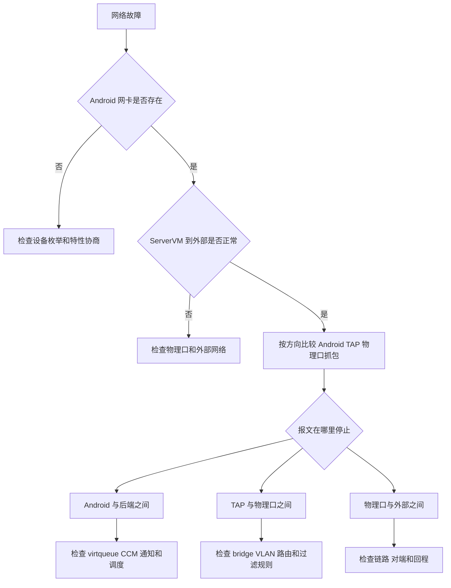
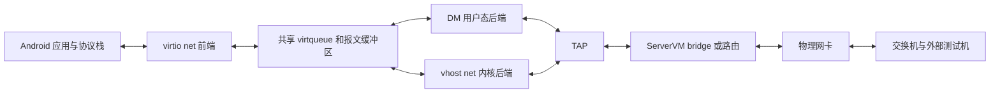
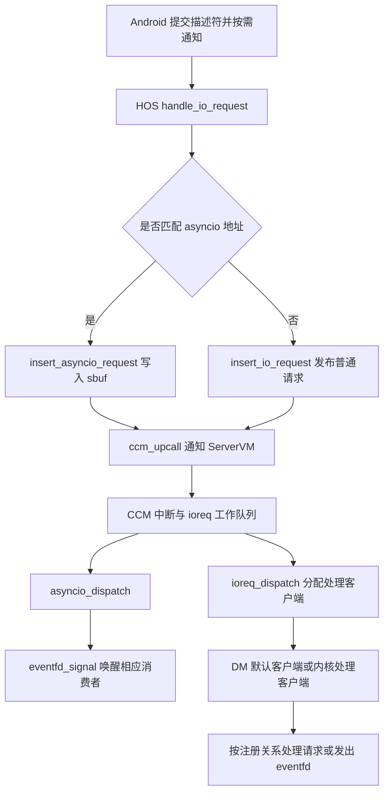

# HOS 网络故障排查手册

版本：v1　日期：2026-11-19

适用对象：基于 Xvisor 的 ARM64 HOS；Linux ServerVM 运行 ACRN 衍生 Device Model，Android 使用 virtio 网络设备，CCM 连接 ServerVM 与 Hypervisor 的 I/O 请求及中断通知。

遇到网络故障，先找出同一条测试流在哪两个观测点之间停止，再沿这一段检查队列、通知和执行线程。网卡存在、接口 UP、某个中断计数增长，都只能证明链路中的一部分工作正常。

## 1 使用范围与现场架构确认

### 1.1 HOS 中已确认的组成

| 组成 | 已确认的项目事实 | 排查时的含义 |
| --- | --- | --- |
| Hypervisor | 基于 Xvisor，ARM64，包含项目自己的 GICv3 和虚拟化扩展 | 上游 Xvisor 的函数和行为不能直接替代 HOS 实现 |
| Guest | Linux ServerVM 和 Android；产品共 12 个物理核，两个 Guest 静态划分 CPU | 用当前 `vcpu list` 建立 vCPU 到物理核的映射，不复用旧日志中的编号 |
| Device Model | ServerVM 使用 ACRN 衍生 DM，由项目 DSM 启动 Android | 需要同时查看 DSM 启动配置、DM 参数及运行日志 |
| CCM | 已提供的代码包含 ioreq、ioeventfd、irqfd、asyncio 共享缓冲区和 HVC 调用 | virtqueue 没有推进时，需要检查跨 VM 的通知路径 |
| 内存 | Guest 内存按配置分配；后端通过项目映射接口访问相关共享内存 | 配置固定并不保证每次启动的队列地址、映射及通知绑定都正确 |

以下项目必须在故障现场填写。它们决定后续应该检查哪条路径。

| 现场项 | 记录内容 | 确认方法 |
| --- | --- | --- |
| 物理网络设备归属 | 由 ServerVM 驱动、其他域驱动，或经过额外交换设备 | HOS 设备分配配置、ServerVM 网卡驱动及设备树 |
| Android 虚拟网卡传输 | virtio-pci 或 virtio-mmio；legacy 或 modern | Android sysfs 设备路径、驱动日志、DM 设备配置 |
| 后端执行位置 | DM 用户态，或 ServerVM 内核 vhost-net | DM 启动参数、初始化成功日志、打开的 fd、工作线程 |
| ServerVM 网络拓扑 | bridge、路由/NAT、macvtap 或项目自定义后端 | `ip -d link`、`bridge link`、路由和防火墙配置 |
| 设备与地址 | Android 网卡、TAP、bridge、物理口、VLAN、IP/MAC、网络命名空间 | 第 4 节的现场清单 |
| 通知机制 | 普通 ioreq、asyncio/ioeventfd；返回方向 MSI/irqfd 或其他机制 | 注册日志和第 8 节的调用链 |

本文的 TAP/bridge 图表示一种需要现场确认的网络连接方式，不意味着所有 HOS 板型都使用该方式。若使用 vhost-net，DM 仍负责设备配置，但数据搬运可能由内核完成。ACRN 文档可用于理解这一分工，具体参数与功能以 HOS 的 DM 分支为准。[ACRN virtio-net 架构](https://projectacrn.github.io/3.1/developer-guides/hld/virtio-net.html)、[ACRN DM 参数](https://projectacrn.github.io/2.7/user-guides/acrn-dm-parameters.html)。

**资料边界：**本版函数说明基于此前提供的 HOS/CCM 源码快照。尚未核实到你提及的那次 virtio-net 故障对话及最终补丁，因此本文不会把某项推测写成该次故障的已确认根因。现网代码有变化时，应按函数名核对，不依赖旧行号。

### 1.2 快速入口

| 现象 | 优先阅读 | 第一个要回答的问题 |
| --- | --- | --- |
| Android 没有网卡 | 第 5、10 节 | 设备未枚举，还是驱动初始化失败？ |
| 网卡存在但不通 | 第 4～7 节 | ARP/邻居发现请求到达了哪一层？ |
| 只能单向收发 | 第 3、6、8 节 | TX 和 RX 中哪条队列或通知链停止？ |
| 小包正常、大包异常 | 第 7、10 节 | MTU、分段、校验和及头部长度是否一致？ |
| 压力下丢包或长延迟 | 第 9、11 节 | 是队列耗尽、后端未运行，还是网络出口拥塞？ |
| Guest 升级后异常 | 第 10 节 | 实际协商、通知格式或队列数量发生了什么变化？ |
| 重启 Android 后才不通 | 第 12 节 | 新队列是否仍绑定着旧的地址、eventfd 或中断信息？ |

## 2 前十分钟的排查顺序

1. 记录故障时间、版本、启动方式和方向。明确是 Android 发不出、收不到，还是只有某个应用失败。
2. 保存两端接口、路由、邻居、网卡统计和中断计数，先保留现场。
3. 验证 ServerVM 到外部测试机的连通性，确定外部链路能否独立工作。
4. 在拓扑允许时，验证 Android 到 ServerVM 本地地址；再测试 Android 到外部测试机。
5. 使用低速、单流、固定方向的测试，同时观察 Android、TAP 和物理口。首先检查 ARP/邻居发现，再看实际业务流。
6. 找到报文停止的区间后，再增加该区间的队列及通知计数。不要同时修改 offload、IRQ affinity、线程优先级和 MTU。



如果物理口不属于 ServerVM，应把第 3 步换成实际出口域的同等检查。如果不存在 ServerVM 可达的本地三层地址，不把“Android ping ServerVM 不通”单独作为 virtio 失败的证据。

## 3 数据链路与通知链路

### 3.1 报文数据在哪里流动

以下示意假定物理口在 ServerVM，后端连接 TAP。



图中 DM 用户态和 vhost-net 表示两种候选数据路径，应按当前配置选择对应分支。不要将两个分支理解成每个包都必须依次经过的两级处理。

Hypervisor 负责隔离、地址访问和设备访问转发，并通过 CCM 等机制通知后端。报文主体通常位于 virtqueue 描述符引用的缓冲区；不能把“网络发了一个包”直接等同于“一次 HVC”或“一次 I/O request”。

上游 Xvisor 的 `emulators/net/virtio_net.c` 和 `netswitch` 是另一套后端实现。HOS 使用 ServerVM 中的 ACRN 衍生 DM 时，应先确认调用实际落在哪套后端，避免只在上游 netswitch 中打点。

### 3.2 TX 和 RX 必须注明观察者

本文默认 TX/RX 从 **Android 虚拟网卡** 的角度描述。

| 数据方向 | Android 队列 | TAP 后端端点的操作 | ServerVM TAP 接口统计 | 物理口统计 |
| --- | --- | --- | --- | --- |
| Android 发往外部 | TX：提交待发送报文 | 用户态后端向 TAP fd 写入；vhost 走对应内核路径 | 通常表现为 TAP RX 增长 | PHY TX 增长 |
| 外部发往 Android | RX：Android 先提供空接收缓冲区 | 用户态后端从 TAP fd 读取；vhost 走对应内核路径 | 通常表现为 TAP TX 增长 | PHY RX 增长 |

TAP 是 Linux 看到的虚拟以太网接口：向其用户态端点写入，相当于向 Linux 接收路径送入帧；从端点读取，相当于取走 Linux 向该接口发送的帧。因此，Android TX 与 TAP TX 不能直接同向比较。[Linux TUN/TAP 文档](https://docs.kernel.org/networking/tuntap.html)。

统计应比较同一时间段的增量。GSO/GRO、合包、分段、广播和其他业务会使各层包数不完全相等；`rx_packets` 也不等于应用最终收到的报文数。[Linux 接口统计说明](https://docs.kernel.org/networking/statistics.html)。

### 3.3 三类共享数据不要混淆

| 对象 | 主要内容 | 停止推进的典型表现 |
| --- | --- | --- |
| virtqueue | 描述符、可用/已用信息及报文缓冲区引用 | Android TX 堵塞、RX 无缓冲区、used 不更新 |
| 普通 ioreq 共享区 | 某次设备访问的地址、宽度、值、方向、处理状态 | Guest 等待寄存器访问完成，初始化或 kick 卡住 |
| asyncio sbuf | 已注册异步通知的标识；所给实现传递 eventfd context 对应的值 | 通知无法入队或 ServerVM 没有消费通知 |

`asyncio sbuf` 不是网络包队列；其元素不是 Ethernet 帧。所给代码中的该标识也不是 DM 用户态 fd 数字，不能直接拿去查 `/proc/PID/fd/数字`。

### 3.4 从 Android 通知后端



该图展开的是已提供代码中的控制路径，不要求每个包都触发完整流程。队列通知可以被抑制或合并；工作队列也可以合并多次唤醒。

### 3.5 从后端通知 Android

完成报文处理后，后端先发布完成信息，再按通知规则通知前端。对于已提供代码中的 MSI 路径：

- 用户态 DM 可以调用 `IOCTL_INJECT_MSI`，由 CCM `hsm.c` 转入 `hcall_inject_msi()`。
- 注册了 irqfd 的内核路径，在 `ccm_irqfd_wakeup()` 收到 `POLLIN` 后调用 `irqfd_inject()`，继而调用 `msi_inject()` 和 HVC。
- HOS `cpu_hcall.c::hcall_inject_msi()` 读取调用方 Guest 中的 MSI 参数，并尝试通过 `vmm_devemu_emulate_write()` 交给目标 VM 的设备模型处理。

**这一步成功，不等于 Android 的 ISR 已经执行。**之后还要核对 MSI 地址/数据对应的虚拟设备、ITS/LPI 或其他中断路由、目标 vCPU，以及 Android 驱动的中断与 NAPI 处理。所给 HOS 函数本身没有直接提供“最终 LPI 已送达”的证明。

CCM `vm.c` 中关于 MSI 地址位域的旧注释带有 ACRN 原始模型背景。ARM64 HOS 的实际含义应以接收端虚拟中断设备实现为准，不能直接把其中的地址位解释成当前目标 vCPU。

## 4 现场清单与基础命令

以下命令在对应系统的 shell 中执行；HOS shell、ServerVM Linux shell、Android shell 是三个不同环境。接口名、进程号及地址必须替换成现场值。不同镜像的命令选项可能不齐全，出现“不支持”时保留该结果，使用列出的基础替代方式。

### 4.1 ServerVM Linux

先做接口和拓扑清点：

```sh
uname -a
cat /proc/version
ip -br link
ip -br addr
ip -d link show
ip route show table all
ip rule show
ip neigh show
bridge link show
bridge vlan show
bridge fdb show
cat /proc/net/dev
cat /proc/interrupts
cat /proc/softirqs
```

`ip -br` 不可用时用 `ip link show`、`ip addr show`。没有 bridge 工具时，至少保存 `ip -d link show` 和 `/sys/class/net/` 下的 master 关系。

下面变量只是填写示例，不代表 HOS 固定命名：

```sh
PHY=eth0
TAP=tap0
BR=br0
DM_PID=1234

ip -s link show dev "$PHY"
ip -s link show dev "$TAP"
ip -s link show dev "$BR"
ethtool "$PHY"
ethtool -i "$PHY"
ethtool -k "$PHY"
ethtool -k "$TAP"
ethtool -S "$PHY"
ip tuntap show
tr '\000' ' ' < "/proc/$DM_PID/cmdline"
ls -l "/proc/$DM_PID/fd"
readlink "/proc/$DM_PID/ns/net"
readlink /proc/self/ns/net
ps -T -p "$DM_PID"
```

对 `/proc/PID/fdinfo/FD` 中的 TAP fd，可进一步查看是否有 `iff:` 等接口信息，建立“DM fd—TAP 接口”的对应关系。检查 fdinfo 时使用实际查到的 FD。

看到 `/dev/vhost-net` 已打开，只能说明进程打开了该设备；还需确认内存表、vring、kick/call eventfd 和后端设置成功，才可认定数据路径已经启用。`lsmod` 没有 vhost 模块也不能证明未使用，因为它可能编进内核。

DM 和当前 shell 的网络命名空间不同，则本 shell 中看不到目标 TAP 是合理现象。确认后使用该命名空间内的命令结果；具备 `nsenter` 时可执行 `nsenter -t "$DM_PID" -n ip link show`。

按实际工具保存过滤与转发规则：

```sh
nft list ruleset
iptables-save
ip6tables-save
sysctl net.ipv4.ip_forward
sysctl net.ipv4.conf.all.rp_filter
tc -s qdisc show
tc -s filter show dev "$PHY" ingress
```

这里只读取规则，不清空规则。纯二层 bridge 转发不以 `ip_forward=1` 为前提；路由转发才需要检查相应转发设置。还应区分 bridge family 规则、br_netfilter 与三层过滤路径。

### 4.2 Android

```sh
uname -a
getprop ro.build.fingerprint
ip link show
ip addr show
ip route show table all
ip rule show
ip neigh show
cat /proc/net/dev
cat /proc/interrupts
dumpsys connectivity
dumpsys ethernet
```

`dumpsys ethernet` 是否存在取决于 Android 构建。root、SELinux 或设备权限可能限制 dmesg、抓包和 `/proc` 访问；记录限制，不把权限错误当成网卡故障。

对实际 Android 接口，例如 `AND_IF=eth0`：

```sh
AND_IF=eth0
readlink -f "/sys/class/net/$AND_IF/device"
readlink -f "/sys/class/net/$AND_IF/device/driver"
cat "/sys/class/net/$AND_IF/mtu"
cat "/sys/class/net/$AND_IF/address"
```

设备父链可用于区分 PCI 与 platform/MMIO 传输；网卡自身 driver 链接一般指向 virtio-net 驱动，不必然直接显示 transport 名称。

如果 shell 中 ping/iperf 正常，但 Android 应用失败，应继续检查该应用的 UID、网络选择、VPN、DNS、代理及 Android 网络策略。shell 的成功不能代替应用路径验证。

### 4.3 HOS

```text
vcpu list
hos irq stats
vm region_list
monitor status
monitor events
```

这些命令来自本项目既有讨论，具体参数以当前命令帮助为准；`monitor` 只有在编译并启用相应功能后才有对应能力。

使用结果时注意：

- `hos irq stats` 曾过滤 disabled、chained 或无名称的项。没有显示某个 IRQ，不证明它没有分配给设备。
- HOS vCPU ID、Guest 内 CPU ID、物理 CPU ID、Linux IRQ 编号分别记录，不混用。
- `monitor status` 是采样结果。检查时间戳、`valid` 和采样间隔；停止采集后仍能看到旧快照。
- monitor 的 exit 总量包含多种退出原因。exit 增长不能单独证明网络 kick 正常，更不等于包数。
- 内存映射要按当前 VM 和地址空间确认；ServerVM GPA、Android GPA、后端用户态 VA、HPA 不是同一概念。

## 5 先定位初始化还是数据收发失败

### 5.1 Android 完全没有对应网卡

按以下顺序检查，并记录第一个失败点：

1. DSM 是否成功启动对应 DM；启动配置是否包含预期网络设备。
2. DM 是否创建了网络设备和后端，TAP 打开/创建是否成功。
3. Android 是否枚举到 virtio 设备；PCI 路径检查 BAR/能力结构，MMIO 路径检查设备树资源。
4. Android virtio-net 驱动是否绑定；`probe` 失败的实际返回值是什么。
5. 设备状态、特性协商、队列创建、共享内存映射、通知注册、中断申请分别在哪一步完成。

只看到 TAP 存在，不能证明 Android 端队列已经建立；只看到 Android 网卡存在，也不能证明后端已进入可收发状态。

### 5.2 有网卡且 UP，但没有地址

先区分“地址配置失败”和“链路无法传包”：

- 静态地址场景：检查地址、掩码、VLAN 和路由是否按预期安装。
- DHCP 场景：观察 Discover/Offer/Request/Ack 分别到达哪些观测点，不直接把无地址归因于 virtio。
- IPv6 场景：观察邻居发现、路由通告与地址状态；IPv4 通不代表 IPv6 正常。
- 地址存在但 `ip neigh` 长期 INCOMPLETE/FAILED：先查 ARP/邻居发现报文及回包路径。

## 6 使用小流量建立定位矩阵

### 6.1 基础矩阵

| 测试 | 隔离的范围 | 结果解释 |
| --- | --- | --- |
| ServerVM 到外部测试机 | 物理口、外部交换/路由、ServerVM 本机协议栈 | 失败时优先解决出口侧；成功不证明 bridge 的 Android 转发正常 |
| Android 到 ServerVM 本地可达地址 | 前端、virtqueue、后端及本地网络栈 | 成功时说明一条本地往返路径可用；不覆盖物理转发 |
| Android 到外部测试机 | 完整外发和返回路径 | 与前两项组合，缩小范围 |
| 外部测试机主动访问 Android | 入站可达、回程与过滤规则 | NAT 下主动入站可能本来就不允许，需按设计判断 |
| Android 应用访问实际服务 | Android 网络策略、DNS、业务协议 | ping 正常仍需做此项 |

对每条可用路径分别做 ICMP、TCP、低速 UDP；记录正向和反向，不只记录一个“网络通/不通”。

### 6.2 有限时长的 iperf3 测试

外部测试机：

```sh
iperf3 -s
```

Android 或待测客户端中，下面地址是文档示例，替换成实际测试机地址：

```sh
PEER_IP=192.0.2.10
ping -c 20 "$PEER_IP"
iperf3 -c "$PEER_IP" -t 30 -i 1
iperf3 -c "$PEER_IP" -R -t 30 -i 1
iperf3 -c "$PEER_IP" -u -b 1M -l 256 -t 30 -i 1
iperf3 -c "$PEER_IP" -u -b 1M -l 256 -R -t 30 -i 1
```

先运行低速 UDP，再视情况提高速率。TCP 默认可能占满可用带宽，应在允许的测试窗口运行。`-R` 反转数据方向；UDP 测试仍需要 TCP 控制连接，不能只放通 UDP 端口。[iperf3 官方使用说明](https://software.es.net/iperf/invoking.html)。

若要复现“约 1 KB、平均每毫秒一包”的负载，可用以下平均负载作为起点：

```sh
iperf3 -c "$PEER_IP" -u -b 8192000 -l 1024 -t 60 -i 1
```

计算为 `1024 × 8 × 1000 = 8,192,000 bit/s`，不含以太网等额外开销。这不能保证每两包严格相隔 1 ms；调度、定时与发送批量仍会改变间隔。验证精确周期应使用带序号和时间戳的发送程序及抓包。

### 6.3 如何记录结果

每次只改变一个条件，并填写：方向、协议、包长、目标速率、实际接收速率、丢包/重传、延迟分布、两端 CPU 占用、接口计数差值、是否开抓包或日志。

不要用 iperf3 的 UDP jitter 代替 HOS 调度延迟，也不要把 ping RTT 直接除以二当作某一侧处理延迟。吞吐、应用 RTT、包间隔和调度等待是不同指标。

## 7 通过抓包找出报文停止的位置

### 7.1 抓包点和基本方式

优先使用以下四个观测点：Android 网卡、ServerVM TAP、ServerVM 物理口、外部测试机。先确保抓包进程位于目标接口所在的网络命名空间。

以下为 ServerVM 示例。`timeout`、tcpdump 可用时，在两个终端分别执行，随后在第三个终端发起测试：

```sh
timeout -s INT 45 tcpdump -p -i "$TAP" -nn -s 0 -U -w tap.pcap 'arp or icmp or (port 5201)'
```

```sh
timeout -s INT 45 tcpdump -p -i "$PHY" -nn -s 0 -U -w phy.pcap 'arp or icmp or (port 5201)'
```

没有 `timeout` 时，前台运行 tcpdump，在测试结束后按 Ctrl+C；保存退出时的 received/dropped 统计。Android/外部测试机用各自接口执行同等抓包。IPv6、DHCP 或带 VLAN 的故障，应相应调整过滤器，必要时短时无过滤抓取，防止过滤条件本身遗漏报文。

先使用 `-p`，避免 tcpdump 自动把接口切入混杂模式。如果不加 `-p` 才恢复通信，应检查 MAC 过滤、bridge 学习和后端接收过滤，而不是认定抓包工具修好了网络。

不建议只抓 `any` 就判断 Ethernet MAC 或 VLAN 一定正确；需要原始二层信息时，在具体接口抓取。保存测试五元组、ICMP sequence 或应用消息序号，跨层关联同一条流。

### 7.2 Android 发往外部时

| 观察结果 | 优先检查 | 尚不能推出的结论 |
| --- | --- | --- |
| Android 抓包也没有测试包 | 应用是否发送、路由、网络选择、过滤条件 | 不能直接认定 virtio 丢包 |
| Android 有包，TAP 无对应包 | TX 队列提交、kick、CCM、后端消费、TAP 写入结果 | Android 抓包可能发生在实际驱动发送前 |
| TAP 有包，物理口无包 | bridge 端口状态、VLAN、FDB、路由、过滤、qdisc | 不能直接认定物理驱动异常 |
| 物理口本地有包，对端无包 | NIC 硬件统计、链路、交换机端口/VLAN、对端过滤 | 本地 TX 抓包不等于帧已成功上线路 |
| 对端收到但 Android 无应答 | 按返回方向逐层排查 | 外发正常不证明 RX 正常 |

### 7.3 外部发往 Android 时

| 观察结果 | 优先检查 |
| --- | --- |
| ServerVM 物理口没有包 | 外部路由、目的 MAC/VLAN、交换机、物理 NIC 接收统计 |
| 物理口有包，TAP 无包 | bridge/路由是否把该包发向正确 TAP，过滤规则、VLAN 和 FDB |
| TAP 有包，后端没有取走 | TAP fd/网络命名空间、poll 唤醒、vhost 后端绑定、工作线程 |
| 后端取得包，RX used 未推进 | Android 是否提供 RX buffer、描述符地址/长度、后端写入失败 |
| RX used 推进，Android 不回收 | 通知抑制状态、call/irqfd、MSI 虚拟路由、前端中断及 NAPI |
| Android 抓到包，应用没有收到 | 校验、协议栈丢弃、socket 绑定、Android UID/网络策略和应用状态 |

桥接情况下，端口 forwarding 状态、PVID、tagged/untagged 配置及目的 MAC 学习均可能影响转发。VLAN filtering 开启时，仅核对 IP 网段不足以说明二层链路正确。[Linux bridge 文档](https://docs.kernel.org/networking/bridge.html)。

### 7.4 抓包中的常见假象

1. 本机 TX 抓包显示 checksum incorrect，可能是尚未由后续 offload 完成校验和；先看对端接收和硬件错误计数。
2. 本机抓到大于 MTU 的包，可能是分段/聚合所在观察位置造成的表现，先比较线侧或对端抓包。
3. 抓包进程自身丢包，会造成 pcap 中有“空洞”。不能直接把这些空洞记成 HOS 丢包。
4. bridge、TAP、物理口统计包含不同方向和处理阶段，包数无需严格相等。
5. 两个 Guest 的时钟没有验证同步时，不能直接相减得到跨 VM 单向延迟。先比较各自域内耗时，或用可关联事件和已校准时间基准。

需要 A/B 验证 offload 时，先保存 `ethtool -k`，一次只改变与现象相关的一项，并记录实际成功改变的开关。测试后恢复原值；不要把“全部关闭后正常”直接当作最终修复。

## 8 HOS 与 CCM 代码定位表

这一节用于“抓包已定位到 Android—后端之间”的场景。函数来自已提供的源码；补充字段是建议的临时诊断信息，当前 monitor 并不自动提供这些网络计数。

### 8.1 后端注册和普通 I/O 请求

| 文件及函数 | 当前代码职责 | 需要观察的证据 |
| --- | --- | --- |
| `vmm_u_ioreq.c::vmm_u_ioreq_register_backend()` | 标记目标 VM 后端已注册并唤醒等待者 | target VM、注册/注销次数、注册是否发生在访问前 |
| `vmm_u_ioreq.c::handle_io_request()` | 接收访问地址、宽度、方向和值；选择异步或普通路径 | VM、vCPU subid、地址、长度、读写、命中哪条路径、返回值 |
| `vmm_u_ioreq.c::insert_io_request()` | 等待 backend；复制请求到共享 slot，发布 PENDING，upcall 后等待完成 | 等 backend 的时间、slot、状态迁移、等待完成时间 |
| `ccm_irq.c::setup_intr_handler()` / `map_irq()` | 从 `/ccm` 设备树节点获取 Linux IRQ，以 `dev_ccm` 注册处理 | 映射出的 IRQ、注册返回值、每 CPU 计数增量 |
| `ioreq.c::ioreq_intr_handler()` | 向 `ioreq_wq` 投递工作；所给版本返回 IRQ_HANDLED | IRQ 进入次数、投递/合并次数、工作实际开始次数 |
| `ioreq.c::ioreq_dispatcher()` | 遍历 VM，处理 asyncio 及普通请求 | 当前 VM、耗时、是否提前退出遍历 |
| `ioreq.c::ioreq_dispatch()` | 查找 PENDING 请求，选择客户端，标记 PROCESSING 并唤醒 | client 类型、匹配失败、请求状态、客户端唤醒时间 |
| `ioeventfd.c::ioeventfd_handler()` | 作为普通 ioreq 的内核客户端，匹配通知并 signal eventfd | 见下一表，必须区分“进入 handler”和“命中 eventfd” |
| `ioreq.c::do_ioreq_complete_request()` | 发布 COMPLETE；非 polling 模式下通知 HOS 完成 | completion_polling、发布和 HVC 返回结果 |
| `cpu_hcall.c::hcall_notify_ioreq_finish()` → `wakeup_io_req()` | 按目标 VM 与 vCPU subid 完成等待 | subid 是否与请求一致、唤醒返回值和后续 FREE 状态 |

在 ServerVM 中可先用以下命令定位 CCM 的实际中断，而不是猜测一个固定 IRQ：

```sh
grep -i dev_ccm /proc/interrupts
```

`ioreq_wq` 在所给版本使用 `WQ_HIGHPRI | WQ_MEM_RECLAIM`，并设置 `max_active=1`。应记录工作排队和执行延迟，不能因为有 HIGHPRI 就认为后端一定即时运行；这是 ServerVM Linux 内的工作队列属性，不会自动提高其 HOS vCPU 优先级。

### 8.2 ioeventfd 与 asyncio

| 文件及函数 | 当前代码职责 | 排查重点 |
| --- | --- | --- |
| `ioeventfd.c::ioeventfd_config()` | 根据标志选择普通 ioeventfd 或 asyncio 注册路径 | 本次实际 flags，而不是仅看编译开关 |
| `ioeventfd.c::ioeventfd_assign()` | 注册地址范围、数据匹配条件、长度和 eventfd | addr、len、type、wildcard/data、队列与 eventfd 的映射 |
| `ioeventfd.c::ccm_ioeventfd_match()` | 匹配普通通知 | 类型、地址、长度和数据是否命中 |
| `ioeventfd.c::ioeventfd_handler()` | 对命中的写请求执行 `eventfd_signal()` | hit/miss 计数；未命中也可能返回 0，不能只检查 rc |
| `ioeventfd.c::ioeventfd_asyncio_config()` | 建立异步描述并通过 HVC 注册到 HOS | VM、通知地址、eventfd 对象及注册/撤销生命周期 |
| `cpu_hcall.c::hcall_asyncio_assign()` | 从调用者 Guest 读取描述，调用 `add_asyncio()` | 读取长度、目标 VM、实际描述是否进入注册表 |
| `vmm_u_ioreq.c::get_asyncio_desc()` | 所给实现按地址查找异步描述 | 地址是否正确；该快路径不能假定具有普通 match 的所有条件 |
| `vmm_u_ioreq.c::insert_asyncio_request()` / `sbuf_put()` | 写入异步标识；满时重试，随后 upcall | head/tail、满队列次数、最大等待、返回长度/错误 |
| `ioreq.c::asyncio_dispatch()` | 从 sbuf 取标识，执行 `eventfd_signal()` 后移动 head | 消费次数、积压、对象生命周期、后续消费者是否运行 |

普通 ioeventfd 和 asyncio 不应当作两个必经的串联环节。观察到普通 `ioeventfd_handler()` 没执行，应先确认是否走了异步路径。

所给 `get_asyncio_desc()` 主要按通知地址匹配，因此必须核对 DM 的注册模型：不同 queue 是使用不同地址，还是在同一通知地址写入不同 queue 值。若共享同一地址，就要继续确认项目如何区分队列，不能仅凭一次地址匹配认定队列选择正确。

### 8.3 vhost 或用户态 DM 消费队列

实际 HOS DM 网络文件尚需以所用分支定位。不要把某个上游函数名当成私有分支必然存在的接口。先在 DM 源码中搜索：

```sh
rg -n 'virtio.*net|vhost.*net|VHOST_SET_VRING|VHOST_NET_SET_BACKEND|TUNSETIFF|TUNSETVNETHDRSZ' .
rg -n 'IOEVENTFD|IRQFD|INJECT_MSI|eventfd|notify' .
```

记录四组关联关系：`VM/设备/queue → vring 地址`、`queue → kick eventfd`、`queue → call eventfd/MSI`、`后端 → TAP fd/接口`。只有 fd 存在，没有这些绑定关系，无法证明路径完整。

Linux v6.12 上游 vhost-net 可从 `handle_tx_kick()`、`handle_rx_kick()`、`handle_tx()`、`handle_rx()` 和 `vhost_net_signal_used()` 检查处理与完成进度；HOS 内核分支可能不同。[Linux v6.12 vhost-net 源码](https://raw.githubusercontent.com/torvalds/linux/v6.12/drivers/vhost/net.c)。

用户态后端对应检查：线程是否被唤醒、是否取得可用描述符、地址映射是否成功、TAP 读写返回的字节数和 errno、何时发布 used。`EAGAIN` 应与稍后恢复处理一起观察，不能简单记为成功或永久丢包。

### 8.4 返回 Android 的中断

| 文件及函数 | 当前代码职责 | 应记录的信息 |
| --- | --- | --- |
| `irqfd.c::ccm_irqfd_wakeup()` | 处理 eventfd 可读或挂断事件 | POLLIN/POLLHUP、VM、绑定代次、触发次数 |
| `irqfd.c::irqfd_inject()` | 调用 MSI 注入包装 | 对应 MSI 地址/数据；仅进入函数不能证明成功 |
| `vm.c::msi_inject()` | 分配并填充 MSI 参数，调用 HVC，错误时记录 | 分配失败、HVC rc、目标 VM |
| `hsm.c` 的 `IOCTL_INJECT_MSI` 分支 | 用户态注入入口 | ioctl 参数复制结果、HVC rc |
| `cpu_hcall.c::hcall_inject_msi()` | 读取参数并调用目标 VM 设备模型写接口 | 参数读取字节数、addr/data、每次设备模型调用结果 |
| HOS 虚拟中断接收端 | 解释 MSI，关联虚拟中断和目标 vCPU | 具体函数由实际 ITS/VGIC 实现确定；记录映射、pending 和注入结果 |
| Android virtio 驱动 | 处理完成通知并消费 used，安排 NAPI | 中断计数、used 回收进度、NAPI 完成和重新开启通知 |

不要把物理 NIC IRQ、ServerVM 的 `dev_ccm` IRQ、Android 的 virtio IRQ 和 HOS 的 IRQ 表条目当成同一个中断号。

### 8.5 仅在对应停顿出现时核查的代码点

以下是根据源码可检查的条件，不是对当前故障的根因认定，也不是要求直接改变既有策略。

| 停顿现象 | 源码中的核查点 | 如何证实或排除 |
| --- | --- | --- |
| 普通请求偶尔完成了，Guest 仍等待 | 所给 `insert_io_request()` 在发布 PENDING 后初始化 completion | 检查有无其他 CPU 的后端在初始化前已完成；记录发布、初始化、完成、wait 的顺序，核对 completion 语义 |
| asyncio 长时间占用某 vCPU | sbuf 满时循环重试，使用 `arch_cpu_relax()` | 记录满计数和 head 是否推进；`arch_cpu_relax()` 不能当成“后端必然获调度”的保证 |
| 一台 VM 正常，后面的 VM 没有请求处理 | 所给 `ioreq_dispatcher()` 遇到无 `ioreq_buf` 的 VM 会 `break` | 记录遍历顺序及退出点，确认后续是否还有应处理的 VM |
| 注册返回成功但通知未建立 | 所给 `hcall_asyncio_assign()` 读取成功后调用 `add_asyncio()` 并返回成功 | 核对内部失败是否实际传回及注册表内容；不要只看外层 rc |
| 升级后 kick 地址命中但队列不动 | 异步匹配与普通匹配条件不同 | 对比实际地址、写宽度、写值、queue 映射及消费者 |

## 9 判断 virtqueue 是否真正推进

### 9.1 split ring 的观测方式

先确认当前使用 split ring。记录同一队列、同一生命周期的以下值：

- Guest 发布的 `avail.idx`。
- 后端已经消费到的索引，通常是实现中的 `last_avail_idx` 或等价字段。
- 后端发布的 `used.idx`。
- Guest 已回收完成描述符的位置，通常是 `last_used_idx` 或等价字段。
- queue size、方向、可用 buffer 数、最近一次推进时间。

这些字段不能跨设备重置、跨 queue 或跨 VM 比较。16 位索引会回绕，比较应使用正确的模运算和队列约束，不能仅用普通整数大小判断“倒退”。packed ring 应观察对应的描述符状态和 wrap 状态，不能套用 split ring 字段。

### 9.2 根据进度判断检查方向

| 证据 | 优先检查 |
| --- | --- |
| Android 有待发送流量，TX avail 不推进 | 前端驱动、队列停止条件、描述符回收、内存分配；先确认抓包点不是发送前的排队观察 |
| TX avail 推进，后端消费位置不动 | kick 是否需要且实际发出、CCM 分发、eventfd 消费、后端调度、地址映射 |
| 后端消费 TX，used 长期不动 | 后端处理错误、TAP/物理链路背压、完成发布或延迟回收机制 |
| RX 方向 TAP 有流量，但没有可用接收描述符 | Android refill、buffer 分配、队列尺寸；此时没有 used 更新可以是无 buffer 的结果 |
| RX buffer 充足、后端取得包，但 used 不动 | 拷贝/映射错误、描述符长度与权限、后端错误处理 |
| used 推进，Guest 长期不回收 | 通知抑制/重开竞态、call/irqfd/MSI 路由、前端 IRQ/NAPI 或 Guest 未运行 |

一次描述符链不必然等于一个线侧数据包；mergeable RX、indirect descriptor、分段和聚合都会影响数量对应关系。

Linux virtqueue 的 `virtqueue_kick()` 即使没有实际执行 transport notify，也可能返回 true：它会先判断通知是否必要。诊断时应分别统计提交、需要通知、实际 notify 和失败次数。[Linux v6.12 virtio_ring 源码](https://raw.githubusercontent.com/torvalds/linux/v6.12/drivers/virtio/virtio_ring.c)。

### 9.3 共享内存与顺序

出现“索引更新了，但内容像旧数据”时，核对：地址空间转换、映射长度、描述符链边界、字节序、内存属性、CPU/DMA 一致性以及发布/读取顺序。ARM64 上增加 `volatile` 不能替代所需的内存屏障或缓存一致性处理。

静态内存配置只固定分配关系，不免除上述检查。使用 vhost 内存表时，尤其要区分 Guest 地址、后端用户态地址以及设备使用的 DMA 地址；若协商了平台 DMA/IOMMU 语义，更不能把描述符地址无条件视为 HPA。

## 10 内核或 DM 升级后的兼容性核对

Linux/Android 5.15 升到 6.12 后出现问题，应先对比实际行为变化，而不是先认定“6.12 的 virtio-net 有问题”。前后两个版本保存同一份启动配置及以下信息。

| 对比项 | 要保存的值 | 不一致时重点检查 |
| --- | --- | --- |
| 设备与 transport | PCI/MMIO、legacy/modern、设备状态 | BAR/通知区、寄存器访问宽度及初始化顺序 |
| 特性协商 | 后端提供、前端选择、最终接受的完整位图 | 是否广告了尚未完整实现的功能；高位是否丢失 |
| 队列格式 | split/packed、每队列长度、队列数 | 后端与前端是否使用同一格式 |
| 网络头部 | virtio net header 长度、TAP vnet header 配置 | 头部偏移错误、长度不一致、数据看似损坏 |
| offload | checksum、TSO/GSO/GRO、mergeable RX 等实际启用项 | 小包通、大包失败、校验和或 buffer 数量异常 |
| 通知 | 注册地址、queue 对应关系、写宽度/值、抑制状态 | ioeventfd/asyncio 匹配失败或唤醒错误 queue |
| 多队列和控制队列 | 协商数、启用数、每队列 kick/call 绑定 | 只有某些流正常、某个队列不动 |
| 中断 | MSI/其他机制、向量映射、目标 vCPU | used 更新后前端没有完成处理 |
| 内存与重置 | 映射、设备/queue 生命周期、重建顺序 | 首次正常、重启或恢复后异常 |

这些是对比项，不表示 HOS 已实现或已启用表中全部特性。Virtio 对通知、队列和网络能力有明确协商规则，应以实际协商结果选择处理路径。[Virtio 1.2 规范](https://docs.oasis-open.org/virtio/virtio/v1.2/virtio-v1.2.html)。

以通知格式变化为例：若协商了 `VIRTIO_F_NOTIFICATION_DATA`，应核对传输层通知格式以及 HOS/CCM 的解码和匹配。没有协商时，不应仅因为内核升级就假设一定使用了该格式。同样，不能因为新内核支持 packed ring 就认定当前设备已使用 packed ring。

对比试验应保留“旧内核＋当前后端”和“新内核＋同一后端”的完整协商记录。若临时关闭某项功能后恢复，应再证明断点正位于该功能路径，不能把关闭功能本身当成根因分析。

## 11 中断和调度引起的网络停顿

### 11.1 四层编号表

故障记录中至少填写以下映射：

| 层次 | 要记录的内容 |
| --- | --- |
| 物理 NIC | 设备名、Linux IRQ、实际物理中断或 MSI/LPI、每 CPU 计数 |
| ServerVM CCM | `/ccm` 映射的 Linux IRQ、`dev_ccm` 计数、处理 CPU |
| HOS | 目标 VM、Guest vCPU/subid、HOS vCPU ID、hCPU、虚拟中断映射 |
| Android | virtio 队列、Linux IRQ/向量、处理 CPU、NAPI 进度 |

中断计数和包数不一一对应。NAPI 可以在一次通知后处理一批报文，通知抑制也会减少中断；应同时检查队列是否推进及实际业务进度。[Linux NAPI 文档](https://docs.kernel.org/networking/napi.html)。

### 11.2 从线程未运行区分通知丢失

在 ServerVM 内观察 DM、ioreq 工作队列、vhost 及网络软中断执行；在 HOS 内观察承载这些工作的 Guest vCPU 是否获调度。两层观察都要有时间关系。

例如：

1. Android TX avail 增长，CCM eventfd 已 signal。
2. 对应 vhost/DM 工作在 20 ms 后才开始执行。
3. 工作开始后立即消费队列并发出报文。

该证据首先指向执行延迟，而不是通知内容丢失。下一步检查 Linux 线程运行/睡眠状态、CPU 竞争及 HOS vCPU 调度；不要仅提高中断频率。

相反，如果工作一直正常运行，但对应 queue 永远没有被唤醒，应优先检查事件绑定、通知抑制和对象生命周期。

使用 monitor 时，应把新鲜、有效的调度样本与故障时间对齐。无效窗口、旧快照或单个 exit 原因字段都不能替代网络路径打点。

### 11.3 调试输出本身会改变时序

优先用计数器和固定大小事件缓冲区，异常后统一导出。避免在每次包处理、MMIO、IRQ 或自旋循环中打印串口日志。可按一秒汇总总量、最大耗时和首个错误，另保留少量故障前后的原始事件。

生产线程优先级、Guest CPU 归属及 HOS auth/mterm 调度约束应保持一致。更改 affinity 或优先级用于 A/B 试验时，记录原值并恢复；不能用“提高到最高优先级”作为通用网络修复。

## 12 启动正常而重启或恢复后异常

设备生命周期问题要把旧实例和新实例分开记录。建议诊断中使用 VM、设备、queue 以及本次初始化代次关联事件，避免把旧队列地址误当成当前队列。

依次检查：

1. Android 重置设备后，旧 queue 是否停止消费，旧通知是否停止产生。
2. 新的 queue 地址、长度、特性和中断信息是否重新传递给后端。
3. 普通 ioeventfd、asyncio 描述、irqfd 是否撤销旧绑定并建立新绑定。
4. 旧 eventfd 对象是否仍可能被共享 sbuf 或在途回调引用。
5. TAP fd、网络命名空间、MAC 和 bridge 端口是否发生变化。
6. 后端重新注册及 CCM 中断恢复后，积压请求是否重新被处理。

出现 `POLLHUP`、DM 重启、Android reset 或设备移除时，把这些事件纳入同一时间线。只重启服务使网络恢复，可以作为缩小生命周期问题范围的线索，不能代替原故障现场证据。

## 13 常见现象的检查卡片

### 13.1 有 TX 统计但 TAP 没包

先确认 Android 统计/抓包发生的位置，再读取 TX avail 与后端消费索引。如果 avail 增长而后端不动，检查本次通知是否需要发出、实际走普通还是异步路径、地址匹配是否命中、eventfd 消费者是否执行。如果后端已消费，记录 TAP 写入结果和错误处理。

### 13.2 TAP 有入站包但 Android 收不到

从 Android RX buffer 数量开始。无 buffer 时查前端 refill；有 buffer 时查后端是否取包并写入。used 已更新则沿 call eventfd、irqfd/HVC、虚拟中断和 Android NAPI 检查。不要一开始就改物理 NIC IRQ affinity。

### 13.3 只有大包失败

比较 MTU、VLAN/隧道额外头、路径 MTU 探测、virtio net header 和 offload。使用同一方向逐步增加长度，并在接收端观察真实帧。IP 分片、GSO 分段、mergeable RX 是不同机制，不能只凭“包很大”判断是哪一个。

### 13.4 高负载后停住，停止发送又恢复

记录 virtqueue 空闲描述符、RX buffer、TAP/后端背压、asyncio sbuf head/tail、workqueue 排队和 CPU 运行时间。若 head/tail 显示通知缓冲区满且消费者不运行，应检查消费者阻塞与调度；若队列一直推进而出口丢包，应优先查吞吐和拥塞。

### 13.5 单流正常，多流或多队列失败

比较每个 queue 的提交、消费、used、kick、call 进度及对应 MSI。聚合的网卡统计可能掩盖某个 queue 完全不动。先确认每个队列都注册到正确地址和消费者，再检查 CPU 分配及流量分布。

### 13.6 抓包或加日志后故障消失

对比是否开启混杂模式、CPU 使用是否变化，以及 notify—consume 的时序是否改变。使用低扰动计数复现，再增加最小范围的事件记录。不能据此宣布偶现问题已经修复。

### 13.7 ServerVM 自己能联网而 Android 不行

这只能证明 ServerVM 的本机路径可用。继续验证 Android—TAP、bridge/路由转发、VLAN 和返回方向。ServerVM 本机发送可以走不同的路由、源地址、过滤链和 offload 路径。

### 13.8 IRQ 表中没有对应条目

先核对 HOS 命令过滤条件、Linux 与 HOS 编号转换、MSI/LPI 路径和名称。历史上 107/108 已用于 ServerVM arcsync，89/90 已用于 Android DMAC，但部分状态在默认统计中不显示。不要把未显示的 IRQ 用作网络注入测试；这条经验来自中断白盒测试故障，不代表这几个号是 virtio-net 中断。

## 14 建议的最小诊断数据

### 14.1 一秒汇总

按 VM、设备和 queue 分组记录以下量。字段名称是诊断设计示例，不是当前 monitor 的 JSON schema。

| 分组 | 字段示例 |
| --- | --- |
| 身份 | vmid、device、queue、TX/RX、初始化代次、CPU |
| 队列 | avail、后端消费索引、used、Guest 回收索引、queue size、buffer 不足次数 |
| 通知 | notify_needed、notify_sent、match_hit、match_miss、eventfd_signal、consumer_run |
| CCM | 普通请求等待、asyncio 入队/出队、满队列次数、最大等待 |
| 中断 | 注入请求、注入失败、前端完成处理次数；注明各计数含义 |
| 后端 | TAP 读写字节、EAGAIN、其他 errno、最大处理耗时 |
| 质量 | 时间基准、采样间隔、数据是否完整、调试记录丢失量 |

累计计数在测试开始和结束各保存一次，计算差值。对会回绕的字段按类型处理。设备重置后的数据另起一组，不跨重置相减。

### 14.2 异常事件

只在首次失败、超时或状态变化时记录详细信息，包括 queue、描述符链头、访问地址空间、长度、返回值和最近进度。地址务必标明是 Android GPA、ServerVM GPA、用户态 VA 还是 HPA。

跨层关联优先使用同一测试流的序号和 queue 进度；确需计算跨域耗时时，先验证各域时间戳的来源、偏移和稳定性。每个函数记录一个时间戳而没有共同时间基准，不能自动拼成准确的端到端延迟。

## 15 一次故障需要保存什么

### 15.1 建议目录

```text
network_case_YYYYMMDD_HHMM/
  case.md
  topology.txt
  versions.txt
  servervm/
    links_routes_rules.txt
    counters_before.txt
    counters_after.txt
    interrupts_before.txt
    interrupts_after.txt
    dm_commandline.txt
    dm_ccm_log.txt
    tap.pcap
    phy.pcap
  android/
    links_routes_rules.txt
    counters_before.txt
    counters_after.txt
    interrupts_before.txt
    interrupts_after.txt
    kernel_log.txt
    connectivity.txt
    guest.pcap
  hos/
    vcpu_list.txt
    irq_stats.txt
    monitor_status.txt
    monitor_events.txt
    queue_notify_trace.txt
  peer/
    iperf_result.txt
    peer.pcap
```

尚未添加临时诊断的现场可以没有 `queue_notify_trace.txt`。保存命令失败和权限受限的结果，便于区分“没采到”与“采到了零次”。

### 15.2 故障记录模板

```text
故障编号与时间：
板型、HOS 提交、固件、设备树：
ServerVM 内核与 CCM 版本：
Android 内核、系统构建：
DSM/DM 版本与启动参数：
最后正常版本 / 首次异常版本：

拓扑与接口映射：
物理口归属：
TAP/bridge/路由/NAT/网络命名空间：
Android MAC/IP、对端 MAC/IP、VLAN、MTU：
用户态后端或 vhost-net：
virtio transport、协商特性、队列数与格式：
普通 ioreq 或 asyncio 通知：

复现步骤、方向、协议、包长、速率、持续时间：
复现次数 / 总次数：
ServerVM 到外部结果：
Android 到 ServerVM 本地结果：
Android 到外部正反向结果：

同一测试包最后出现的观测点：
下一观测点是否排除抓包丢失/过滤错误：
对应队列最后推进的位置：
通知已到达哪一层：
后端线程及目标 vCPU 当时是否运行：

已确认事实：
候选原因及其待验证证据：
本次只改了哪一个条件：
改动前后结果及是否恢复原配置：
最终修复、回归项及附件：
```

### 15.3 修复后的最低回归范围

至少覆盖曾失败的方向、反方向、低速与原负载、原包长与大包、连续运行、Android 重启以及重复启动。若修改了协商、通知或 queue 绑定，还应比较旧/新内核、各队列和所支持的后端模式。

通过标准不仅是 ping 通：还应确认原断点恢复推进、无新增错误、无持续积压，并验证关闭临时诊断后仍能稳定复现修复效果。

## 16 源码与规范索引

项目源码依据为此前提供的文件快照，阅读时优先对照现网分支中的同名函数：

| 层次 | 文件 | 本文主要用途 |
| --- | --- | --- |
| HOS | `vmm_u_ioreq.c` | MMIO 转发、普通请求等待、异步匹配、sbuf 与后端注册 |
| HOS | `cpu_hcall.c`、`cpu_hcall.h` | asyncio 注册、完成通知、MSI 注入入口 |
| ServerVM CCM | `ioreq.c`、`ioeventfd.c` | 共享请求分发、工作队列、事件匹配和通知 |
| ServerVM CCM | `irqfd.c`、`vm.c`、`hsm.c` | eventfd 完成通知、MSI 参数与 ioctl/HVC |
| ServerVM CCM | `ccm_irq.c`、`sbuf.c` | CCM 中断映射和共享通知消费 |
| ServerVM CCM | `mm.c`、`udmabuf_ccm.c` 及头文件 | 后续核对共享内存映射时的入口 |

通用行为参考：

- [Virtio 1.2 规范](https://docs.oasis-open.org/virtio/virtio/v1.2/virtio-v1.2.html)：特性协商、队列、通知和网络设备约定。
- [ACRN virtio-net 架构](https://projectacrn.github.io/3.1/developer-guides/hld/virtio-net.html)：DM 与 Service VM 后端的设计背景；其中具体功能限制不能直接套到 HOS。
- [ACRN DM 参数](https://projectacrn.github.io/2.7/user-guides/acrn-dm-parameters.html)：上游后端选项示例；HOS 参数以本分支为准。
- [Linux TUN/TAP](https://docs.kernel.org/networking/tuntap.html)、[接口统计](https://docs.kernel.org/networking/statistics.html)、[bridge](https://docs.kernel.org/networking/bridge.html)、[NAPI](https://docs.kernel.org/networking/napi.html)：接口与内核网络行为。
- [Linux v6.12 vhost-net](https://raw.githubusercontent.com/torvalds/linux/v6.12/drivers/vhost/net.c)、[virtio_ring](https://raw.githubusercontent.com/torvalds/linux/v6.12/drivers/virtio/virtio_ring.c)：与升级版本对照的队列及通知实现。
- [iperf3 官方使用说明](https://software.es.net/iperf/invoking.html)：测试命令语义；现场安装版本的帮助优先用于核对可用参数。
